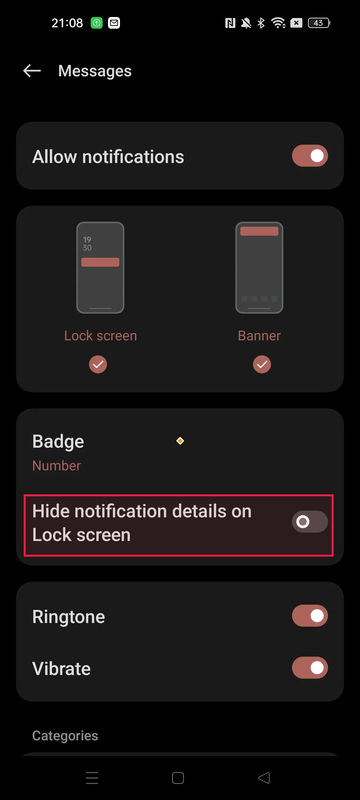
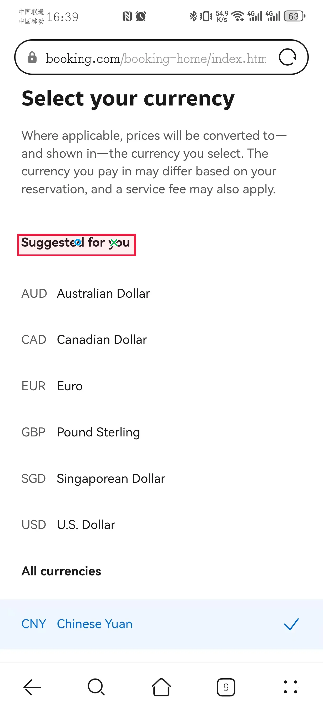
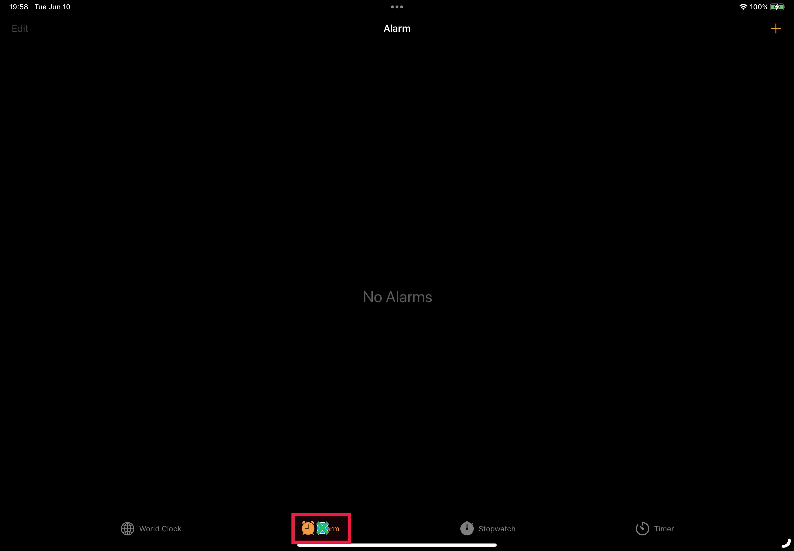
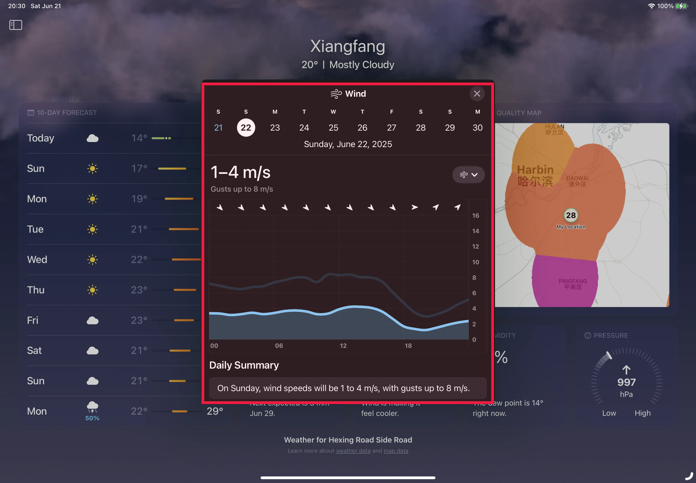
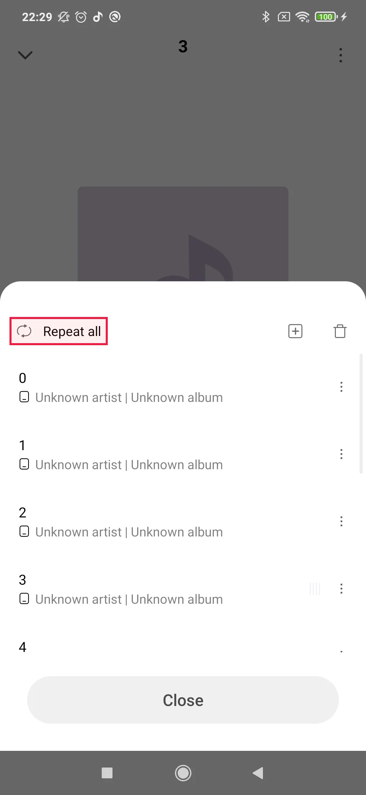
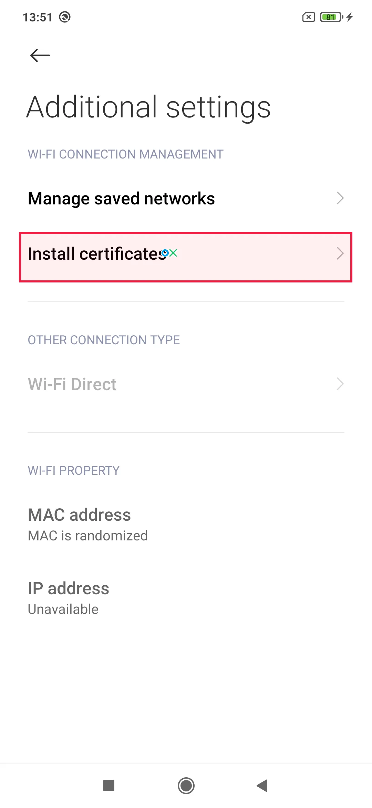
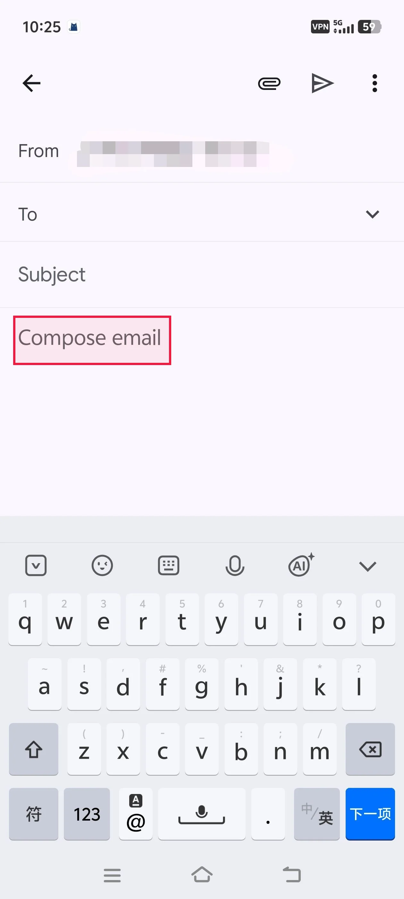
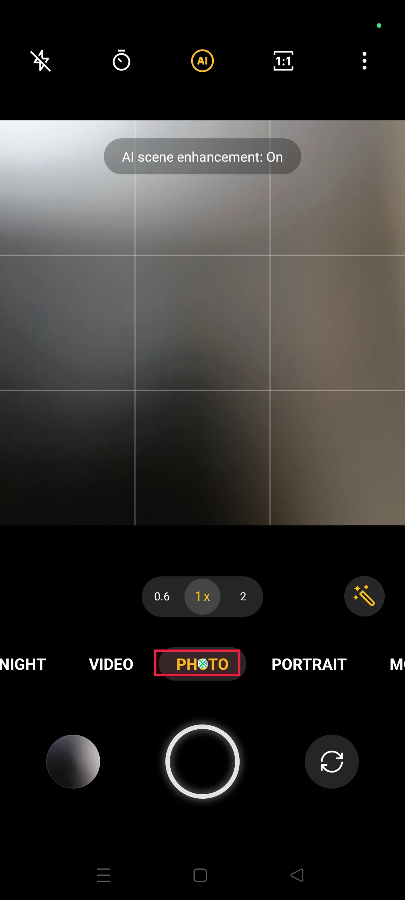
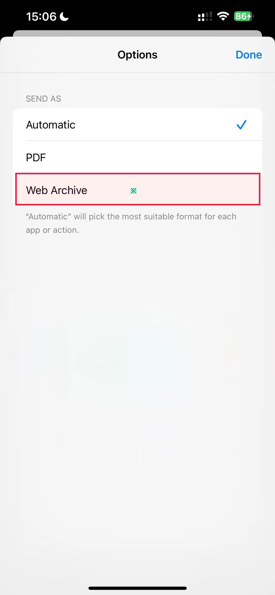
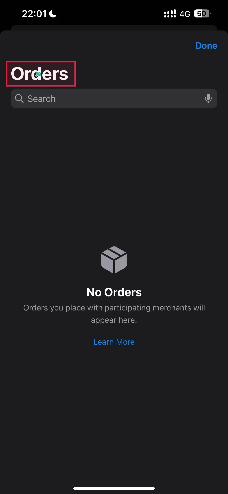

# Qwen 위치 지정 원시 출력 · EN GUI

[전체 요약과 `addCriterion` 점검](QWEN_RAW_OUTPUT_AUDIT_KO.md) · [JSON↔괄호 결과](QWEN_FORMAT_COMPARISON_RESULTS_KO.md)

12개 화면, 56개 응답의 **원문 전체**를 기록했다. `addCriterion` 포함 응답은 23개다. 같은 언어 대조는 첫 두 문항에만 있다.

이미지의 **빨간 bbox는 GT**, 파란 원·초록 X는 짧은 표현 JSON O/R 예측, 주황 마름모는 v3 JSON 대조의 예측이다. 괄호형 예측점은 이미지에 그려져 있지 않으며 아래 표에서 확인한다. 이미지는 보기용이고 채점은 원본 이미지로 했다.

| # | 문항 | 질문 방향 | `addCriterion` 응답 |
| ---: | --- | --- | ---: |
| 01 | [booking_1](#01-booking_1-en-gui) | RU→EN | 2 |
| 02 | [message_1](#02-message_1-en-gui) | RU→EN | 4 |
| 03 | [booking_10](#03-booking_10-en-gui) | RU→EN | 0 |
| 04 | [clock_10](#04-clock_10-en-gui) | RU→EN | 2 |
| 05 | [weather_3](#05-weather_3-en-gui) | RU→EN | 4 |
| 06 | [music_7](#06-music_7-en-gui) | RU→EN | 4 |
| 07 | [settings_2](#07-settings_2-en-gui) | RU→EN | 0 |
| 08 | [Gmail_8](#08-gmail_8-en-gui) | RU→EN | 3 |
| 09 | [twitter_6](#09-twitter_6-en-gui) | RU→EN | 4 |
| 10 | [camera_1](#10-camera_1-en-gui) | RU→EN | 0 |
| 11 | [safari_7](#11-safari_7-en-gui) | RU→EN | 0 |
| 12 | [wallet_3](#12-wallet_3-en-gui) | RU→EN | 0 |

## 01 booking_1 EN GUI

질문 RU→GUI EN · 문항 `rel::1/booking_1.jpg`


GT 원본 bbox: `[82.0, 1396.0, 1155.0, 1569.0]` · 원본 화면 1228×2700px

### 같은 언어 대조 · 전체 관계 질문

질문: `In the row for selecting the number of guests, which input field is located directly above the horizontal center of the blue '<ref>Search</ref>' button?`

모델 입력 화면: 980×2128px. 아래 점은 이 화면의 픽셀 좌표다.

| 출력 | 판정 | 점 | 토큰 | `addCriterion` |
| --- | --- | --- | ---: | ---: |
| JSON | GT 밖 | (703, 1024) | 20 | 0 |
| (x, y) | GT 밖 | (476, 1015) | 12 | 0 |

**JSON 원시 출력 전문**

```text
[{"point_2d": [703, 1024]}]
```

**(x, y) 원시 출력 전문**

```text
(476, 1015)
```

**JSON 실제 렌더링 프롬프트**

```text
<|im_start|>system
You are a helpful assistant.<|im_end|>
<|im_start|>user
<|vision_start|><|image_pad|><|vision_end|>Locate the GUI reference element marked with <ref>...</ref> in the question below. The marked expression may be in a different language from the screenshot. Use surrounding words to identify the marked element. Do not locate the element that the question asks for.
Question: In the row for selecting the number of guests, which input field is located directly above the horizontal center of the blue '<ref>Search</ref>' button?
The screenshot is 980 pixels wide and 2128 pixels high. Give one point inside the marked reference element using integer pixel coordinates on this screenshot, with (0, 0) at the top-left. Return only this JSON array: [{"point_2d": [x, y]}]. No explanation or code fence.<|im_end|>
<|im_start|>assistant

```

**(x, y) 실제 렌더링 프롬프트**

```text
<|im_start|>system
You are a helpful assistant.<|im_end|>
<|im_start|>user
<|vision_start|><|image_pad|><|vision_end|>Locate the GUI reference element marked with <ref>...</ref> in the question below. The marked expression may be in a different language from the screenshot. Use surrounding words to identify the marked element. Do not locate the element that the question asks for.
Question: In the row for selecting the number of guests, which input field is located directly above the horizontal center of the blue '<ref>Search</ref>' button?
The screenshot is 980 pixels wide and 2128 pixels high. Give one point inside the marked reference element using integer pixel coordinates on this screenshot, with (0, 0) at the top-left. Return only one coordinate as (x, y). No explanation or code fence.<|im_end|>
<|im_start|>assistant

```

### 같은 언어 대조 · 짧은 기준 표현

질문: `In the row for selecting the number of guests, which input field is located directly above the horizontal center of the blue '<ref>Search</ref>' button?`

모델에 준 기준 표현: `blue '<ref>Search</ref>' button`

모델 입력 화면: 980×2128px. 아래 점은 이 화면의 픽셀 좌표다.

| 출력 | 판정 | 점 | 토큰 | `addCriterion` |
| --- | --- | --- | ---: | ---: |
| JSON | 형식 실패 | — | 64 | 14 |
| (x, y) | GT 안 | (435, 1160) | 12 | 0 |

**JSON 원시 출력 전문**

```text
[{"point_2d": [49
 addCriterion

 addCriterion

 addCriterion

 addCriterion

 addCriterion

 addCriterion

 addCriterion

 addCriterion

 addCriterion

 addCriterion

 addCriterion

 addCriterion

 addCriterion

 addCriterion
```

**(x, y) 원시 출력 전문**

```text
(435, 1160)
```

**JSON 실제 렌더링 프롬프트**

```text
<|im_start|>system
You are a helpful assistant.<|im_end|>
<|im_start|>user
<|vision_start|><|image_pad|><|vision_end|>Reference phrase: blue '<ref>Search</ref>' button
Locate this GUI element in the screenshot. The phrase may be in a different language from the screenshot. The screenshot is 980 pixels wide and 2128 pixels high. Give one point inside the element, using integer pixel coordinates with (0, 0) at the top-left. Return only this JSON array: [{"point_2d": [x, y]}]. No explanation or code fence.<|im_end|>
<|im_start|>assistant

```

**(x, y) 실제 렌더링 프롬프트**

```text
<|im_start|>system
You are a helpful assistant.<|im_end|>
<|im_start|>user
<|vision_start|><|image_pad|><|vision_end|>Reference phrase: blue '<ref>Search</ref>' button
Locate this GUI element in the screenshot. The phrase may be in a different language from the screenshot. The screenshot is 980 pixels wide and 2128 pixels high. Give one point inside the element, using integer pixel coordinates with (0, 0) at the top-left. Return only one coordinate as (x, y). No explanation or code fence.<|im_end|>
<|im_start|>assistant

```

### O · 짧은 기준 표현

질문: `В строке выбора количества гостей, какое поле ввода расположено прямо над горизонтальным центром синей кнопки '<ref>Найти</ref>'?`

모델에 준 기준 표현: `синей кнопки '<ref>Найти</ref>'`

모델 입력 화면: 980×2128px. 아래 점은 이 화면의 픽셀 좌표다.

| 출력 | 판정 | 점 | 토큰 | `addCriterion` |
| --- | --- | --- | ---: | ---: |
| JSON | 형식 실패 | — | 2 | 0 |
| (x, y) | GT 안 | (435, 1160) | 12 | 0 |

**JSON 원시 출력 전문**

```text
[]
```

**(x, y) 원시 출력 전문**

```text
(435, 1160)
```

**JSON 실제 렌더링 프롬프트**

```text
<|im_start|>system
You are a helpful assistant.<|im_end|>
<|im_start|>user
<|vision_start|><|image_pad|><|vision_end|>Reference phrase: синей кнопки '<ref>Найти</ref>'
Locate this GUI element in the screenshot. The phrase may be in a different language from the screenshot. The screenshot is 980 pixels wide and 2128 pixels high. Give one point inside the element, using integer pixel coordinates with (0, 0) at the top-left. Return only this JSON array: [{"point_2d": [x, y]}]. No explanation or code fence.<|im_end|>
<|im_start|>assistant

```

**(x, y) 실제 렌더링 프롬프트**

```text
<|im_start|>system
You are a helpful assistant.<|im_end|>
<|im_start|>user
<|vision_start|><|image_pad|><|vision_end|>Reference phrase: синей кнопки '<ref>Найти</ref>'
Locate this GUI element in the screenshot. The phrase may be in a different language from the screenshot. The screenshot is 980 pixels wide and 2128 pixels high. Give one point inside the element, using integer pixel coordinates with (0, 0) at the top-left. Return only one coordinate as (x, y). No explanation or code fence.<|im_end|>
<|im_start|>assistant

```

### R · 짧은 기준 표현

질문: `В строке выбора количества гостей, какое поле ввода расположено прямо над горизонтальным центром синей кнопки '<ref>Search</ref>'?`

모델에 준 기준 표현: `синей кнопки '<ref>Search</ref>'`

모델 입력 화면: 980×2128px. 아래 점은 이 화면의 픽셀 좌표다.

| 출력 | 판정 | 점 | 토큰 | `addCriterion` |
| --- | --- | --- | ---: | ---: |
| JSON | 형식 실패 | — | 64 | 14 |
| (x, y) | 형식 실패 | — | 11 | 0 |

**JSON 원시 출력 전문**

```text
[{"point_2d": [48
 addCriterion

 addCriterion

 addCriterion

 addCriterion

 addCriterion

 addCriterion

 addCriterion

 addCriterion

 addCriterion

 addCriterion

 addCriterion

 addCriterion

 addCriterion

 addCriterion
```

**(x, y) 원시 출력 전문**

```text
(467, 1159
```

**JSON 실제 렌더링 프롬프트**

```text
<|im_start|>system
You are a helpful assistant.<|im_end|>
<|im_start|>user
<|vision_start|><|image_pad|><|vision_end|>Reference phrase: синей кнопки '<ref>Search</ref>'
Locate this GUI element in the screenshot. The phrase may be in a different language from the screenshot. The screenshot is 980 pixels wide and 2128 pixels high. Give one point inside the element, using integer pixel coordinates with (0, 0) at the top-left. Return only this JSON array: [{"point_2d": [x, y]}]. No explanation or code fence.<|im_end|>
<|im_start|>assistant

```

**(x, y) 실제 렌더링 프롬프트**

```text
<|im_start|>system
You are a helpful assistant.<|im_end|>
<|im_start|>user
<|vision_start|><|image_pad|><|vision_end|>Reference phrase: синей кнопки '<ref>Search</ref>'
Locate this GUI element in the screenshot. The phrase may be in a different language from the screenshot. The screenshot is 980 pixels wide and 2128 pixels high. Give one point inside the element, using integer pixel coordinates with (0, 0) at the top-left. Return only one coordinate as (x, y). No explanation or code fence.<|im_end|>
<|im_start|>assistant

```

## 02 message_1 EN GUI

질문 RU→GUI EN · 문항 `rel::5/message_1.jpg`



GT 원본 bbox: `[71.0, 1483.0, 1000.0, 1669.0]` · 원본 화면 1080×2400px

### 같은 언어 대조 · 전체 관계 질문

질문: `Which element is positioned directly above '<ref>Hide notification details on Lock screen</ref>'?`

모델 입력 화면: 952×2128px. 아래 점은 이 화면의 픽셀 좌표다.

| 출력 | 판정 | 점 | 토큰 | `addCriterion` |
| --- | --- | --- | ---: | ---: |
| JSON | GT 밖 | (476, 1173) | 20 | 0 |
| (x, y) | GT 밖 | (163, 1204) | 12 | 0 |

**JSON 원시 출력 전문**

```text
[{"point_2d": [476, 1173]}]
```

**(x, y) 원시 출력 전문**

```text
(163, 1204)
```

**JSON 실제 렌더링 프롬프트**

```text
<|im_start|>system
You are a helpful assistant.<|im_end|>
<|im_start|>user
<|vision_start|><|image_pad|><|vision_end|>Locate the GUI reference element marked with <ref>...</ref> in the question below. The marked expression may be in a different language from the screenshot. Use surrounding words to identify the marked element. Do not locate the element that the question asks for.
Question: Which element is positioned directly above '<ref>Hide notification details on Lock screen</ref>'?
The screenshot is 952 pixels wide and 2128 pixels high. Give one point inside the marked reference element using integer pixel coordinates on this screenshot, with (0, 0) at the top-left. Return only this JSON array: [{"point_2d": [x, y]}]. No explanation or code fence.<|im_end|>
<|im_start|>assistant

```

**(x, y) 실제 렌더링 프롬프트**

```text
<|im_start|>system
You are a helpful assistant.<|im_end|>
<|im_start|>user
<|vision_start|><|image_pad|><|vision_end|>Locate the GUI reference element marked with <ref>...</ref> in the question below. The marked expression may be in a different language from the screenshot. Use surrounding words to identify the marked element. Do not locate the element that the question asks for.
Question: Which element is positioned directly above '<ref>Hide notification details on Lock screen</ref>'?
The screenshot is 952 pixels wide and 2128 pixels high. Give one point inside the marked reference element using integer pixel coordinates on this screenshot, with (0, 0) at the top-left. Return only one coordinate as (x, y). No explanation or code fence.<|im_end|>
<|im_start|>assistant

```

### 같은 언어 대조 · 짧은 기준 표현

질문: `Which element is positioned directly above '<ref>Hide notification details on Lock screen</ref>'?`

모델에 준 기준 표현: `'<ref>Hide notification details on Lock screen</ref>'`

모델 입력 화면: 952×2128px. 아래 점은 이 화면의 픽셀 좌표다.

| 출력 | 판정 | 점 | 토큰 | `addCriterion` |
| --- | --- | --- | ---: | ---: |
| JSON | 형식 실패 | — | 64 | 5 |
| (x, y) | GT 안 | (163, 1407) | 12 | 0 |

**JSON 원시 출력 전문**

```text
[{"point_2d": [374, 138

 addCriterion

 addCriterion


 addCriterion


 addCriterion

 addCriterion
```

**(x, y) 원시 출력 전문**

```text
(163, 1407)
```

**JSON 실제 렌더링 프롬프트**

```text
<|im_start|>system
You are a helpful assistant.<|im_end|>
<|im_start|>user
<|vision_start|><|image_pad|><|vision_end|>Reference phrase: '<ref>Hide notification details on Lock screen</ref>'
Locate this GUI element in the screenshot. The phrase may be in a different language from the screenshot. The screenshot is 952 pixels wide and 2128 pixels high. Give one point inside the element, using integer pixel coordinates with (0, 0) at the top-left. Return only this JSON array: [{"point_2d": [x, y]}]. No explanation or code fence.<|im_end|>
<|im_start|>assistant

```

**(x, y) 실제 렌더링 프롬프트**

```text
<|im_start|>system
You are a helpful assistant.<|im_end|>
<|im_start|>user
<|vision_start|><|image_pad|><|vision_end|>Reference phrase: '<ref>Hide notification details on Lock screen</ref>'
Locate this GUI element in the screenshot. The phrase may be in a different language from the screenshot. The screenshot is 952 pixels wide and 2128 pixels high. Give one point inside the element, using integer pixel coordinates with (0, 0) at the top-left. Return only one coordinate as (x, y). No explanation or code fence.<|im_end|>
<|im_start|>assistant

```

### O · 짧은 기준 표현

질문: `Какой элемент расположен непосредственно выше '<ref>Скрывать данные уведомлений на экране блокировки</ref>'?`

모델에 준 기준 표현: `'<ref>Скрывать данные уведомлений на экране блокировки</ref>'`

모델 입력 화면: 952×2128px. 아래 점은 이 화면의 픽셀 좌표다.

| 출력 | 판정 | 점 | 토큰 | `addCriterion` |
| --- | --- | --- | ---: | ---: |
| JSON | 형식 실패 | — | 64 | 6 |
| (x, y) | 형식 실패 | — | 64 | 10 |

**JSON 원시 출력 전문**

```text
[{"point_2d": [374, 138
 addCriterion

 addCriterion

 addCriterion


 addCriterion


 addCriterion

 addCriterion
```

**(x, y) 원시 출력 전문**

```text
(436, 138

 addCriterion


 addCriterion

 addCriterion


 addCriterion

 addCriterion

 addCriterion

 addCriterion


 addCriterion


 addCriterion


 addCriterion
```

**JSON 실제 렌더링 프롬프트**

```text
<|im_start|>system
You are a helpful assistant.<|im_end|>
<|im_start|>user
<|vision_start|><|image_pad|><|vision_end|>Reference phrase: '<ref>Скрывать данные уведомлений на экране блокировки</ref>'
Locate this GUI element in the screenshot. The phrase may be in a different language from the screenshot. The screenshot is 952 pixels wide and 2128 pixels high. Give one point inside the element, using integer pixel coordinates with (0, 0) at the top-left. Return only this JSON array: [{"point_2d": [x, y]}]. No explanation or code fence.<|im_end|>
<|im_start|>assistant

```

**(x, y) 실제 렌더링 프롬프트**

```text
<|im_start|>system
You are a helpful assistant.<|im_end|>
<|im_start|>user
<|vision_start|><|image_pad|><|vision_end|>Reference phrase: '<ref>Скрывать данные уведомлений на экране блокировки</ref>'
Locate this GUI element in the screenshot. The phrase may be in a different language from the screenshot. The screenshot is 952 pixels wide and 2128 pixels high. Give one point inside the element, using integer pixel coordinates with (0, 0) at the top-left. Return only one coordinate as (x, y). No explanation or code fence.<|im_end|>
<|im_start|>assistant

```

### R · 짧은 기준 표현

질문: `Какой элемент расположен непосредственно выше '<ref>Hide notification details on Lock screen</ref>'?`

모델에 준 기준 표현: `'<ref>Hide notification details on Lock screen</ref>'`

모델 입력 화면: 952×2128px. 아래 점은 이 화면의 픽셀 좌표다.

| 출력 | 판정 | 점 | 토큰 | `addCriterion` |
| --- | --- | --- | ---: | ---: |
| JSON | 형식 실패 | — | 64 | 5 |
| (x, y) | GT 안 | (163, 1407) | 12 | 0 |

**JSON 원시 출력 전문**

```text
[{"point_2d": [374, 138

 addCriterion

 addCriterion


 addCriterion


 addCriterion

 addCriterion
```

**(x, y) 원시 출력 전문**

```text
(163, 1407)
```

**JSON 실제 렌더링 프롬프트**

```text
<|im_start|>system
You are a helpful assistant.<|im_end|>
<|im_start|>user
<|vision_start|><|image_pad|><|vision_end|>Reference phrase: '<ref>Hide notification details on Lock screen</ref>'
Locate this GUI element in the screenshot. The phrase may be in a different language from the screenshot. The screenshot is 952 pixels wide and 2128 pixels high. Give one point inside the element, using integer pixel coordinates with (0, 0) at the top-left. Return only this JSON array: [{"point_2d": [x, y]}]. No explanation or code fence.<|im_end|>
<|im_start|>assistant

```

**(x, y) 실제 렌더링 프롬프트**

```text
<|im_start|>system
You are a helpful assistant.<|im_end|>
<|im_start|>user
<|vision_start|><|image_pad|><|vision_end|>Reference phrase: '<ref>Hide notification details on Lock screen</ref>'
Locate this GUI element in the screenshot. The phrase may be in a different language from the screenshot. The screenshot is 952 pixels wide and 2128 pixels high. Give one point inside the element, using integer pixel coordinates with (0, 0) at the top-left. Return only one coordinate as (x, y). No explanation or code fence.<|im_end|>
<|im_start|>assistant

```

## 03 booking_10 EN GUI

질문 RU→GUI EN · 문항 `rel::1/booking_10.jpg`



GT 원본 bbox: `[66.0, 887.0, 516.0, 971.0]` · 원본 화면 1228×2700px

### O · 짧은 기준 표현

질문: `Какая валютная опция находится сразу под разделом "<ref>Рекомендовано для вас</ref>"?`

모델에 준 기준 표현: `разделом "<ref>Рекомендовано для вас</ref>"`

모델 입력 화면: 980×2128px. 아래 점은 이 화면의 픽셀 좌표다.

| 출력 | 판정 | 점 | 토큰 | `addCriterion` |
| --- | --- | --- | ---: | ---: |
| JSON | GT 안 | (236, 724) | 19 | 0 |
| (x, y) | GT 안 | (67, 715) | 10 | 0 |

**JSON 원시 출력 전문**

```text
[{"point_2d": [236, 724]}]
```

**(x, y) 원시 출력 전문**

```text
(67, 715)
```

**JSON 실제 렌더링 프롬프트**

```text
<|im_start|>system
You are a helpful assistant.<|im_end|>
<|im_start|>user
<|vision_start|><|image_pad|><|vision_end|>Reference phrase: разделом "<ref>Рекомендовано для вас</ref>"
Locate this GUI element in the screenshot. The phrase may be in a different language from the screenshot. The screenshot is 980 pixels wide and 2128 pixels high. Give one point inside the element, using integer pixel coordinates with (0, 0) at the top-left. Return only this JSON array: [{"point_2d": [x, y]}]. No explanation or code fence.<|im_end|>
<|im_start|>assistant

```

**(x, y) 실제 렌더링 프롬프트**

```text
<|im_start|>system
You are a helpful assistant.<|im_end|>
<|im_start|>user
<|vision_start|><|image_pad|><|vision_end|>Reference phrase: разделом "<ref>Рекомендовано для вас</ref>"
Locate this GUI element in the screenshot. The phrase may be in a different language from the screenshot. The screenshot is 980 pixels wide and 2128 pixels high. Give one point inside the element, using integer pixel coordinates with (0, 0) at the top-left. Return only one coordinate as (x, y). No explanation or code fence.<|im_end|>
<|im_start|>assistant

```

### R · 짧은 기준 표현

질문: `Какая валютная опция находится сразу под разделом "<ref>Suggested for you</ref>"?`

모델에 준 기준 표현: `разделом "<ref>Suggested for you</ref>"`

모델 입력 화면: 980×2128px. 아래 점은 이 화면의 픽셀 좌표다.

| 출력 | 판정 | 점 | 토큰 | `addCriterion` |
| --- | --- | --- | ---: | ---: |
| JSON | GT 안 | (346, 725) | 19 | 0 |
| (x, y) | GT 안 | (156, 714) | 11 | 0 |

**JSON 원시 출력 전문**

```text
[{"point_2d": [346, 725]}]
```

**(x, y) 원시 출력 전문**

```text
(156, 714)
```

**JSON 실제 렌더링 프롬프트**

```text
<|im_start|>system
You are a helpful assistant.<|im_end|>
<|im_start|>user
<|vision_start|><|image_pad|><|vision_end|>Reference phrase: разделом "<ref>Suggested for you</ref>"
Locate this GUI element in the screenshot. The phrase may be in a different language from the screenshot. The screenshot is 980 pixels wide and 2128 pixels high. Give one point inside the element, using integer pixel coordinates with (0, 0) at the top-left. Return only this JSON array: [{"point_2d": [x, y]}]. No explanation or code fence.<|im_end|>
<|im_start|>assistant

```

**(x, y) 실제 렌더링 프롬프트**

```text
<|im_start|>system
You are a helpful assistant.<|im_end|>
<|im_start|>user
<|vision_start|><|image_pad|><|vision_end|>Reference phrase: разделом "<ref>Suggested for you</ref>"
Locate this GUI element in the screenshot. The phrase may be in a different language from the screenshot. The screenshot is 980 pixels wide and 2128 pixels high. Give one point inside the element, using integer pixel coordinates with (0, 0) at the top-left. Return only one coordinate as (x, y). No explanation or code fence.<|im_end|>
<|im_start|>assistant

```

## 04 clock_10 EN GUI

질문 RU→GUI EN · 문항 `rel::2/clock_10.png`



GT 원본 bbox: `[1008.0, 1776.0, 1213.0, 1882.0]` · 원본 화면 2746×1908px

### O · 짧은 기준 표현

질문: `Какой элемент находится непосредственно справа от вкладки '<ref>Будильник</ref>' в нижней части экрана?`

모델에 준 기준 표현: `вкладки '<ref>Будильник</ref>' в нижней части экрана`

모델 입력 화면: 1736×1204px. 아래 점은 이 화면의 픽셀 좌표다.

| 출력 | 판정 | 점 | 토큰 | `addCriterion` |
| --- | --- | --- | ---: | ---: |
| JSON | GT 안 | (705, 1154) | 20 | 0 |
| (x, y) | 형식 실패 | — | 15 | 2 |

**JSON 원시 출력 전문**

```text
[{"point_2d": [705, 1154]}]
```

**(x, y) 원시 출력 전문**

```text
(68

 addCriterion: (69
 addCriterion:
```

**JSON 실제 렌더링 프롬프트**

```text
<|im_start|>system
You are a helpful assistant.<|im_end|>
<|im_start|>user
<|vision_start|><|image_pad|><|vision_end|>Reference phrase: вкладки '<ref>Будильник</ref>' в нижней части экрана
Locate this GUI element in the screenshot. The phrase may be in a different language from the screenshot. The screenshot is 1736 pixels wide and 1204 pixels high. Give one point inside the element, using integer pixel coordinates with (0, 0) at the top-left. Return only this JSON array: [{"point_2d": [x, y]}]. No explanation or code fence.<|im_end|>
<|im_start|>assistant

```

**(x, y) 실제 렌더링 프롬프트**

```text
<|im_start|>system
You are a helpful assistant.<|im_end|>
<|im_start|>user
<|vision_start|><|image_pad|><|vision_end|>Reference phrase: вкладки '<ref>Будильник</ref>' в нижней части экрана
Locate this GUI element in the screenshot. The phrase may be in a different language from the screenshot. The screenshot is 1736 pixels wide and 1204 pixels high. Give one point inside the element, using integer pixel coordinates with (0, 0) at the top-left. Return only one coordinate as (x, y). No explanation or code fence.<|im_end|>
<|im_start|>assistant

```

### R · 짧은 기준 표현

질문: `Какой элемент находится непосредственно справа от вкладки '<ref>Alarm</ref>' в нижней части экрана?`

모델에 준 기준 표현: `вкладки '<ref>Alarm</ref>' в нижней части экрана`

모델 입력 화면: 1736×1204px. 아래 점은 이 화면의 픽셀 좌표다.

| 출력 | 판정 | 점 | 토큰 | `addCriterion` |
| --- | --- | --- | ---: | ---: |
| JSON | GT 안 | (705, 1154) | 20 | 0 |
| (x, y) | 형식 실패 | — | 30 | 1 |

**JSON 원시 출력 전문**

```text
[{"point_2d": [705, 1154]}]
```

**(x, y) 원시 출력 전문**

```text
(69

 addCriterion 'вкладки '\''<ref>Alarm</ref>'\''' в нижней части экрана'
```

**JSON 실제 렌더링 프롬프트**

```text
<|im_start|>system
You are a helpful assistant.<|im_end|>
<|im_start|>user
<|vision_start|><|image_pad|><|vision_end|>Reference phrase: вкладки '<ref>Alarm</ref>' в нижней части экрана
Locate this GUI element in the screenshot. The phrase may be in a different language from the screenshot. The screenshot is 1736 pixels wide and 1204 pixels high. Give one point inside the element, using integer pixel coordinates with (0, 0) at the top-left. Return only this JSON array: [{"point_2d": [x, y]}]. No explanation or code fence.<|im_end|>
<|im_start|>assistant

```

**(x, y) 실제 렌더링 프롬프트**

```text
<|im_start|>system
You are a helpful assistant.<|im_end|>
<|im_start|>user
<|vision_start|><|image_pad|><|vision_end|>Reference phrase: вкладки '<ref>Alarm</ref>' в нижней части экрана
Locate this GUI element in the screenshot. The phrase may be in a different language from the screenshot. The screenshot is 1736 pixels wide and 1204 pixels high. Give one point inside the element, using integer pixel coordinates with (0, 0) at the top-left. Return only one coordinate as (x, y). No explanation or code fence.<|im_end|>
<|im_start|>assistant

```

## 05 weather_3 EN GUI

질문 RU→GUI EN · 문항 `rel::2/weather_3.png`



GT 원본 bbox: `[795.0, 326.0, 1948.0, 1595.0]` · 원본 화면 2746×1908px

### O · 짧은 기준 표현

질문: `Какой элемент расположен непосредственно справа от раздела '<ref>Ветер</ref>' и выше датчика давления?`

모델에 준 기준 표현: `раздела '<ref>Ветер</ref>'`

모델 입력 화면: 1736×1204px. 아래 점은 이 화면의 픽셀 좌표다.

| 출력 | 판정 | 점 | 토큰 | `addCriterion` |
| --- | --- | --- | ---: | ---: |
| JSON | 형식 실패 | — | 13 | 1 |
| (x, y) | 형식 실패 | — | 12 | 2 |

**JSON 원시 출력 전문**

```text
[{"point_2d": [9
 addCriterion
```

**(x, y) 원시 출력 전문**

```text
(8
 addCriterion
(9
 addCriterion
(
```

**JSON 실제 렌더링 프롬프트**

```text
<|im_start|>system
You are a helpful assistant.<|im_end|>
<|im_start|>user
<|vision_start|><|image_pad|><|vision_end|>Reference phrase: раздела '<ref>Ветер</ref>'
Locate this GUI element in the screenshot. The phrase may be in a different language from the screenshot. The screenshot is 1736 pixels wide and 1204 pixels high. Give one point inside the element, using integer pixel coordinates with (0, 0) at the top-left. Return only this JSON array: [{"point_2d": [x, y]}]. No explanation or code fence.<|im_end|>
<|im_start|>assistant

```

**(x, y) 실제 렌더링 프롬프트**

```text
<|im_start|>system
You are a helpful assistant.<|im_end|>
<|im_start|>user
<|vision_start|><|image_pad|><|vision_end|>Reference phrase: раздела '<ref>Ветер</ref>'
Locate this GUI element in the screenshot. The phrase may be in a different language from the screenshot. The screenshot is 1736 pixels wide and 1204 pixels high. Give one point inside the element, using integer pixel coordinates with (0, 0) at the top-left. Return only one coordinate as (x, y). No explanation or code fence.<|im_end|>
<|im_start|>assistant

```

### R · 짧은 기준 표현

질문: `Какой элемент расположен непосредственно справа от раздела '<ref>Wind</ref>' и выше датчика давления?`

모델에 준 기준 표현: `раздела '<ref>Wind</ref>'`

모델 입력 화면: 1736×1204px. 아래 점은 이 화면의 픽셀 좌표다.

| 출력 | 판정 | 점 | 토큰 | `addCriterion` |
| --- | --- | --- | ---: | ---: |
| JSON | 형식 실패 | — | 13 | 1 |
| (x, y) | 형식 실패 | — | 33 | 3 |

**JSON 원시 출력 전문**

```text
[{"point_2d": [9
 addCriterion
```

**(x, y) 원시 출력 전문**

````text
(8
 addCriterion
```json
[9
 addCriterion
```json
1050,232,109
 addCriterion
```
````

**JSON 실제 렌더링 프롬프트**

```text
<|im_start|>system
You are a helpful assistant.<|im_end|>
<|im_start|>user
<|vision_start|><|image_pad|><|vision_end|>Reference phrase: раздела '<ref>Wind</ref>'
Locate this GUI element in the screenshot. The phrase may be in a different language from the screenshot. The screenshot is 1736 pixels wide and 1204 pixels high. Give one point inside the element, using integer pixel coordinates with (0, 0) at the top-left. Return only this JSON array: [{"point_2d": [x, y]}]. No explanation or code fence.<|im_end|>
<|im_start|>assistant

```

**(x, y) 실제 렌더링 프롬프트**

```text
<|im_start|>system
You are a helpful assistant.<|im_end|>
<|im_start|>user
<|vision_start|><|image_pad|><|vision_end|>Reference phrase: раздела '<ref>Wind</ref>'
Locate this GUI element in the screenshot. The phrase may be in a different language from the screenshot. The screenshot is 1736 pixels wide and 1204 pixels high. Give one point inside the element, using integer pixel coordinates with (0, 0) at the top-left. Return only one coordinate as (x, y). No explanation or code fence.<|im_end|>
<|im_start|>assistant

```

## 06 music_7 EN GUI

질문 RU→GUI EN · 문항 `rel::3/music_7.jpg`



GT 원본 bbox: `[28.0, 933.0, 317.0, 1015.0]` · 원본 화면 1080×2340px

### O · 짧은 기준 표현

질문: `Какой из следующих вариантов находится непосредственно под пунктом меню "<ref>Повторить все</ref>"?`

모델에 준 기준 표현: `пунктом меню "<ref>Повторить все</ref>"`

모델 입력 화면: 980×2100px. 아래 점은 이 화면의 픽셀 좌표다.

| 출력 | 판정 | 점 | 토큰 | `addCriterion` |
| --- | --- | --- | ---: | ---: |
| JSON | 형식 실패 | — | 64 | 14 |
| (x, y) | 형식 실패 | — | 11 | 1 |

**JSON 원시 출력 전문**

```text
[{"point_2d": [19
 addCriterion

 addCriterion

 addCriterion

 addCriterion

 addCriterion

 addCriterion

 addCriterion

 addCriterion

 addCriterion

 addCriterion

 addCriterion

 addCriterion

 addCriterion

 addCriterion
```

**(x, y) 원시 출력 전문**

```text
(145, 8
 addCriterion
```

**JSON 실제 렌더링 프롬프트**

```text
<|im_start|>system
You are a helpful assistant.<|im_end|>
<|im_start|>user
<|vision_start|><|image_pad|><|vision_end|>Reference phrase: пунктом меню "<ref>Повторить все</ref>"
Locate this GUI element in the screenshot. The phrase may be in a different language from the screenshot. The screenshot is 980 pixels wide and 2100 pixels high. Give one point inside the element, using integer pixel coordinates with (0, 0) at the top-left. Return only this JSON array: [{"point_2d": [x, y]}]. No explanation or code fence.<|im_end|>
<|im_start|>assistant

```

**(x, y) 실제 렌더링 프롬프트**

```text
<|im_start|>system
You are a helpful assistant.<|im_end|>
<|im_start|>user
<|vision_start|><|image_pad|><|vision_end|>Reference phrase: пунктом меню "<ref>Повторить все</ref>"
Locate this GUI element in the screenshot. The phrase may be in a different language from the screenshot. The screenshot is 980 pixels wide and 2100 pixels high. Give one point inside the element, using integer pixel coordinates with (0, 0) at the top-left. Return only one coordinate as (x, y). No explanation or code fence.<|im_end|>
<|im_start|>assistant

```

### R · 짧은 기준 표현

질문: `Какой из следующих вариантов находится непосредственно под пунктом меню "<ref>Repeat all</ref>"?`

모델에 준 기준 표현: `пунктом меню "<ref>Repeat all</ref>"`

모델 입력 화면: 980×2100px. 아래 점은 이 화면의 픽셀 좌표다.

| 출력 | 판정 | 점 | 토큰 | `addCriterion` |
| --- | --- | --- | ---: | ---: |
| JSON | 형식 실패 | — | 64 | 14 |
| (x, y) | 형식 실패 | — | 10 | 1 |

**JSON 원시 출력 전문**

```text
[{"point_2d": [19
 addCriterion

 addCriterion

 addCriterion

 addCriterion

 addCriterion

 addCriterion

 addCriterion

 addCriterion

 addCriterion

 addCriterion

 addCriterion

 addCriterion

 addCriterion

 addCriterion
```

**(x, y) 원시 출력 전문**

```text
(145, 8
 addCriterion
```

**JSON 실제 렌더링 프롬프트**

```text
<|im_start|>system
You are a helpful assistant.<|im_end|>
<|im_start|>user
<|vision_start|><|image_pad|><|vision_end|>Reference phrase: пунктом меню "<ref>Repeat all</ref>"
Locate this GUI element in the screenshot. The phrase may be in a different language from the screenshot. The screenshot is 980 pixels wide and 2100 pixels high. Give one point inside the element, using integer pixel coordinates with (0, 0) at the top-left. Return only this JSON array: [{"point_2d": [x, y]}]. No explanation or code fence.<|im_end|>
<|im_start|>assistant

```

**(x, y) 실제 렌더링 프롬프트**

```text
<|im_start|>system
You are a helpful assistant.<|im_end|>
<|im_start|>user
<|vision_start|><|image_pad|><|vision_end|>Reference phrase: пунктом меню "<ref>Repeat all</ref>"
Locate this GUI element in the screenshot. The phrase may be in a different language from the screenshot. The screenshot is 980 pixels wide and 2100 pixels high. Give one point inside the element, using integer pixel coordinates with (0, 0) at the top-left. Return only one coordinate as (x, y). No explanation or code fence.<|im_end|>
<|im_start|>assistant

```

## 07 settings_2 EN GUI

질문 RU→GUI EN · 문항 `rel::3/settings_2.jpg`



GT 원본 bbox: `[55.0, 672.0, 1022.0, 817.0]` · 원본 화면 1080×2340px

### O · 짧은 기준 표현

질문: `Какой элемент находится непосредственно ниже '<ref>Установка сертификатов</ref>'?`

모델에 준 기준 표현: `'<ref>Установка сертификатов</ref>'`

모델 입력 화면: 980×2100px. 아래 점은 이 화면의 픽셀 좌표다.

| 출력 | 판정 | 점 | 토큰 | `addCriterion` |
| --- | --- | --- | ---: | ---: |
| JSON | GT 안 | (435, 657) | 19 | 0 |
| (x, y) | GT 안 | (156, 654) | 11 | 0 |

**JSON 원시 출력 전문**

```text
[{"point_2d": [435, 657]}]
```

**(x, y) 원시 출력 전문**

```text
(156, 654)
```

**JSON 실제 렌더링 프롬프트**

```text
<|im_start|>system
You are a helpful assistant.<|im_end|>
<|im_start|>user
<|vision_start|><|image_pad|><|vision_end|>Reference phrase: '<ref>Установка сертификатов</ref>'
Locate this GUI element in the screenshot. The phrase may be in a different language from the screenshot. The screenshot is 980 pixels wide and 2100 pixels high. Give one point inside the element, using integer pixel coordinates with (0, 0) at the top-left. Return only this JSON array: [{"point_2d": [x, y]}]. No explanation or code fence.<|im_end|>
<|im_start|>assistant

```

**(x, y) 실제 렌더링 프롬프트**

```text
<|im_start|>system
You are a helpful assistant.<|im_end|>
<|im_start|>user
<|vision_start|><|image_pad|><|vision_end|>Reference phrase: '<ref>Установка сертификатов</ref>'
Locate this GUI element in the screenshot. The phrase may be in a different language from the screenshot. The screenshot is 980 pixels wide and 2100 pixels high. Give one point inside the element, using integer pixel coordinates with (0, 0) at the top-left. Return only one coordinate as (x, y). No explanation or code fence.<|im_end|>
<|im_start|>assistant

```

### R · 짧은 기준 표현

질문: `Какой элемент находится непосредственно ниже '<ref>Install certificates</ref>'?`

모델에 준 기준 표현: `'<ref>Install certificates</ref>'`

모델 입력 화면: 980×2100px. 아래 점은 이 화면의 픽셀 좌표다.

| 출력 | 판정 | 점 | 토큰 | `addCriterion` |
| --- | --- | --- | ---: | ---: |
| JSON | GT 안 | (456, 657) | 19 | 0 |
| (x, y) | GT 안 | (156, 654) | 11 | 0 |

**JSON 원시 출력 전문**

```text
[{"point_2d": [456, 657]}]
```

**(x, y) 원시 출력 전문**

```text
(156, 654)
```

**JSON 실제 렌더링 프롬프트**

```text
<|im_start|>system
You are a helpful assistant.<|im_end|>
<|im_start|>user
<|vision_start|><|image_pad|><|vision_end|>Reference phrase: '<ref>Install certificates</ref>'
Locate this GUI element in the screenshot. The phrase may be in a different language from the screenshot. The screenshot is 980 pixels wide and 2100 pixels high. Give one point inside the element, using integer pixel coordinates with (0, 0) at the top-left. Return only this JSON array: [{"point_2d": [x, y]}]. No explanation or code fence.<|im_end|>
<|im_start|>assistant

```

**(x, y) 실제 렌더링 프롬프트**

```text
<|im_start|>system
You are a helpful assistant.<|im_end|>
<|im_start|>user
<|vision_start|><|image_pad|><|vision_end|>Reference phrase: '<ref>Install certificates</ref>'
Locate this GUI element in the screenshot. The phrase may be in a different language from the screenshot. The screenshot is 980 pixels wide and 2100 pixels high. Give one point inside the element, using integer pixel coordinates with (0, 0) at the top-left. Return only one coordinate as (x, y). No explanation or code fence.<|im_end|>
<|im_start|>assistant

```

## 08 Gmail_8 EN GUI

질문 RU→GUI EN · 문항 `rel::4/Gmail_8.jpg`



GT 원본 bbox: `[41.0, 983.0, 533.0, 1136.0]` · 원본 화면 1260×2800px

### O · 짧은 기준 표현

질문: `Какой элемент находится непосредственно выше текста-заполнителя '<ref>Текст сообщения</ref>'?`

모델에 준 기준 표현: `текста-заполнителя '<ref>Текст сообщения</ref>'`

모델 입력 화면: 952×2156px. 아래 점은 이 화면의 픽셀 좌표다.

| 출력 | 판정 | 점 | 토큰 | `addCriterion` |
| --- | --- | --- | ---: | ---: |
| JSON | 형식 실패 | — | 18 | 1 |
| (x, y) | 형식 실패 | — | 15 | 1 |

**JSON 원시 출력 전문**

```text
[{"point_2d": [476, 8
 addCriterion
```

**(x, y) 원시 출력 전문**

```text
(148

 addCriterion), (317,
```

**JSON 실제 렌더링 프롬프트**

```text
<|im_start|>system
You are a helpful assistant.<|im_end|>
<|im_start|>user
<|vision_start|><|image_pad|><|vision_end|>Reference phrase: текста-заполнителя '<ref>Текст сообщения</ref>'
Locate this GUI element in the screenshot. The phrase may be in a different language from the screenshot. The screenshot is 952 pixels wide and 2156 pixels high. Give one point inside the element, using integer pixel coordinates with (0, 0) at the top-left. Return only this JSON array: [{"point_2d": [x, y]}]. No explanation or code fence.<|im_end|>
<|im_start|>assistant

```

**(x, y) 실제 렌더링 프롬프트**

```text
<|im_start|>system
You are a helpful assistant.<|im_end|>
<|im_start|>user
<|vision_start|><|image_pad|><|vision_end|>Reference phrase: текста-заполнителя '<ref>Текст сообщения</ref>'
Locate this GUI element in the screenshot. The phrase may be in a different language from the screenshot. The screenshot is 952 pixels wide and 2156 pixels high. Give one point inside the element, using integer pixel coordinates with (0, 0) at the top-left. Return only one coordinate as (x, y). No explanation or code fence.<|im_end|>
<|im_start|>assistant

```

### R · 짧은 기준 표현

질문: `Какой элемент находится непосредственно выше текста-заполнителя '<ref>Compose email</ref>'?`

모델에 준 기준 표현: `текста-заполнителя '<ref>Compose email</ref>'`

모델 입력 화면: 952×2156px. 아래 점은 이 화면의 픽셀 좌표다.

| 출력 | 판정 | 점 | 토큰 | `addCriterion` |
| --- | --- | --- | ---: | ---: |
| JSON | 형식 실패 | — | 64 | 13 |
| (x, y) | GT 밖 | (134, 8) | 8 | 0 |

**JSON 원시 출력 전문**

```text
[{"point_2d": [473, 8
 addCriterion

 addCriterion

 addCriterion

 addCriterion

 addCriterion

 addCriterion

 addCriterion

 addCriterion

 addCriterion

 addCriterion

 addCriterion

 addCriterion

 addCriterion
```

**(x, y) 원시 출력 전문**

```text
(134,8)
```

**JSON 실제 렌더링 프롬프트**

```text
<|im_start|>system
You are a helpful assistant.<|im_end|>
<|im_start|>user
<|vision_start|><|image_pad|><|vision_end|>Reference phrase: текста-заполнителя '<ref>Compose email</ref>'
Locate this GUI element in the screenshot. The phrase may be in a different language from the screenshot. The screenshot is 952 pixels wide and 2156 pixels high. Give one point inside the element, using integer pixel coordinates with (0, 0) at the top-left. Return only this JSON array: [{"point_2d": [x, y]}]. No explanation or code fence.<|im_end|>
<|im_start|>assistant

```

**(x, y) 실제 렌더링 프롬프트**

```text
<|im_start|>system
You are a helpful assistant.<|im_end|>
<|im_start|>user
<|vision_start|><|image_pad|><|vision_end|>Reference phrase: текста-заполнителя '<ref>Compose email</ref>'
Locate this GUI element in the screenshot. The phrase may be in a different language from the screenshot. The screenshot is 952 pixels wide and 2156 pixels high. Give one point inside the element, using integer pixel coordinates with (0, 0) at the top-left. Return only one coordinate as (x, y). No explanation or code fence.<|im_end|>
<|im_start|>assistant

```

## 09 twitter_6 EN GUI

질문 RU→GUI EN · 문항 `rel::4/twitter_6.jpg`


GT 원본 bbox: `[9.0, 647.0, 843.0, 918.0]` · 원본 화면 864×1920px

### O · 짧은 기준 표현

질문: `Какой параметр находится непосредственно ниже опции '<ref>Безопасность и доступ к учетной записи</ref>' в меню настроек?`

모델에 준 기준 표현: `опции '<ref>Безопасность и доступ к учетной записи</ref>' в меню настроек`

모델 입력 화면: 868×1932px. 아래 점은 이 화면의 픽셀 좌표다.

| 출력 | 판정 | 점 | 토큰 | `addCriterion` |
| --- | --- | --- | ---: | ---: |
| JSON | 형식 실패 | — | 64 | 6 |
| (x, y) | 형식 실패 | — | 11 | 1 |

**JSON 원시 출력 전문**

```text
[{"point_2d": [457, 69
 addCriterion

 addCriterion

 addCriterion

 addCriterion

 addCriterion


 addCriterion
```

**(x, y) 원시 출력 전문**

```text
(174, 68
 addCriterion
```

**JSON 실제 렌더링 프롬프트**

```text
<|im_start|>system
You are a helpful assistant.<|im_end|>
<|im_start|>user
<|vision_start|><|image_pad|><|vision_end|>Reference phrase: опции '<ref>Безопасность и доступ к учетной записи</ref>' в меню настроек
Locate this GUI element in the screenshot. The phrase may be in a different language from the screenshot. The screenshot is 868 pixels wide and 1932 pixels high. Give one point inside the element, using integer pixel coordinates with (0, 0) at the top-left. Return only this JSON array: [{"point_2d": [x, y]}]. No explanation or code fence.<|im_end|>
<|im_start|>assistant

```

**(x, y) 실제 렌더링 프롬프트**

```text
<|im_start|>system
You are a helpful assistant.<|im_end|>
<|im_start|>user
<|vision_start|><|image_pad|><|vision_end|>Reference phrase: опции '<ref>Безопасность и доступ к учетной записи</ref>' в меню настроек
Locate this GUI element in the screenshot. The phrase may be in a different language from the screenshot. The screenshot is 868 pixels wide and 1932 pixels high. Give one point inside the element, using integer pixel coordinates with (0, 0) at the top-left. Return only one coordinate as (x, y). No explanation or code fence.<|im_end|>
<|im_start|>assistant

```

### R · 짧은 기준 표현

질문: `Какой параметр находится непосредственно ниже опции '<ref>Security and account access</ref>' в меню настроек?`

모델에 준 기준 표현: `опции '<ref>Security and account access</ref>' в меню настроек`

모델 입력 화면: 868×1932px. 아래 점은 이 화면의 픽셀 좌표다.

| 출력 | 판정 | 점 | 토큰 | `addCriterion` |
| --- | --- | --- | ---: | ---: |
| JSON | 형식 실패 | — | 64 | 6 |
| (x, y) | 형식 실패 | — | 12 | 1 |

**JSON 원시 출력 전문**

```text
[{"point_2d": [457, 69
 addCriterion

 addCriterion

 addCriterion

 addCriterion


 addCriterion

 addCriterion
```

**(x, y) 원시 출력 전문**

```text
(174, 68
 addCriterion
```

**JSON 실제 렌더링 프롬프트**

```text
<|im_start|>system
You are a helpful assistant.<|im_end|>
<|im_start|>user
<|vision_start|><|image_pad|><|vision_end|>Reference phrase: опции '<ref>Security and account access</ref>' в меню настроек
Locate this GUI element in the screenshot. The phrase may be in a different language from the screenshot. The screenshot is 868 pixels wide and 1932 pixels high. Give one point inside the element, using integer pixel coordinates with (0, 0) at the top-left. Return only this JSON array: [{"point_2d": [x, y]}]. No explanation or code fence.<|im_end|>
<|im_start|>assistant

```

**(x, y) 실제 렌더링 프롬프트**

```text
<|im_start|>system
You are a helpful assistant.<|im_end|>
<|im_start|>user
<|vision_start|><|image_pad|><|vision_end|>Reference phrase: опции '<ref>Security and account access</ref>' в меню настроек
Locate this GUI element in the screenshot. The phrase may be in a different language from the screenshot. The screenshot is 868 pixels wide and 1932 pixels high. Give one point inside the element, using integer pixel coordinates with (0, 0) at the top-left. Return only one coordinate as (x, y). No explanation or code fence.<|im_end|>
<|im_start|>assistant

```

## 10 camera_1 EN GUI

질문 RU→GUI EN · 문항 `rel::5/camera_1.jpg`



GT 원본 bbox: `[411.0, 1732.0, 640.0, 1802.0]` · 원본 화면 1080×2400px

### O · 짧은 기준 표현

질문: `Какой элемент находится прямо над кнопкой режима '<ref>ФОТО</ref>'?`

모델에 준 기준 표현: `кнопкой режима '<ref>ФОТО</ref>'`

모델 입력 화면: 952×2128px. 아래 점은 이 화면의 픽셀 좌표다.

| 출력 | 판정 | 점 | 토큰 | `addCriterion` |
| --- | --- | --- | ---: | ---: |
| JSON | GT 안 | (476, 1569) | 20 | 0 |
| (x, y) | GT 안 | (463, 1567) | 12 | 0 |

**JSON 원시 출력 전문**

```text
[{"point_2d": [476, 1569]}]
```

**(x, y) 원시 출력 전문**

```text
(463, 1567)
```

**JSON 실제 렌더링 프롬프트**

```text
<|im_start|>system
You are a helpful assistant.<|im_end|>
<|im_start|>user
<|vision_start|><|image_pad|><|vision_end|>Reference phrase: кнопкой режима '<ref>ФОТО</ref>'
Locate this GUI element in the screenshot. The phrase may be in a different language from the screenshot. The screenshot is 952 pixels wide and 2128 pixels high. Give one point inside the element, using integer pixel coordinates with (0, 0) at the top-left. Return only this JSON array: [{"point_2d": [x, y]}]. No explanation or code fence.<|im_end|>
<|im_start|>assistant

```

**(x, y) 실제 렌더링 프롬프트**

```text
<|im_start|>system
You are a helpful assistant.<|im_end|>
<|im_start|>user
<|vision_start|><|image_pad|><|vision_end|>Reference phrase: кнопкой режима '<ref>ФОТО</ref>'
Locate this GUI element in the screenshot. The phrase may be in a different language from the screenshot. The screenshot is 952 pixels wide and 2128 pixels high. Give one point inside the element, using integer pixel coordinates with (0, 0) at the top-left. Return only one coordinate as (x, y). No explanation or code fence.<|im_end|>
<|im_start|>assistant

```

### R · 짧은 기준 표현

질문: `Какой элемент находится прямо над кнопкой режима '<ref>PHOTO</ref>'?`

모델에 준 기준 표현: `кнопкой режима '<ref>PHOTO</ref>'`

모델 입력 화면: 952×2128px. 아래 점은 이 화면의 픽셀 좌표다.

| 출력 | 판정 | 점 | 토큰 | `addCriterion` |
| --- | --- | --- | ---: | ---: |
| JSON | GT 안 | (476, 1569) | 20 | 0 |
| (x, y) | GT 안 | (473, 1566) | 12 | 0 |

**JSON 원시 출력 전문**

```text
[{"point_2d": [476, 1569]}]
```

**(x, y) 원시 출력 전문**

```text
(473, 1566)
```

**JSON 실제 렌더링 프롬프트**

```text
<|im_start|>system
You are a helpful assistant.<|im_end|>
<|im_start|>user
<|vision_start|><|image_pad|><|vision_end|>Reference phrase: кнопкой режима '<ref>PHOTO</ref>'
Locate this GUI element in the screenshot. The phrase may be in a different language from the screenshot. The screenshot is 952 pixels wide and 2128 pixels high. Give one point inside the element, using integer pixel coordinates with (0, 0) at the top-left. Return only this JSON array: [{"point_2d": [x, y]}]. No explanation or code fence.<|im_end|>
<|im_start|>assistant

```

**(x, y) 실제 렌더링 프롬프트**

```text
<|im_start|>system
You are a helpful assistant.<|im_end|>
<|im_start|>user
<|vision_start|><|image_pad|><|vision_end|>Reference phrase: кнопкой режима '<ref>PHOTO</ref>'
Locate this GUI element in the screenshot. The phrase may be in a different language from the screenshot. The screenshot is 952 pixels wide and 2128 pixels high. Give one point inside the element, using integer pixel coordinates with (0, 0) at the top-left. Return only one coordinate as (x, y). No explanation or code fence.<|im_end|>
<|im_start|>assistant

```

## 11 safari_7 EN GUI

질문 RU→GUI EN · 문항 `rel::6/safari_7.jpg`



GT 원본 bbox: `[71.0, 804.0, 1211.0, 955.0]` · 원본 화면 1280×2769px

### O · 짧은 기준 표현

질문: `Какой вариант отображается непосредственно выше настройки '<ref>Веб-архив</ref>' в списке, показанном на скриншоте?`

모델에 준 기준 표현: `настройки '<ref>Веб-архив</ref>' в списке`

모델 입력 화면: 980×2100px. 아래 점은 이 화면의 픽셀 좌표다.

| 출력 | 판정 | 점 | 토큰 | `addCriterion` |
| --- | --- | --- | ---: | ---: |
| JSON | GT 안 | (476, 673) | 19 | 0 |
| (x, y) | GT 안 | (163, 674) | 11 | 0 |

**JSON 원시 출력 전문**

```text
[{"point_2d": [476, 673]}]
```

**(x, y) 원시 출력 전문**

```text
(163, 674)
```

**JSON 실제 렌더링 프롬프트**

```text
<|im_start|>system
You are a helpful assistant.<|im_end|>
<|im_start|>user
<|vision_start|><|image_pad|><|vision_end|>Reference phrase: настройки '<ref>Веб-архив</ref>' в списке
Locate this GUI element in the screenshot. The phrase may be in a different language from the screenshot. The screenshot is 980 pixels wide and 2100 pixels high. Give one point inside the element, using integer pixel coordinates with (0, 0) at the top-left. Return only this JSON array: [{"point_2d": [x, y]}]. No explanation or code fence.<|im_end|>
<|im_start|>assistant

```

**(x, y) 실제 렌더링 프롬프트**

```text
<|im_start|>system
You are a helpful assistant.<|im_end|>
<|im_start|>user
<|vision_start|><|image_pad|><|vision_end|>Reference phrase: настройки '<ref>Веб-архив</ref>' в списке
Locate this GUI element in the screenshot. The phrase may be in a different language from the screenshot. The screenshot is 980 pixels wide and 2100 pixels high. Give one point inside the element, using integer pixel coordinates with (0, 0) at the top-left. Return only one coordinate as (x, y). No explanation or code fence.<|im_end|>
<|im_start|>assistant

```

### R · 짧은 기준 표현

질문: `Какой вариант отображается непосредственно выше настройки '<ref>Web Archive</ref>' в списке, показанном на скриншоте?`

모델에 준 기준 표현: `настройки '<ref>Web Archive</ref>' в списке`

모델 입력 화면: 980×2100px. 아래 점은 이 화면의 픽셀 좌표다.

| 출력 | 판정 | 점 | 토큰 | `addCriterion` |
| --- | --- | --- | ---: | ---: |
| JSON | GT 안 | (476, 673) | 19 | 0 |
| (x, y) | GT 안 | (163, 674) | 11 | 0 |

**JSON 원시 출력 전문**

```text
[{"point_2d": [476, 673]}]
```

**(x, y) 원시 출력 전문**

```text
(163, 674)
```

**JSON 실제 렌더링 프롬프트**

```text
<|im_start|>system
You are a helpful assistant.<|im_end|>
<|im_start|>user
<|vision_start|><|image_pad|><|vision_end|>Reference phrase: настройки '<ref>Web Archive</ref>' в списке
Locate this GUI element in the screenshot. The phrase may be in a different language from the screenshot. The screenshot is 980 pixels wide and 2100 pixels high. Give one point inside the element, using integer pixel coordinates with (0, 0) at the top-left. Return only this JSON array: [{"point_2d": [x, y]}]. No explanation or code fence.<|im_end|>
<|im_start|>assistant

```

**(x, y) 실제 렌더링 프롬프트**

```text
<|im_start|>system
You are a helpful assistant.<|im_end|>
<|im_start|>user
<|vision_start|><|image_pad|><|vision_end|>Reference phrase: настройки '<ref>Web Archive</ref>' в списке
Locate this GUI element in the screenshot. The phrase may be in a different language from the screenshot. The screenshot is 980 pixels wide and 2100 pixels high. Give one point inside the element, using integer pixel coordinates with (0, 0) at the top-left. Return only one coordinate as (x, y). No explanation or code fence.<|im_end|>
<|im_start|>assistant

```

## 12 wallet_3 EN GUI

질문 RU→GUI EN · 문항 `rel::6/wallet_3.jpg`



GT 원본 bbox: `[32.0, 343.0, 424.0, 484.0]` · 원본 화면 1280×2769px

### O · 짧은 기준 표현

질문: `Каков прямой порядок элементов сверху вниз на экране после заголовка "<ref>Заказы</ref>"?`

모델에 준 기준 표현: `заголовка "<ref>Заказы</ref>"`

모델 입력 화면: 980×2100px. 아래 점은 이 화면의 픽셀 좌표다.

| 출력 | 판정 | 점 | 토큰 | `addCriterion` |
| --- | --- | --- | ---: | ---: |
| JSON | GT 안 | (165, 314) | 19 | 0 |
| (x, y) | GT 안 | (103, 314) | 11 | 0 |

**JSON 원시 출력 전문**

```text
[{"point_2d": [165, 314]}]
```

**(x, y) 원시 출력 전문**

```text
(103, 314)
```

**JSON 실제 렌더링 프롬프트**

```text
<|im_start|>system
You are a helpful assistant.<|im_end|>
<|im_start|>user
<|vision_start|><|image_pad|><|vision_end|>Reference phrase: заголовка "<ref>Заказы</ref>"
Locate this GUI element in the screenshot. The phrase may be in a different language from the screenshot. The screenshot is 980 pixels wide and 2100 pixels high. Give one point inside the element, using integer pixel coordinates with (0, 0) at the top-left. Return only this JSON array: [{"point_2d": [x, y]}]. No explanation or code fence.<|im_end|>
<|im_start|>assistant

```

**(x, y) 실제 렌더링 프롬프트**

```text
<|im_start|>system
You are a helpful assistant.<|im_end|>
<|im_start|>user
<|vision_start|><|image_pad|><|vision_end|>Reference phrase: заголовка "<ref>Заказы</ref>"
Locate this GUI element in the screenshot. The phrase may be in a different language from the screenshot. The screenshot is 980 pixels wide and 2100 pixels high. Give one point inside the element, using integer pixel coordinates with (0, 0) at the top-left. Return only one coordinate as (x, y). No explanation or code fence.<|im_end|>
<|im_start|>assistant

```

### R · 짧은 기준 표현

질문: `Каков прямой порядок элементов сверху вниз на экране после заголовка "<ref>Orders</ref>"?`

모델에 준 기준 표현: `заголовка "<ref>Orders</ref>"`

모델 입력 화면: 980×2100px. 아래 점은 이 화면의 픽셀 좌표다.

| 출력 | 판정 | 점 | 토큰 | `addCriterion` |
| --- | --- | --- | ---: | ---: |
| JSON | GT 안 | (165, 314) | 19 | 0 |
| (x, y) | GT 안 | (134, 315) | 11 | 0 |

**JSON 원시 출력 전문**

```text
[{"point_2d": [165, 314]}]
```

**(x, y) 원시 출력 전문**

```text
(134, 315)
```

**JSON 실제 렌더링 프롬프트**

```text
<|im_start|>system
You are a helpful assistant.<|im_end|>
<|im_start|>user
<|vision_start|><|image_pad|><|vision_end|>Reference phrase: заголовка "<ref>Orders</ref>"
Locate this GUI element in the screenshot. The phrase may be in a different language from the screenshot. The screenshot is 980 pixels wide and 2100 pixels high. Give one point inside the element, using integer pixel coordinates with (0, 0) at the top-left. Return only this JSON array: [{"point_2d": [x, y]}]. No explanation or code fence.<|im_end|>
<|im_start|>assistant

```

**(x, y) 실제 렌더링 프롬프트**

```text
<|im_start|>system
You are a helpful assistant.<|im_end|>
<|im_start|>user
<|vision_start|><|image_pad|><|vision_end|>Reference phrase: заголовка "<ref>Orders</ref>"
Locate this GUI element in the screenshot. The phrase may be in a different language from the screenshot. The screenshot is 980 pixels wide and 2100 pixels high. Give one point inside the element, using integer pixel coordinates with (0, 0) at the top-left. Return only one coordinate as (x, y). No explanation or code fence.<|im_end|>
<|im_start|>assistant

```
