# Qwen 위치 지정 원시 출력 · RU GUI

[전체 요약과 `addCriterion` 점검](QWEN_RAW_OUTPUT_AUDIT_KO.md) · [JSON↔괄호 결과](QWEN_FORMAT_COMPARISON_RESULTS_KO.md)

12개 화면, 56개 응답의 **원문 전체**를 기록했다. `addCriterion` 포함 응답은 19개다. 같은 언어 대조는 첫 두 문항에만 있다.

이미지의 **빨간 bbox는 GT**, 파란 원·초록 X는 짧은 표현 JSON O/R 예측, 주황 마름모는 v3 JSON 대조의 예측이다. 괄호형 예측점은 이미지에 그려져 있지 않으며 아래 표에서 확인한다. 이미지는 보기용이고 채점은 원본 이미지로 했다.

| # | 문항 | 질문 방향 | `addCriterion` 응답 |
| ---: | --- | --- | ---: |
| 01 | [booking_1](#01-booking_1-ru-gui) | TH→RU | 4 |
| 02 | [message_1](#02-message_1-ru-gui) | TH→RU | 1 |
| 03 | [booking_10](#03-booking_10-ru-gui) | TH→RU | 2 |
| 04 | [clock_10](#04-clock_10-ru-gui) | TH→RU | 1 |
| 05 | [weather_3](#05-weather_3-ru-gui) | TH→RU | 4 |
| 06 | [music_7](#06-music_7-ru-gui) | TH→RU | 4 |
| 07 | [settings_2](#07-settings_2-ru-gui) | TH→RU | 0 |
| 08 | [Gmail_8](#08-gmail_8-ru-gui) | TH→RU | 3 |
| 09 | [twitter_6](#09-twitter_6-ru-gui) | TH→RU | 0 |
| 10 | [camera_1](#10-camera_1-ru-gui) | TH→RU | 0 |
| 11 | [safari_7](#11-safari_7-ru-gui) | TH→RU | 0 |
| 12 | [wallet_3](#12-wallet_3-ru-gui) | TH→RU | 0 |

## 01 booking_1 RU GUI

질문 TH→GUI RU · 문항 `rel::1/booking_1.jpg`


GT 원본 bbox: `[86.0, 1550.0, 1152.0, 1728.0]` · 원본 화면 1228×2700px

### 같은 언어 대조 · 전체 관계 질문

질문: `В строке выбора количества гостей, какое поле ввода расположено прямо над горизонтальным центром синей кнопки '<ref>Найти</ref>'?`

모델 입력 화면: 980×2128px. 아래 점은 이 화면의 픽셀 좌표다.

| 출력 | 판정 | 점 | 토큰 | `addCriterion` |
| --- | --- | --- | ---: | ---: |
| JSON | GT 밖 | (374, 1165) | 20 | 0 |
| (x, y) | GT 밖 | (476, 1053) | 12 | 0 |

**JSON 원시 출력 전문**

```text
[{"point_2d": [374, 1165]}]
```

**(x, y) 원시 출력 전문**

```text
(476, 1053)
```

**JSON 실제 렌더링 프롬프트**

```text
<|im_start|>system
You are a helpful assistant.<|im_end|>
<|im_start|>user
<|vision_start|><|image_pad|><|vision_end|>Locate the GUI reference element marked with <ref>...</ref> in the question below. The marked expression may be in a different language from the screenshot. Use surrounding words to identify the marked element. Do not locate the element that the question asks for.
Question: В строке выбора количества гостей, какое поле ввода расположено прямо над горизонтальным центром синей кнопки '<ref>Найти</ref>'?
The screenshot is 980 pixels wide and 2128 pixels high. Give one point inside the marked reference element using integer pixel coordinates on this screenshot, with (0, 0) at the top-left. Return only this JSON array: [{"point_2d": [x, y]}]. No explanation or code fence.<|im_end|>
<|im_start|>assistant

```

**(x, y) 실제 렌더링 프롬프트**

```text
<|im_start|>system
You are a helpful assistant.<|im_end|>
<|im_start|>user
<|vision_start|><|image_pad|><|vision_end|>Locate the GUI reference element marked with <ref>...</ref> in the question below. The marked expression may be in a different language from the screenshot. Use surrounding words to identify the marked element. Do not locate the element that the question asks for.
Question: В строке выбора количества гостей, какое поле ввода расположено прямо над горизонтальным центром синей кнопки '<ref>Найти</ref>'?
The screenshot is 980 pixels wide and 2128 pixels high. Give one point inside the marked reference element using integer pixel coordinates on this screenshot, with (0, 0) at the top-left. Return only one coordinate as (x, y). No explanation or code fence.<|im_end|>
<|im_start|>assistant

```

### 같은 언어 대조 · 짧은 기준 표현

질문: `В строке выбора количества гостей, какое поле ввода расположено прямо над горизонтальным центром синей кнопки '<ref>Найти</ref>'?`

모델에 준 기준 표현: `синей кнопки '<ref>Найти</ref>'`

모델 입력 화면: 980×2128px. 아래 점은 이 화면의 픽셀 좌표다.

| 출력 | 판정 | 점 | 토큰 | `addCriterion` |
| --- | --- | --- | ---: | ---: |
| JSON | 형식 실패 | — | 64 | 3 |
| (x, y) | 형식 실패 | — | 16 | 1 |

**JSON 원시 출력 전문**

```text
[{"point_2d": [476, 128
 addCriterion

 addCriterion

 addCriterion
```

**(x, y) 원시 출력 전문**

```text
(476, 128

 addCriterion
```

**JSON 실제 렌더링 프롬프트**

```text
<|im_start|>system
You are a helpful assistant.<|im_end|>
<|im_start|>user
<|vision_start|><|image_pad|><|vision_end|>Reference phrase: синей кнопки '<ref>Найти</ref>'
Locate this GUI element in the screenshot. The phrase may be in a different language from the screenshot. The screenshot is 980 pixels wide and 2128 pixels high. Give one point inside the element, using integer pixel coordinates with (0, 0) at the top-left. Return only this JSON array: [{"point_2d": [x, y]}]. No explanation or code fence.<|im_end|>
<|im_start|>assistant

```

**(x, y) 실제 렌더링 프롬프트**

```text
<|im_start|>system
You are a helpful assistant.<|im_end|>
<|im_start|>user
<|vision_start|><|image_pad|><|vision_end|>Reference phrase: синей кнопки '<ref>Найти</ref>'
Locate this GUI element in the screenshot. The phrase may be in a different language from the screenshot. The screenshot is 980 pixels wide and 2128 pixels high. Give one point inside the element, using integer pixel coordinates with (0, 0) at the top-left. Return only one coordinate as (x, y). No explanation or code fence.<|im_end|>
<|im_start|>assistant

```

### O · 짧은 기준 표현

질문: `ในแถวสำหรับเลือกจำนวนแขก ช่องป้อนข้อมูลใดอยู่ตรงกลางแนวนอนของปุ่มสีน้ำเงิน "<ref>ค้นหา</ref>"?`

모델에 준 기준 표현: `ปุ่มสีน้ำเงิน "<ref>ค้นหา</ref>"`

모델 입력 화면: 980×2128px. 아래 점은 이 화면의 픽셀 좌표다.

| 출력 | 판정 | 점 | 토큰 | `addCriterion` |
| --- | --- | --- | ---: | ---: |
| JSON | 형식 실패 | — | 20 | 1 |
| (x, y) | GT 안 | (463, 1275) | 12 | 0 |

**JSON 원시 출력 전문**

```text
[{"point_2d": [476, 128
 addCriterion
```

**(x, y) 원시 출력 전문**

```text
(463, 1275)
```

**JSON 실제 렌더링 프롬프트**

```text
<|im_start|>system
You are a helpful assistant.<|im_end|>
<|im_start|>user
<|vision_start|><|image_pad|><|vision_end|>Reference phrase: ปุ่มสีน้ำเงิน "<ref>ค้นหา</ref>"
Locate this GUI element in the screenshot. The phrase may be in a different language from the screenshot. The screenshot is 980 pixels wide and 2128 pixels high. Give one point inside the element, using integer pixel coordinates with (0, 0) at the top-left. Return only this JSON array: [{"point_2d": [x, y]}]. No explanation or code fence.<|im_end|>
<|im_start|>assistant

```

**(x, y) 실제 렌더링 프롬프트**

```text
<|im_start|>system
You are a helpful assistant.<|im_end|>
<|im_start|>user
<|vision_start|><|image_pad|><|vision_end|>Reference phrase: ปุ่มสีน้ำเงิน "<ref>ค้นหา</ref>"
Locate this GUI element in the screenshot. The phrase may be in a different language from the screenshot. The screenshot is 980 pixels wide and 2128 pixels high. Give one point inside the element, using integer pixel coordinates with (0, 0) at the top-left. Return only one coordinate as (x, y). No explanation or code fence.<|im_end|>
<|im_start|>assistant

```

### R · 짧은 기준 표현

질문: `ในแถวสำหรับเลือกจำนวนแขก ช่องป้อนข้อมูลใดอยู่ตรงกลางแนวนอนของปุ่มสีน้ำเงิน "<ref>Найти</ref>"?`

모델에 준 기준 표현: `ปุ่มสีน้ำเงิน "<ref>Найти</ref>"`

모델 입력 화면: 980×2128px. 아래 점은 이 화면의 픽셀 좌표다.

| 출력 | 판정 | 점 | 토큰 | `addCriterion` |
| --- | --- | --- | ---: | ---: |
| JSON | 형식 실패 | — | 64 | 6 |
| (x, y) | GT 안 | (467, 1275) | 12 | 0 |

**JSON 원시 출력 전문**

```text
[{"point_2d": [476, 128
 addCriterion

 addCriterion

 addCriterion


 addCriterion


 addCriterion


 addCriterion
```

**(x, y) 원시 출력 전문**

```text
(467, 1275)
```

**JSON 실제 렌더링 프롬프트**

```text
<|im_start|>system
You are a helpful assistant.<|im_end|>
<|im_start|>user
<|vision_start|><|image_pad|><|vision_end|>Reference phrase: ปุ่มสีน้ำเงิน "<ref>Найти</ref>"
Locate this GUI element in the screenshot. The phrase may be in a different language from the screenshot. The screenshot is 980 pixels wide and 2128 pixels high. Give one point inside the element, using integer pixel coordinates with (0, 0) at the top-left. Return only this JSON array: [{"point_2d": [x, y]}]. No explanation or code fence.<|im_end|>
<|im_start|>assistant

```

**(x, y) 실제 렌더링 프롬프트**

```text
<|im_start|>system
You are a helpful assistant.<|im_end|>
<|im_start|>user
<|vision_start|><|image_pad|><|vision_end|>Reference phrase: ปุ่มสีน้ำเงิน "<ref>Найти</ref>"
Locate this GUI element in the screenshot. The phrase may be in a different language from the screenshot. The screenshot is 980 pixels wide and 2128 pixels high. Give one point inside the element, using integer pixel coordinates with (0, 0) at the top-left. Return only one coordinate as (x, y). No explanation or code fence.<|im_end|>
<|im_start|>assistant

```

## 02 message_1 RU GUI

질문 TH→GUI RU · 문항 `rel::5/message_1.jpg`

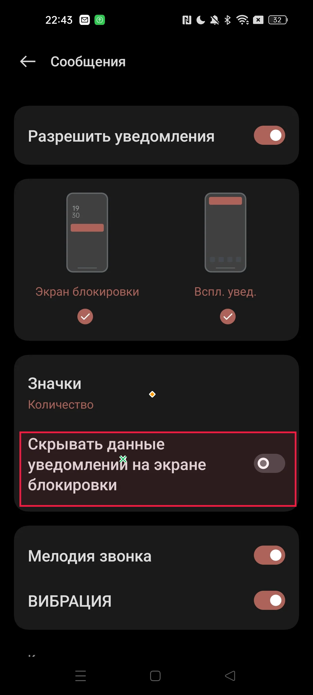

GT 원본 bbox: `[67.0, 1490.0, 1022.0, 1749.0]` · 원본 화면 1080×2400px

### 같은 언어 대조 · 전체 관계 질문

질문: `Какой элемент расположен непосредственно выше '<ref>Скрывать данные уведомлений на экране блокировки</ref>'?`

모델 입력 화면: 952×2128px. 아래 점은 이 화면의 픽셀 좌표다.

| 출력 | 판정 | 점 | 토큰 | `addCriterion` |
| --- | --- | --- | ---: | ---: |
| JSON | GT 밖 | (463, 1207) | 20 | 0 |
| (x, y) | GT 밖 | (143, 1206) | 12 | 0 |

**JSON 원시 출력 전문**

```text
[{"point_2d": [463, 1207]}]
```

**(x, y) 원시 출력 전문**

```text
(143, 1206)
```

**JSON 실제 렌더링 프롬프트**

```text
<|im_start|>system
You are a helpful assistant.<|im_end|>
<|im_start|>user
<|vision_start|><|image_pad|><|vision_end|>Locate the GUI reference element marked with <ref>...</ref> in the question below. The marked expression may be in a different language from the screenshot. Use surrounding words to identify the marked element. Do not locate the element that the question asks for.
Question: Какой элемент расположен непосредственно выше '<ref>Скрывать данные уведомлений на экране блокировки</ref>'?
The screenshot is 952 pixels wide and 2128 pixels high. Give one point inside the marked reference element using integer pixel coordinates on this screenshot, with (0, 0) at the top-left. Return only this JSON array: [{"point_2d": [x, y]}]. No explanation or code fence.<|im_end|>
<|im_start|>assistant

```

**(x, y) 실제 렌더링 프롬프트**

```text
<|im_start|>system
You are a helpful assistant.<|im_end|>
<|im_start|>user
<|vision_start|><|image_pad|><|vision_end|>Locate the GUI reference element marked with <ref>...</ref> in the question below. The marked expression may be in a different language from the screenshot. Use surrounding words to identify the marked element. Do not locate the element that the question asks for.
Question: Какой элемент расположен непосредственно выше '<ref>Скрывать данные уведомлений на экране блокировки</ref>'?
The screenshot is 952 pixels wide and 2128 pixels high. Give one point inside the marked reference element using integer pixel coordinates on this screenshot, with (0, 0) at the top-left. Return only one coordinate as (x, y). No explanation or code fence.<|im_end|>
<|im_start|>assistant

```

### 같은 언어 대조 · 짧은 기준 표현

질문: `Какой элемент расположен непосредственно выше '<ref>Скрывать данные уведомлений на экране блокировки</ref>'?`

모델에 준 기준 표현: `'<ref>Скрывать данные уведомлений на экране блокировки</ref>'`

모델 입력 화면: 952×2128px. 아래 점은 이 화면의 픽셀 좌표다.

| 출력 | 판정 | 점 | 토큰 | `addCriterion` |
| --- | --- | --- | ---: | ---: |
| JSON | GT 안 | (374, 1406) | 20 | 0 |
| (x, y) | GT 안 | (163, 1427) | 12 | 0 |

**JSON 원시 출력 전문**

```text
[{"point_2d": [374, 1406]}]
```

**(x, y) 원시 출력 전문**

```text
(163, 1427)
```

**JSON 실제 렌더링 프롬프트**

```text
<|im_start|>system
You are a helpful assistant.<|im_end|>
<|im_start|>user
<|vision_start|><|image_pad|><|vision_end|>Reference phrase: '<ref>Скрывать данные уведомлений на экране блокировки</ref>'
Locate this GUI element in the screenshot. The phrase may be in a different language from the screenshot. The screenshot is 952 pixels wide and 2128 pixels high. Give one point inside the element, using integer pixel coordinates with (0, 0) at the top-left. Return only this JSON array: [{"point_2d": [x, y]}]. No explanation or code fence.<|im_end|>
<|im_start|>assistant

```

**(x, y) 실제 렌더링 프롬프트**

```text
<|im_start|>system
You are a helpful assistant.<|im_end|>
<|im_start|>user
<|vision_start|><|image_pad|><|vision_end|>Reference phrase: '<ref>Скрывать данные уведомлений на экране блокировки</ref>'
Locate this GUI element in the screenshot. The phrase may be in a different language from the screenshot. The screenshot is 952 pixels wide and 2128 pixels high. Give one point inside the element, using integer pixel coordinates with (0, 0) at the top-left. Return only one coordinate as (x, y). No explanation or code fence.<|im_end|>
<|im_start|>assistant

```

### O · 짧은 기준 표현

질문: `องค์ประกอบใดที่อยู่เหนือ "<ref>ซ่อนรายละเอียดของการแจ้งบนหน้าจอล็อก</ref>"?`

모델에 준 기준 표현: `"<ref>ซ่อนรายละเอียดของการแจ้งบนหน้าจอล็อก</ref>"`

모델 입력 화면: 952×2128px. 아래 점은 이 화면의 픽셀 좌표다.

| 출력 | 판정 | 점 | 토큰 | `addCriterion` |
| --- | --- | --- | ---: | ---: |
| JSON | 형식 실패 | — | 64 | 12 |
| (x, y) | GT 안 | (346, 1427) | 12 | 0 |

**JSON 원시 출력 전문**

```text
[{"point_2d": [476, 139
 addCriterion

 addCriterion

 addCriterion

 addCriterion

 addCriterion

 addCriterion

 addCriterion

 addCriterion

 addCriterion

 addCriterion

 addCriterion

 addCriterion
```

**(x, y) 원시 출력 전문**

```text
(346, 1427)
```

**JSON 실제 렌더링 프롬프트**

```text
<|im_start|>system
You are a helpful assistant.<|im_end|>
<|im_start|>user
<|vision_start|><|image_pad|><|vision_end|>Reference phrase: "<ref>ซ่อนรายละเอียดของการแจ้งบนหน้าจอล็อก</ref>"
Locate this GUI element in the screenshot. The phrase may be in a different language from the screenshot. The screenshot is 952 pixels wide and 2128 pixels high. Give one point inside the element, using integer pixel coordinates with (0, 0) at the top-left. Return only this JSON array: [{"point_2d": [x, y]}]. No explanation or code fence.<|im_end|>
<|im_start|>assistant

```

**(x, y) 실제 렌더링 프롬프트**

```text
<|im_start|>system
You are a helpful assistant.<|im_end|>
<|im_start|>user
<|vision_start|><|image_pad|><|vision_end|>Reference phrase: "<ref>ซ่อนรายละเอียดของการแจ้งบนหน้าจอล็อก</ref>"
Locate this GUI element in the screenshot. The phrase may be in a different language from the screenshot. The screenshot is 952 pixels wide and 2128 pixels high. Give one point inside the element, using integer pixel coordinates with (0, 0) at the top-left. Return only one coordinate as (x, y). No explanation or code fence.<|im_end|>
<|im_start|>assistant

```

### R · 짧은 기준 표현

질문: `องค์ประกอบใดที่อยู่เหนือ "<ref>Скрывать данные уведомлений на экране блокировки</ref>"?`

모델에 준 기준 표현: `"<ref>Скрывать данные уведомлений на экране блокировки</ref>"`

모델 입력 화면: 952×2128px. 아래 점은 이 화면의 픽셀 좌표다.

| 출력 | 판정 | 점 | 토큰 | `addCriterion` |
| --- | --- | --- | ---: | ---: |
| JSON | GT 안 | (374, 1406) | 20 | 0 |
| (x, y) | GT 안 | (163, 1427) | 12 | 0 |

**JSON 원시 출력 전문**

```text
[{"point_2d": [374, 1406]}]
```

**(x, y) 원시 출력 전문**

```text
(163, 1427)
```

**JSON 실제 렌더링 프롬프트**

```text
<|im_start|>system
You are a helpful assistant.<|im_end|>
<|im_start|>user
<|vision_start|><|image_pad|><|vision_end|>Reference phrase: "<ref>Скрывать данные уведомлений на экране блокировки</ref>"
Locate this GUI element in the screenshot. The phrase may be in a different language from the screenshot. The screenshot is 952 pixels wide and 2128 pixels high. Give one point inside the element, using integer pixel coordinates with (0, 0) at the top-left. Return only this JSON array: [{"point_2d": [x, y]}]. No explanation or code fence.<|im_end|>
<|im_start|>assistant

```

**(x, y) 실제 렌더링 프롬프트**

```text
<|im_start|>system
You are a helpful assistant.<|im_end|>
<|im_start|>user
<|vision_start|><|image_pad|><|vision_end|>Reference phrase: "<ref>Скрывать данные уведомлений на экране блокировки</ref>"
Locate this GUI element in the screenshot. The phrase may be in a different language from the screenshot. The screenshot is 952 pixels wide and 2128 pixels high. Give one point inside the element, using integer pixel coordinates with (0, 0) at the top-left. Return only one coordinate as (x, y). No explanation or code fence.<|im_end|>
<|im_start|>assistant

```

## 03 booking_10 RU GUI

질문 TH→GUI RU · 문항 `rel::1/booking_10.jpg`

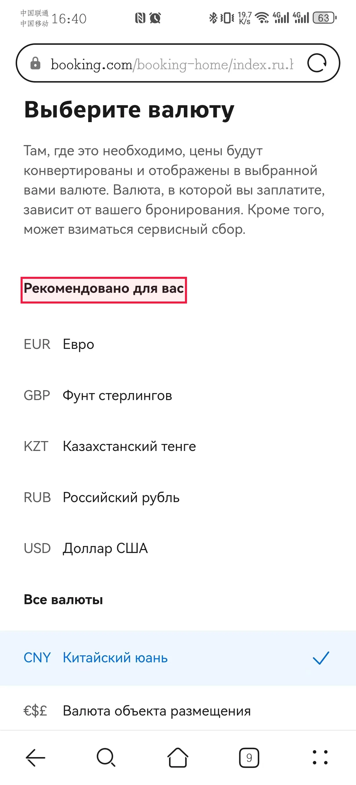

GT 원본 bbox: `[71.0, 952.0, 644.0, 1043.0]` · 원본 화면 1228×2700px

### O · 짧은 기준 표현

질문: `ตัวเลือกสกุลเงินใดอยู่ด้านล่างของส่วน "<ref>ตัวเลือกแนะนำสำหรับคุณ</ref>" ทันที?`

모델에 준 기준 표현: `ส่วน "<ref>ตัวเลือกแนะนำสำหรับคุณ</ref>"`

모델 입력 화면: 980×2128px. 아래 점은 이 화면의 픽셀 좌표다.

| 출력 | 판정 | 점 | 토큰 | `addCriterion` |
| --- | --- | --- | ---: | ---: |
| JSON | 형식 실패 | — | 64 | 7 |
| (x, y) | GT 안 | (67, 774) | 10 | 0 |

**JSON 원시 출력 전문**

```text
[{"point_2d": [304, 78
 addCriterion

 addCriterion

 addCriterion

 addCriterion

 addCriterion

 addCriterion

 addCriterion
```

**(x, y) 원시 출력 전문**

```text
(67, 774)
```

**JSON 실제 렌더링 프롬프트**

```text
<|im_start|>system
You are a helpful assistant.<|im_end|>
<|im_start|>user
<|vision_start|><|image_pad|><|vision_end|>Reference phrase: ส่วน "<ref>ตัวเลือกแนะนำสำหรับคุณ</ref>"
Locate this GUI element in the screenshot. The phrase may be in a different language from the screenshot. The screenshot is 980 pixels wide and 2128 pixels high. Give one point inside the element, using integer pixel coordinates with (0, 0) at the top-left. Return only this JSON array: [{"point_2d": [x, y]}]. No explanation or code fence.<|im_end|>
<|im_start|>assistant

```

**(x, y) 실제 렌더링 프롬프트**

```text
<|im_start|>system
You are a helpful assistant.<|im_end|>
<|im_start|>user
<|vision_start|><|image_pad|><|vision_end|>Reference phrase: ส่วน "<ref>ตัวเลือกแนะนำสำหรับคุณ</ref>"
Locate this GUI element in the screenshot. The phrase may be in a different language from the screenshot. The screenshot is 980 pixels wide and 2128 pixels high. Give one point inside the element, using integer pixel coordinates with (0, 0) at the top-left. Return only one coordinate as (x, y). No explanation or code fence.<|im_end|>
<|im_start|>assistant

```

### R · 짧은 기준 표현

질문: `ตัวเลือกสกุลเงินใดอยู่ด้านล่างของส่วน "<ref>Рекомендовано для вас</ref>" ทันที?`

모델에 준 기준 표현: `ส่วน "<ref>Рекомендовано для вас</ref>"`

모델 입력 화면: 980×2128px. 아래 점은 이 화면의 픽셀 좌표다.

| 출력 | 판정 | 점 | 토큰 | `addCriterion` |
| --- | --- | --- | ---: | ---: |
| JSON | 형식 실패 | — | 19 | 1 |
| (x, y) | 형식 실패 | — | 9 | 0 |

**JSON 원시 출력 전문**

```text
[{"point_2d": [304, 78
 addCriterion
```

**(x, y) 원시 출력 전문**

```text
(54, 768
```

**JSON 실제 렌더링 프롬프트**

```text
<|im_start|>system
You are a helpful assistant.<|im_end|>
<|im_start|>user
<|vision_start|><|image_pad|><|vision_end|>Reference phrase: ส่วน "<ref>Рекомендовано для вас</ref>"
Locate this GUI element in the screenshot. The phrase may be in a different language from the screenshot. The screenshot is 980 pixels wide and 2128 pixels high. Give one point inside the element, using integer pixel coordinates with (0, 0) at the top-left. Return only this JSON array: [{"point_2d": [x, y]}]. No explanation or code fence.<|im_end|>
<|im_start|>assistant

```

**(x, y) 실제 렌더링 프롬프트**

```text
<|im_start|>system
You are a helpful assistant.<|im_end|>
<|im_start|>user
<|vision_start|><|image_pad|><|vision_end|>Reference phrase: ส่วน "<ref>Рекомендовано для вас</ref>"
Locate this GUI element in the screenshot. The phrase may be in a different language from the screenshot. The screenshot is 980 pixels wide and 2128 pixels high. Give one point inside the element, using integer pixel coordinates with (0, 0) at the top-left. Return only one coordinate as (x, y). No explanation or code fence.<|im_end|>
<|im_start|>assistant

```

## 04 clock_10 RU GUI

질문 TH→GUI RU · 문항 `rel::2/clock_10.png`

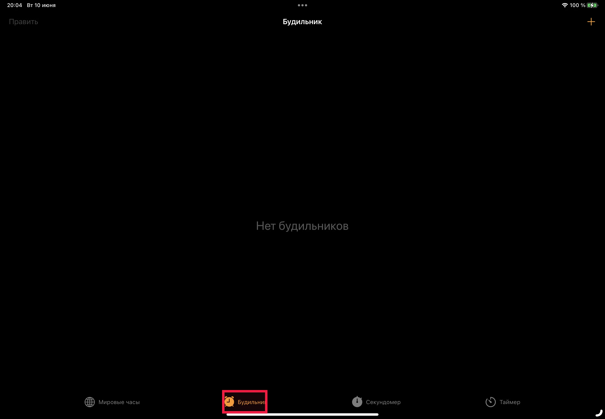

GT 원본 bbox: `[1008.0, 1776.0, 1213.0, 1882.0]` · 원본 화면 2746×1908px

### O · 짧은 기준 표현

질문: `องค์ประกอบใดอยู่ทางขวาของแท็บ '<ref>นาฬิกาปลุก</ref>' ที่ด้านล่างของหน้าจอ?`

모델에 준 기준 표현: `แท็บ '<ref>นาฬิกาปลุก</ref>' ที่ด้านล่างของหน้าจอ`

모델 입력 화면: 1736×1204px. 아래 점은 이 화면의 픽셀 좌표다.

| 출력 | 판정 | 점 | 토큰 | `addCriterion` |
| --- | --- | --- | ---: | ---: |
| JSON | 형식 실패 | — | 64 | 11 |
| (x, y) | GT 안 | (705, 1153) | 12 | 0 |

**JSON 원시 출력 전문**

```text
[{"point_2d": [708
 addCriterion

 addCriterion

 addCriterion

 addCriterion


 addCriterion

 addCriterion

 addCriterion

 addCriterion

 addCriterion

 addCriterion

 addCriterion
```

**(x, y) 원시 출력 전문**

```text
(705, 1153)
```

**JSON 실제 렌더링 프롬프트**

```text
<|im_start|>system
You are a helpful assistant.<|im_end|>
<|im_start|>user
<|vision_start|><|image_pad|><|vision_end|>Reference phrase: แท็บ '<ref>นาฬิกาปลุก</ref>' ที่ด้านล่างของหน้าจอ
Locate this GUI element in the screenshot. The phrase may be in a different language from the screenshot. The screenshot is 1736 pixels wide and 1204 pixels high. Give one point inside the element, using integer pixel coordinates with (0, 0) at the top-left. Return only this JSON array: [{"point_2d": [x, y]}]. No explanation or code fence.<|im_end|>
<|im_start|>assistant

```

**(x, y) 실제 렌더링 프롬프트**

```text
<|im_start|>system
You are a helpful assistant.<|im_end|>
<|im_start|>user
<|vision_start|><|image_pad|><|vision_end|>Reference phrase: แท็บ '<ref>นาฬิกาปลุก</ref>' ที่ด้านล่างของหน้าจอ
Locate this GUI element in the screenshot. The phrase may be in a different language from the screenshot. The screenshot is 1736 pixels wide and 1204 pixels high. Give one point inside the element, using integer pixel coordinates with (0, 0) at the top-left. Return only one coordinate as (x, y). No explanation or code fence.<|im_end|>
<|im_start|>assistant

```

### R · 짧은 기준 표현

질문: `องค์ประกอบใดอยู่ทางขวาของแท็บ '<ref>Будильник</ref>' ที่ด้านล่างของหน้าจอ?`

모델에 준 기준 표현: `แท็บ '<ref>Будильник</ref>' ที่ด้านล่างของหน้าจอ`

모델 입력 화면: 1736×1204px. 아래 점은 이 화면의 픽셀 좌표다.

| 출력 | 판정 | 점 | 토큰 | `addCriterion` |
| --- | --- | --- | ---: | ---: |
| JSON | 형식 실패 | — | 12 | 0 |
| (x, y) | 형식 실패 | — | 11 | 0 |

**JSON 원시 출력 전문**

```text
[{"point_2d": [708
```

**(x, y) 원시 출력 전문**

```text
(708, 1151
```

**JSON 실제 렌더링 프롬프트**

```text
<|im_start|>system
You are a helpful assistant.<|im_end|>
<|im_start|>user
<|vision_start|><|image_pad|><|vision_end|>Reference phrase: แท็บ '<ref>Будильник</ref>' ที่ด้านล่างของหน้าจอ
Locate this GUI element in the screenshot. The phrase may be in a different language from the screenshot. The screenshot is 1736 pixels wide and 1204 pixels high. Give one point inside the element, using integer pixel coordinates with (0, 0) at the top-left. Return only this JSON array: [{"point_2d": [x, y]}]. No explanation or code fence.<|im_end|>
<|im_start|>assistant

```

**(x, y) 실제 렌더링 프롬프트**

```text
<|im_start|>system
You are a helpful assistant.<|im_end|>
<|im_start|>user
<|vision_start|><|image_pad|><|vision_end|>Reference phrase: แท็บ '<ref>Будильник</ref>' ที่ด้านล่างของหน้าจอ
Locate this GUI element in the screenshot. The phrase may be in a different language from the screenshot. The screenshot is 1736 pixels wide and 1204 pixels high. Give one point inside the element, using integer pixel coordinates with (0, 0) at the top-left. Return only one coordinate as (x, y). No explanation or code fence.<|im_end|>
<|im_start|>assistant

```

## 05 weather_3 RU GUI

질문 TH→GUI RU · 문항 `rel::2/weather_3.png`

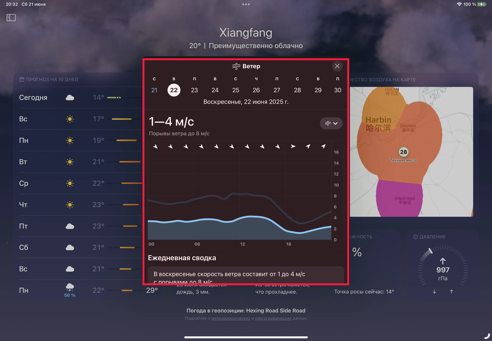

GT 원본 bbox: `[795.0, 326.0, 1948.0, 1595.0]` · 원본 화면 2746×1908px

### O · 짧은 기준 표현

질문: `องค์ประกอบใดอยู่ทางขวาของส่วน '<ref>ลม</ref>' และเหนือมาตรวัดความดัน?`

모델에 준 기준 표현: `ส่วน '<ref>ลม</ref>'`

모델 입력 화면: 1736×1204px. 아래 점은 이 화면의 픽셀 좌표다.

| 출력 | 판정 | 점 | 토큰 | `addCriterion` |
| --- | --- | --- | ---: | ---: |
| JSON | 형식 실패 | — | 64 | 13 |
| (x, y) | 형식 실패 | — | 64 | 1 |

**JSON 원시 출력 전문**

```text
[{"point_2d": [8
 addCriterion

 addCriterion

 addCriterion

 addCriterion

 addCriterion


 addCriterion

 addCriterion

 addCriterion

 addCriterion

 addCriterion

 addCriterion

 addCriterion

 addCriterion
```

**(x, y) 원시 출력 전문**

```text
(8
 addCriterion
(159
```

**JSON 실제 렌더링 프롬프트**

```text
<|im_start|>system
You are a helpful assistant.<|im_end|>
<|im_start|>user
<|vision_start|><|image_pad|><|vision_end|>Reference phrase: ส่วน '<ref>ลม</ref>'
Locate this GUI element in the screenshot. The phrase may be in a different language from the screenshot. The screenshot is 1736 pixels wide and 1204 pixels high. Give one point inside the element, using integer pixel coordinates with (0, 0) at the top-left. Return only this JSON array: [{"point_2d": [x, y]}]. No explanation or code fence.<|im_end|>
<|im_start|>assistant

```

**(x, y) 실제 렌더링 프롬프트**

```text
<|im_start|>system
You are a helpful assistant.<|im_end|>
<|im_start|>user
<|vision_start|><|image_pad|><|vision_end|>Reference phrase: ส่วน '<ref>ลม</ref>'
Locate this GUI element in the screenshot. The phrase may be in a different language from the screenshot. The screenshot is 1736 pixels wide and 1204 pixels high. Give one point inside the element, using integer pixel coordinates with (0, 0) at the top-left. Return only one coordinate as (x, y). No explanation or code fence.<|im_end|>
<|im_start|>assistant

```

### R · 짧은 기준 표현

질문: `องค์ประกอบใดอยู่ทางขวาของส่วน '<ref>Ветер</ref>' และเหนือมาตรวัดความดัน?`

모델에 준 기준 표현: `ส่วน '<ref>Ветер</ref>'`

모델 입력 화면: 1736×1204px. 아래 점은 이 화면의 픽셀 좌표다.

| 출력 | 판정 | 점 | 토큰 | `addCriterion` |
| --- | --- | --- | ---: | ---: |
| JSON | 형식 실패 | — | 64 | 14 |
| (x, y) | 형식 실패 | — | 12 | 2 |

**JSON 원시 출력 전문**

```text
[{"point_2d": [8
 addCriterion

 addCriterion

 addCriterion

 addCriterion

 addCriterion

 addCriterion

 addCriterion

 addCriterion

 addCriterion

 addCriterion

 addCriterion

 addCriterion

 addCriterion

 addCriterion
```

**(x, y) 원시 출력 전문**

```text
(8
 addCriterion
(9
 addCriterion
(
```

**JSON 실제 렌더링 프롬프트**

```text
<|im_start|>system
You are a helpful assistant.<|im_end|>
<|im_start|>user
<|vision_start|><|image_pad|><|vision_end|>Reference phrase: ส่วน '<ref>Ветер</ref>'
Locate this GUI element in the screenshot. The phrase may be in a different language from the screenshot. The screenshot is 1736 pixels wide and 1204 pixels high. Give one point inside the element, using integer pixel coordinates with (0, 0) at the top-left. Return only this JSON array: [{"point_2d": [x, y]}]. No explanation or code fence.<|im_end|>
<|im_start|>assistant

```

**(x, y) 실제 렌더링 프롬프트**

```text
<|im_start|>system
You are a helpful assistant.<|im_end|>
<|im_start|>user
<|vision_start|><|image_pad|><|vision_end|>Reference phrase: ส่วน '<ref>Ветер</ref>'
Locate this GUI element in the screenshot. The phrase may be in a different language from the screenshot. The screenshot is 1736 pixels wide and 1204 pixels high. Give one point inside the element, using integer pixel coordinates with (0, 0) at the top-left. Return only one coordinate as (x, y). No explanation or code fence.<|im_end|>
<|im_start|>assistant

```

## 06 music_7 RU GUI

질문 TH→GUI RU · 문항 `rel::3/music_7.jpg`

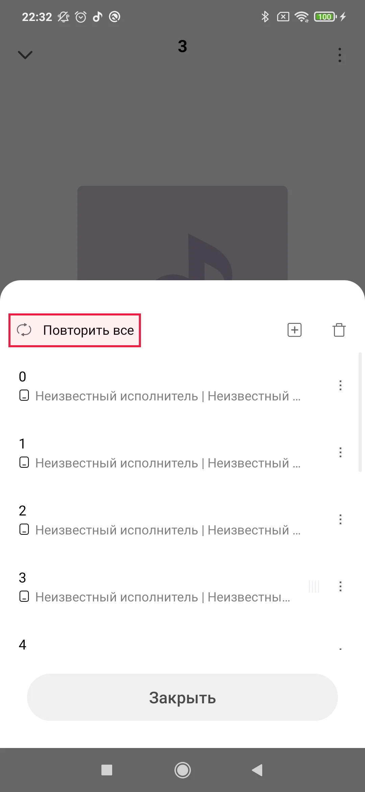

GT 원본 bbox: `[25.0, 926.0, 416.0, 1025.0]` · 원본 화면 1080×2340px

### O · 짧은 기준 표현

질문: `ตัวเลือกใดต่อไปนี้อยู่ด้านล่างของตัวเลือก "<ref>เล่นซ้ำทั้งหมด</ref>" ในเมนู?`

모델에 준 기준 표현: `ตัวเลือก "<ref>เล่นซ้ำทั้งหมด</ref>" ในเมนู`

모델 입력 화면: 980×2100px. 아래 점은 이 화면의 픽셀 좌표다.

| 출력 | 판정 | 점 | 토큰 | `addCriterion` |
| --- | --- | --- | ---: | ---: |
| JSON | 형식 실패 | — | 23 | 1 |
| (x, y) | 형식 실패 | — | 10 | 1 |

**JSON 원시 출력 전문**

```text
[{"point_2d": [304, 8
 addCriterion: "เล่นซ
```

**(x, y) 원시 출력 전문**

```text
(146, 8
 addCriterion
```

**JSON 실제 렌더링 프롬프트**

```text
<|im_start|>system
You are a helpful assistant.<|im_end|>
<|im_start|>user
<|vision_start|><|image_pad|><|vision_end|>Reference phrase: ตัวเลือก "<ref>เล่นซ้ำทั้งหมด</ref>" ในเมนู
Locate this GUI element in the screenshot. The phrase may be in a different language from the screenshot. The screenshot is 980 pixels wide and 2100 pixels high. Give one point inside the element, using integer pixel coordinates with (0, 0) at the top-left. Return only this JSON array: [{"point_2d": [x, y]}]. No explanation or code fence.<|im_end|>
<|im_start|>assistant

```

**(x, y) 실제 렌더링 프롬프트**

```text
<|im_start|>system
You are a helpful assistant.<|im_end|>
<|im_start|>user
<|vision_start|><|image_pad|><|vision_end|>Reference phrase: ตัวเลือก "<ref>เล่นซ้ำทั้งหมด</ref>" ในเมนู
Locate this GUI element in the screenshot. The phrase may be in a different language from the screenshot. The screenshot is 980 pixels wide and 2100 pixels high. Give one point inside the element, using integer pixel coordinates with (0, 0) at the top-left. Return only one coordinate as (x, y). No explanation or code fence.<|im_end|>
<|im_start|>assistant

```

### R · 짧은 기준 표현

질문: `ตัวเลือกใดต่อไปนี้อยู่ด้านล่างของตัวเลือก "<ref>Повторить все</ref>" ในเมนู?`

모델에 준 기준 표현: `ตัวเลือก "<ref>Повторить все</ref>" ในเมนู`

모델 입력 화면: 980×2100px. 아래 점은 이 화면의 픽셀 좌표다.

| 출력 | 판정 | 점 | 토큰 | `addCriterion` |
| --- | --- | --- | ---: | ---: |
| JSON | 형식 실패 | — | 40 | 1 |
| (x, y) | 형식 실패 | — | 10 | 1 |

**JSON 원시 출력 전문**

```text
[{"point_2d": [237, 8
 addCriterion: "ตัวเลือก \"<ref>Повторить все</ref>\" ในเมนู
```

**(x, y) 원시 출력 전문**

```text
(145, 8
 addCriterion
```

**JSON 실제 렌더링 프롬프트**

```text
<|im_start|>system
You are a helpful assistant.<|im_end|>
<|im_start|>user
<|vision_start|><|image_pad|><|vision_end|>Reference phrase: ตัวเลือก "<ref>Повторить все</ref>" ในเมนู
Locate this GUI element in the screenshot. The phrase may be in a different language from the screenshot. The screenshot is 980 pixels wide and 2100 pixels high. Give one point inside the element, using integer pixel coordinates with (0, 0) at the top-left. Return only this JSON array: [{"point_2d": [x, y]}]. No explanation or code fence.<|im_end|>
<|im_start|>assistant

```

**(x, y) 실제 렌더링 프롬프트**

```text
<|im_start|>system
You are a helpful assistant.<|im_end|>
<|im_start|>user
<|vision_start|><|image_pad|><|vision_end|>Reference phrase: ตัวเลือก "<ref>Повторить все</ref>" ในเมนู
Locate this GUI element in the screenshot. The phrase may be in a different language from the screenshot. The screenshot is 980 pixels wide and 2100 pixels high. Give one point inside the element, using integer pixel coordinates with (0, 0) at the top-left. Return only one coordinate as (x, y). No explanation or code fence.<|im_end|>
<|im_start|>assistant

```

## 07 settings_2 RU GUI

질문 TH→GUI RU · 문항 `rel::3/settings_2.jpg`

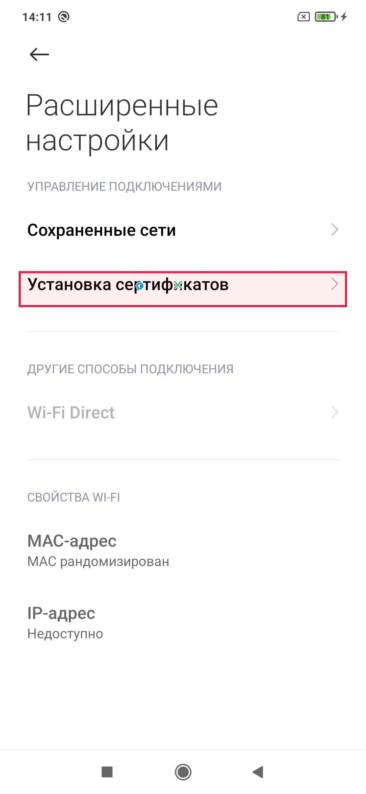

GT 원본 bbox: `[55.0, 799.0, 1023.0, 904.0]` · 원본 화면 1080×2340px

### O · 짧은 기준 표현

질문: `องค์ประกอบใดอยู่ด้านล่างโดยตรงของ '<ref>ติดตั้งใบรับรอง</ref>'?`

모델에 준 기준 표현: `'<ref>ติดตั้งใบรับรอง</ref>'`

모델 입력 화면: 980×2100px. 아래 점은 이 화면의 픽셀 좌표다.

| 출력 | 판정 | 점 | 토큰 | `addCriterion` |
| --- | --- | --- | ---: | ---: |
| JSON | GT 안 | (374, 756) | 19 | 0 |
| (x, y) | GT 안 | (340, 756) | 11 | 0 |

**JSON 원시 출력 전문**

```text
[{"point_2d": [374, 756]}]
```

**(x, y) 원시 출력 전문**

```text
(340, 756)
```

**JSON 실제 렌더링 프롬프트**

```text
<|im_start|>system
You are a helpful assistant.<|im_end|>
<|im_start|>user
<|vision_start|><|image_pad|><|vision_end|>Reference phrase: '<ref>ติดตั้งใบรับรอง</ref>'
Locate this GUI element in the screenshot. The phrase may be in a different language from the screenshot. The screenshot is 980 pixels wide and 2100 pixels high. Give one point inside the element, using integer pixel coordinates with (0, 0) at the top-left. Return only this JSON array: [{"point_2d": [x, y]}]. No explanation or code fence.<|im_end|>
<|im_start|>assistant

```

**(x, y) 실제 렌더링 프롬프트**

```text
<|im_start|>system
You are a helpful assistant.<|im_end|>
<|im_start|>user
<|vision_start|><|image_pad|><|vision_end|>Reference phrase: '<ref>ติดตั้งใบรับรอง</ref>'
Locate this GUI element in the screenshot. The phrase may be in a different language from the screenshot. The screenshot is 980 pixels wide and 2100 pixels high. Give one point inside the element, using integer pixel coordinates with (0, 0) at the top-left. Return only one coordinate as (x, y). No explanation or code fence.<|im_end|>
<|im_start|>assistant

```

### R · 짧은 기준 표현

질문: `องค์ประกอบใดอยู่ด้านล่างโดยตรงของ '<ref>Установка сертификатов</ref>'?`

모델에 준 기준 표현: `'<ref>Установка сертификатов</ref>'`

모델 입력 화면: 980×2100px. 아래 점은 이 화면의 픽셀 좌표다.

| 출력 | 판정 | 점 | 토큰 | `addCriterion` |
| --- | --- | --- | ---: | ---: |
| JSON | GT 안 | (476, 753) | 19 | 0 |
| (x, y) | GT 안 | (153, 746) | 11 | 0 |

**JSON 원시 출력 전문**

```text
[{"point_2d": [476, 753]}]
```

**(x, y) 원시 출력 전문**

```text
(153, 746)
```

**JSON 실제 렌더링 프롬프트**

```text
<|im_start|>system
You are a helpful assistant.<|im_end|>
<|im_start|>user
<|vision_start|><|image_pad|><|vision_end|>Reference phrase: '<ref>Установка сертификатов</ref>'
Locate this GUI element in the screenshot. The phrase may be in a different language from the screenshot. The screenshot is 980 pixels wide and 2100 pixels high. Give one point inside the element, using integer pixel coordinates with (0, 0) at the top-left. Return only this JSON array: [{"point_2d": [x, y]}]. No explanation or code fence.<|im_end|>
<|im_start|>assistant

```

**(x, y) 실제 렌더링 프롬프트**

```text
<|im_start|>system
You are a helpful assistant.<|im_end|>
<|im_start|>user
<|vision_start|><|image_pad|><|vision_end|>Reference phrase: '<ref>Установка сертификатов</ref>'
Locate this GUI element in the screenshot. The phrase may be in a different language from the screenshot. The screenshot is 980 pixels wide and 2100 pixels high. Give one point inside the element, using integer pixel coordinates with (0, 0) at the top-left. Return only one coordinate as (x, y). No explanation or code fence.<|im_end|>
<|im_start|>assistant

```

## 08 Gmail_8 RU GUI

질문 TH→GUI RU · 문항 `rel::4/Gmail_8.jpg`

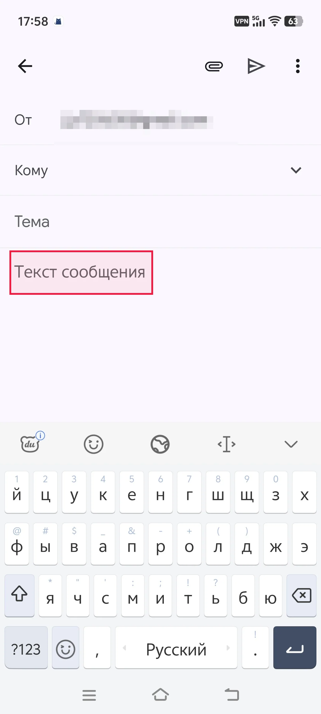

GT 원본 bbox: `[37.0, 982.0, 600.0, 1155.0]` · 원본 화면 1260×2800px

### O · 짧은 기준 표현

질문: `องค์ประกอบใดอยู่เหนือข้อความตัวอย่าง '<ref>เขียนอีเมล</ref>' โดยตรง?`

모델에 준 기준 표현: `ข้อความตัวอย่าง '<ref>เขียนอีเมล</ref>'`

모델 입력 화면: 952×2156px. 아래 점은 이 화면의 픽셀 좌표다.

| 출력 | 판정 | 점 | 토큰 | `addCriterion` |
| --- | --- | --- | ---: | ---: |
| JSON | 형식 실패 | — | 2 | 0 |
| (x, y) | 형식 실패 | — | 11 | 1 |

**JSON 원시 출력 전문**

```text
[]
```

**(x, y) 원시 출력 전문**

```text
(347, 8
 addCriterion
```

**JSON 실제 렌더링 프롬프트**

```text
<|im_start|>system
You are a helpful assistant.<|im_end|>
<|im_start|>user
<|vision_start|><|image_pad|><|vision_end|>Reference phrase: ข้อความตัวอย่าง '<ref>เขียนอีเมล</ref>'
Locate this GUI element in the screenshot. The phrase may be in a different language from the screenshot. The screenshot is 952 pixels wide and 2156 pixels high. Give one point inside the element, using integer pixel coordinates with (0, 0) at the top-left. Return only this JSON array: [{"point_2d": [x, y]}]. No explanation or code fence.<|im_end|>
<|im_start|>assistant

```

**(x, y) 실제 렌더링 프롬프트**

```text
<|im_start|>system
You are a helpful assistant.<|im_end|>
<|im_start|>user
<|vision_start|><|image_pad|><|vision_end|>Reference phrase: ข้อความตัวอย่าง '<ref>เขียนอีเมล</ref>'
Locate this GUI element in the screenshot. The phrase may be in a different language from the screenshot. The screenshot is 952 pixels wide and 2156 pixels high. Give one point inside the element, using integer pixel coordinates with (0, 0) at the top-left. Return only one coordinate as (x, y). No explanation or code fence.<|im_end|>
<|im_start|>assistant

```

### R · 짧은 기준 표현

질문: `องค์ประกอบใดอยู่เหนือข้อความตัวอย่าง '<ref>Текст сообщения</ref>' โดยตรง?`

모델에 준 기준 표현: `ข้อความตัวอย่าง '<ref>Текст сообщения</ref>'`

모델 입력 화면: 952×2156px. 아래 점은 이 화면의 픽셀 좌표다.

| 출력 | 판정 | 점 | 토큰 | `addCriterion` |
| --- | --- | --- | ---: | ---: |
| JSON | 형식 실패 | — | 18 | 1 |
| (x, y) | 형식 실패 | — | 10 | 1 |

**JSON 원시 출력 전문**

```text
[{"point_2d": [473, 8
 addCriterion
```

**(x, y) 원시 출력 전문**

```text
(148

 addCriterion'
```

**JSON 실제 렌더링 프롬프트**

```text
<|im_start|>system
You are a helpful assistant.<|im_end|>
<|im_start|>user
<|vision_start|><|image_pad|><|vision_end|>Reference phrase: ข้อความตัวอย่าง '<ref>Текст сообщения</ref>'
Locate this GUI element in the screenshot. The phrase may be in a different language from the screenshot. The screenshot is 952 pixels wide and 2156 pixels high. Give one point inside the element, using integer pixel coordinates with (0, 0) at the top-left. Return only this JSON array: [{"point_2d": [x, y]}]. No explanation or code fence.<|im_end|>
<|im_start|>assistant

```

**(x, y) 실제 렌더링 프롬프트**

```text
<|im_start|>system
You are a helpful assistant.<|im_end|>
<|im_start|>user
<|vision_start|><|image_pad|><|vision_end|>Reference phrase: ข้อความตัวอย่าง '<ref>Текст сообщения</ref>'
Locate this GUI element in the screenshot. The phrase may be in a different language from the screenshot. The screenshot is 952 pixels wide and 2156 pixels high. Give one point inside the element, using integer pixel coordinates with (0, 0) at the top-left. Return only one coordinate as (x, y). No explanation or code fence.<|im_end|>
<|im_start|>assistant

```

## 09 twitter_6 RU GUI

질문 TH→GUI RU · 문항 `rel::4/twitter_6.jpg`

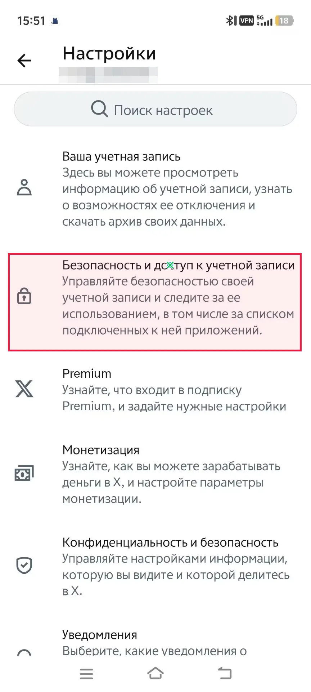

GT 원본 bbox: `[22.0, 702.0, 837.0, 974.0]` · 원본 화면 864×1920px

### O · 짧은 기준 표현

질문: `ตัวเลือกใดอยู่ด้านล่างของตัวเลือก '<ref>ความปลอดภัยและการเข้าถึงบัญชี</ref>' ในเมนูการตั้งค่า?`

모델에 준 기준 표현: `ตัวเลือก '<ref>ความปลอดภัยและการเข้าถึงบัญชี</ref>' ในเมนูการตั้งค่า`

모델 입력 화면: 868×1932px. 아래 점은 이 화면의 픽셀 좌표다.

| 출력 | 판정 | 점 | 토큰 | `addCriterion` |
| --- | --- | --- | ---: | ---: |
| JSON | GT 안 | (475, 740) | 19 | 0 |
| (x, y) | 형식 실패 | — | 10 | 0 |

**JSON 원시 출력 전문**

```text
[{"point_2d": [475, 740]}]
```

**(x, y) 원시 출력 전문**

```text
(175, 728
```

**JSON 실제 렌더링 프롬프트**

```text
<|im_start|>system
You are a helpful assistant.<|im_end|>
<|im_start|>user
<|vision_start|><|image_pad|><|vision_end|>Reference phrase: ตัวเลือก '<ref>ความปลอดภัยและการเข้าถึงบัญชี</ref>' ในเมนูการตั้งค่า
Locate this GUI element in the screenshot. The phrase may be in a different language from the screenshot. The screenshot is 868 pixels wide and 1932 pixels high. Give one point inside the element, using integer pixel coordinates with (0, 0) at the top-left. Return only this JSON array: [{"point_2d": [x, y]}]. No explanation or code fence.<|im_end|>
<|im_start|>assistant

```

**(x, y) 실제 렌더링 프롬프트**

```text
<|im_start|>system
You are a helpful assistant.<|im_end|>
<|im_start|>user
<|vision_start|><|image_pad|><|vision_end|>Reference phrase: ตัวเลือก '<ref>ความปลอดภัยและการเข้าถึงบัญชี</ref>' ในเมนูการตั้งค่า
Locate this GUI element in the screenshot. The phrase may be in a different language from the screenshot. The screenshot is 868 pixels wide and 1932 pixels high. Give one point inside the element, using integer pixel coordinates with (0, 0) at the top-left. Return only one coordinate as (x, y). No explanation or code fence.<|im_end|>
<|im_start|>assistant

```

### R · 짧은 기준 표현

질문: `ตัวเลือกใดอยู่ด้านล่างของตัวเลือก '<ref>Безопасность и доступ к учетной записи</ref>' ในเมนูการตั้งค่า?`

모델에 준 기준 표현: `ตัวเลือก '<ref>Безопасность и доступ к учетной записи</ref>' ในเมนูการตั้งค่า`

모델 입력 화면: 868×1932px. 아래 점은 이 화면의 픽셀 좌표다.

| 출력 | 판정 | 점 | 토큰 | `addCriterion` |
| --- | --- | --- | ---: | ---: |
| JSON | GT 안 | (475, 740) | 19 | 0 |
| (x, y) | 형식 실패 | — | 10 | 0 |

**JSON 원시 출력 전문**

```text
[{"point_2d": [475, 740]}]
```

**(x, y) 원시 출력 전문**

```text
(175, 729
```

**JSON 실제 렌더링 프롬프트**

```text
<|im_start|>system
You are a helpful assistant.<|im_end|>
<|im_start|>user
<|vision_start|><|image_pad|><|vision_end|>Reference phrase: ตัวเลือก '<ref>Безопасность и доступ к учетной записи</ref>' ในเมนูการตั้งค่า
Locate this GUI element in the screenshot. The phrase may be in a different language from the screenshot. The screenshot is 868 pixels wide and 1932 pixels high. Give one point inside the element, using integer pixel coordinates with (0, 0) at the top-left. Return only this JSON array: [{"point_2d": [x, y]}]. No explanation or code fence.<|im_end|>
<|im_start|>assistant

```

**(x, y) 실제 렌더링 프롬프트**

```text
<|im_start|>system
You are a helpful assistant.<|im_end|>
<|im_start|>user
<|vision_start|><|image_pad|><|vision_end|>Reference phrase: ตัวเลือก '<ref>Безопасность и доступ к учетной записи</ref>' ในเมนูการตั้งค่า
Locate this GUI element in the screenshot. The phrase may be in a different language from the screenshot. The screenshot is 868 pixels wide and 1932 pixels high. Give one point inside the element, using integer pixel coordinates with (0, 0) at the top-left. Return only one coordinate as (x, y). No explanation or code fence.<|im_end|>
<|im_start|>assistant

```

## 10 camera_1 RU GUI

질문 TH→GUI RU · 문항 `rel::5/camera_1.jpg`

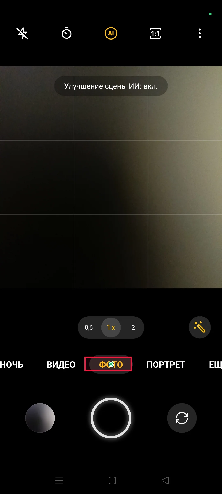

GT 원본 bbox: `[411.0, 1732.0, 640.0, 1802.0]` · 원본 화면 1080×2400px

### O · 짧은 기준 표현

질문: `องค์ประกอบใดอยู่เหนือปุ่มโหมด '<ref>รูปถ่าย</ref>' โดยตรง?`

모델에 준 기준 표현: `ปุ่มโหมด '<ref>รูปถ่าย</ref>'`

모델 입력 화면: 952×2128px. 아래 점은 이 화면의 픽셀 좌표다.

| 출력 | 판정 | 점 | 토큰 | `addCriterion` |
| --- | --- | --- | ---: | ---: |
| JSON | GT 안 | (476, 1569) | 20 | 0 |
| (x, y) | GT 안 | (467, 1566) | 12 | 0 |

**JSON 원시 출력 전문**

```text
[{"point_2d": [476, 1569]}]
```

**(x, y) 원시 출력 전문**

```text
(467, 1566)
```

**JSON 실제 렌더링 프롬프트**

```text
<|im_start|>system
You are a helpful assistant.<|im_end|>
<|im_start|>user
<|vision_start|><|image_pad|><|vision_end|>Reference phrase: ปุ่มโหมด '<ref>รูปถ่าย</ref>'
Locate this GUI element in the screenshot. The phrase may be in a different language from the screenshot. The screenshot is 952 pixels wide and 2128 pixels high. Give one point inside the element, using integer pixel coordinates with (0, 0) at the top-left. Return only this JSON array: [{"point_2d": [x, y]}]. No explanation or code fence.<|im_end|>
<|im_start|>assistant

```

**(x, y) 실제 렌더링 프롬프트**

```text
<|im_start|>system
You are a helpful assistant.<|im_end|>
<|im_start|>user
<|vision_start|><|image_pad|><|vision_end|>Reference phrase: ปุ่มโหมด '<ref>รูปถ่าย</ref>'
Locate this GUI element in the screenshot. The phrase may be in a different language from the screenshot. The screenshot is 952 pixels wide and 2128 pixels high. Give one point inside the element, using integer pixel coordinates with (0, 0) at the top-left. Return only one coordinate as (x, y). No explanation or code fence.<|im_end|>
<|im_start|>assistant

```

### R · 짧은 기준 표현

질문: `องค์ประกอบใดอยู่เหนือปุ่มโหมด '<ref>ФОТО</ref>' โดยตรง?`

모델에 준 기준 표현: `ปุ่มโหมด '<ref>ФОТО</ref>'`

모델 입력 화면: 952×2128px. 아래 점은 이 화면의 픽셀 좌표다.

| 출력 | 판정 | 점 | 토큰 | `addCriterion` |
| --- | --- | --- | ---: | ---: |
| JSON | GT 안 | (476, 1569) | 20 | 0 |
| (x, y) | GT 안 | (456, 1537) | 12 | 0 |

**JSON 원시 출력 전문**

```text
[{"point_2d": [476, 1569]}]
```

**(x, y) 원시 출력 전문**

```text
(456, 1537)
```

**JSON 실제 렌더링 프롬프트**

```text
<|im_start|>system
You are a helpful assistant.<|im_end|>
<|im_start|>user
<|vision_start|><|image_pad|><|vision_end|>Reference phrase: ปุ่มโหมด '<ref>ФОТО</ref>'
Locate this GUI element in the screenshot. The phrase may be in a different language from the screenshot. The screenshot is 952 pixels wide and 2128 pixels high. Give one point inside the element, using integer pixel coordinates with (0, 0) at the top-left. Return only this JSON array: [{"point_2d": [x, y]}]. No explanation or code fence.<|im_end|>
<|im_start|>assistant

```

**(x, y) 실제 렌더링 프롬프트**

```text
<|im_start|>system
You are a helpful assistant.<|im_end|>
<|im_start|>user
<|vision_start|><|image_pad|><|vision_end|>Reference phrase: ปุ่มโหมด '<ref>ФОТО</ref>'
Locate this GUI element in the screenshot. The phrase may be in a different language from the screenshot. The screenshot is 952 pixels wide and 2128 pixels high. Give one point inside the element, using integer pixel coordinates with (0, 0) at the top-left. Return only one coordinate as (x, y). No explanation or code fence.<|im_end|>
<|im_start|>assistant

```

## 11 safari_7 RU GUI

질문 TH→GUI RU · 문항 `rel::6/safari_7.jpg`

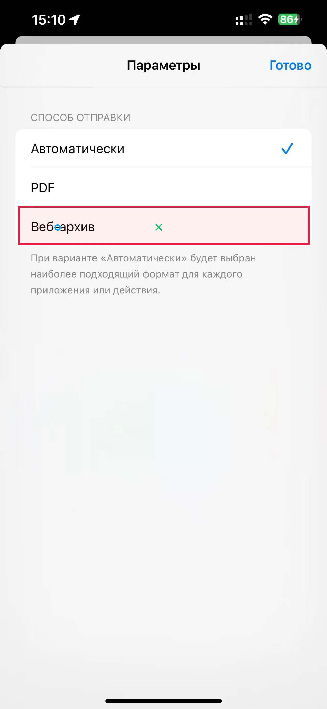

GT 원본 bbox: `[71.0, 804.0, 1211.0, 955.0]` · 원본 화면 1280×2769px

### O · 짧은 기준 표현

질문: `ตัวเลือกใดปรากฏอยู่เหนือการตั้งค่า "<ref>ที่เก็บเว็บถาวร</ref>" ในรายการที่แสดงในภาพหน้าจอ?`

모델에 준 기준 표현: `การตั้งค่า "<ref>ที่เก็บเว็บถาวร</ref>" ในรายการ`

모델 입력 화면: 980×2100px. 아래 점은 이 화면의 픽셀 좌표다.

| 출력 | 판정 | 점 | 토큰 | `addCriterion` |
| --- | --- | --- | ---: | ---: |
| JSON | GT 안 | (173, 674) | 19 | 0 |
| (x, y) | GT 안 | (134, 675) | 11 | 0 |

**JSON 원시 출력 전문**

```text
[{"point_2d": [173, 674]}]
```

**(x, y) 원시 출력 전문**

```text
(134, 675)
```

**JSON 실제 렌더링 프롬프트**

```text
<|im_start|>system
You are a helpful assistant.<|im_end|>
<|im_start|>user
<|vision_start|><|image_pad|><|vision_end|>Reference phrase: การตั้งค่า "<ref>ที่เก็บเว็บถาวร</ref>" ในรายการ
Locate this GUI element in the screenshot. The phrase may be in a different language from the screenshot. The screenshot is 980 pixels wide and 2100 pixels high. Give one point inside the element, using integer pixel coordinates with (0, 0) at the top-left. Return only this JSON array: [{"point_2d": [x, y]}]. No explanation or code fence.<|im_end|>
<|im_start|>assistant

```

**(x, y) 실제 렌더링 프롬프트**

```text
<|im_start|>system
You are a helpful assistant.<|im_end|>
<|im_start|>user
<|vision_start|><|image_pad|><|vision_end|>Reference phrase: การตั้งค่า "<ref>ที่เก็บเว็บถาวร</ref>" ในรายการ
Locate this GUI element in the screenshot. The phrase may be in a different language from the screenshot. The screenshot is 980 pixels wide and 2100 pixels high. Give one point inside the element, using integer pixel coordinates with (0, 0) at the top-left. Return only one coordinate as (x, y). No explanation or code fence.<|im_end|>
<|im_start|>assistant

```

### R · 짧은 기준 표현

질문: `ตัวเลือกใดปรากฏอยู่เหนือการตั้งค่า "<ref>Веб-архив</ref>" ในรายการที่แสดงในภาพหน้าจอ?`

모델에 준 기준 표현: `การตั้งค่า "<ref>Веб-архив</ref>" ในรายการ`

모델 입력 화면: 980×2100px. 아래 점은 이 화면의 픽셀 좌표다.

| 출력 | 판정 | 점 | 토큰 | `addCriterion` |
| --- | --- | --- | ---: | ---: |
| JSON | GT 안 | (476, 673) | 19 | 0 |
| (x, y) | GT 안 | (163, 675) | 11 | 0 |

**JSON 원시 출력 전문**

```text
[{"point_2d": [476, 673]}]
```

**(x, y) 원시 출력 전문**

```text
(163, 675)
```

**JSON 실제 렌더링 프롬프트**

```text
<|im_start|>system
You are a helpful assistant.<|im_end|>
<|im_start|>user
<|vision_start|><|image_pad|><|vision_end|>Reference phrase: การตั้งค่า "<ref>Веб-архив</ref>" ในรายการ
Locate this GUI element in the screenshot. The phrase may be in a different language from the screenshot. The screenshot is 980 pixels wide and 2100 pixels high. Give one point inside the element, using integer pixel coordinates with (0, 0) at the top-left. Return only this JSON array: [{"point_2d": [x, y]}]. No explanation or code fence.<|im_end|>
<|im_start|>assistant

```

**(x, y) 실제 렌더링 프롬프트**

```text
<|im_start|>system
You are a helpful assistant.<|im_end|>
<|im_start|>user
<|vision_start|><|image_pad|><|vision_end|>Reference phrase: การตั้งค่า "<ref>Веб-архив</ref>" ในรายการ
Locate this GUI element in the screenshot. The phrase may be in a different language from the screenshot. The screenshot is 980 pixels wide and 2100 pixels high. Give one point inside the element, using integer pixel coordinates with (0, 0) at the top-left. Return only one coordinate as (x, y). No explanation or code fence.<|im_end|>
<|im_start|>assistant

```

## 12 wallet_3 RU GUI

질문 TH→GUI RU · 문항 `rel::6/wallet_3.jpg`

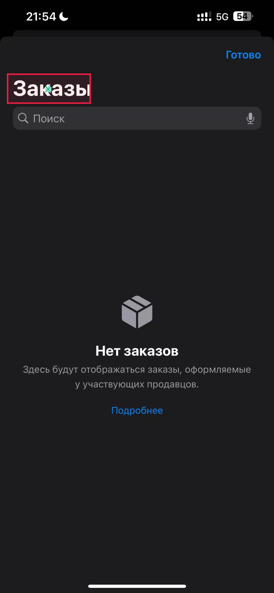

GT 원본 bbox: `[32.0, 343.0, 424.0, 484.0]` · 원본 화면 1280×2769px

### O · 짧은 기준 표현

질문: `ลำดับโดยตรงขององค์ประกอบจากบนลงล่างบนหน้าจอหลังจากหัวข้อ "<ref>คำสั่งซื้อ</ref>" คืออะไร?`

모델에 준 기준 표현: `หัวข้อ "<ref>คำสั่งซื้อ</ref>"`

모델 입력 화면: 980×2100px. 아래 점은 이 화면의 픽셀 좌표다.

| 출력 | 판정 | 점 | 토큰 | `addCriterion` |
| --- | --- | --- | ---: | ---: |
| JSON | GT 안 | (173, 316) | 19 | 0 |
| (x, y) | GT 안 | (75, 304) | 10 | 0 |

**JSON 원시 출력 전문**

```text
[{"point_2d": [173, 316]}]
```

**(x, y) 원시 출력 전문**

```text
(75, 304)
```

**JSON 실제 렌더링 프롬프트**

```text
<|im_start|>system
You are a helpful assistant.<|im_end|>
<|im_start|>user
<|vision_start|><|image_pad|><|vision_end|>Reference phrase: หัวข้อ "<ref>คำสั่งซื้อ</ref>"
Locate this GUI element in the screenshot. The phrase may be in a different language from the screenshot. The screenshot is 980 pixels wide and 2100 pixels high. Give one point inside the element, using integer pixel coordinates with (0, 0) at the top-left. Return only this JSON array: [{"point_2d": [x, y]}]. No explanation or code fence.<|im_end|>
<|im_start|>assistant

```

**(x, y) 실제 렌더링 프롬프트**

```text
<|im_start|>system
You are a helpful assistant.<|im_end|>
<|im_start|>user
<|vision_start|><|image_pad|><|vision_end|>Reference phrase: หัวข้อ "<ref>คำสั่งซื้อ</ref>"
Locate this GUI element in the screenshot. The phrase may be in a different language from the screenshot. The screenshot is 980 pixels wide and 2100 pixels high. Give one point inside the element, using integer pixel coordinates with (0, 0) at the top-left. Return only one coordinate as (x, y). No explanation or code fence.<|im_end|>
<|im_start|>assistant

```

### R · 짧은 기준 표현

질문: `ลำดับโดยตรงขององค์ประกอบจากบนลงล่างบนหน้าจอหลังจากหัวข้อ "<ref>Заказы</ref>" คืออะไร?`

모델에 준 기준 표현: `หัวข้อ "<ref>Заказы</ref>"`

모델 입력 화면: 980×2100px. 아래 점은 이 화면의 픽셀 좌표다.

| 출력 | 판정 | 점 | 토큰 | `addCriterion` |
| --- | --- | --- | ---: | ---: |
| JSON | GT 안 | (173, 316) | 19 | 0 |
| (x, y) | GT 안 | (76, 304) | 10 | 0 |

**JSON 원시 출력 전문**

```text
[{"point_2d": [173, 316]}]
```

**(x, y) 원시 출력 전문**

```text
(76, 304)
```

**JSON 실제 렌더링 프롬프트**

```text
<|im_start|>system
You are a helpful assistant.<|im_end|>
<|im_start|>user
<|vision_start|><|image_pad|><|vision_end|>Reference phrase: หัวข้อ "<ref>Заказы</ref>"
Locate this GUI element in the screenshot. The phrase may be in a different language from the screenshot. The screenshot is 980 pixels wide and 2100 pixels high. Give one point inside the element, using integer pixel coordinates with (0, 0) at the top-left. Return only this JSON array: [{"point_2d": [x, y]}]. No explanation or code fence.<|im_end|>
<|im_start|>assistant

```

**(x, y) 실제 렌더링 프롬프트**

```text
<|im_start|>system
You are a helpful assistant.<|im_end|>
<|im_start|>user
<|vision_start|><|image_pad|><|vision_end|>Reference phrase: หัวข้อ "<ref>Заказы</ref>"
Locate this GUI element in the screenshot. The phrase may be in a different language from the screenshot. The screenshot is 980 pixels wide and 2100 pixels high. Give one point inside the element, using integer pixel coordinates with (0, 0) at the top-left. Return only one coordinate as (x, y). No explanation or code fence.<|im_end|>
<|im_start|>assistant

```
