# Qwen 위치 지정 원시 출력 · TH GUI

[전체 요약과 `addCriterion` 점검](QWEN_RAW_OUTPUT_AUDIT_KO.md) · [JSON↔괄호 결과](QWEN_FORMAT_COMPARISON_RESULTS_KO.md)

12개 화면, 56개 응답의 **원문 전체**를 기록했다. `addCriterion` 포함 응답은 20개다. 같은 언어 대조는 첫 두 문항에만 있다.

이미지의 **빨간 bbox는 GT**, 파란 원·초록 X는 짧은 표현 JSON O/R 예측, 주황 마름모는 v3 JSON 대조의 예측이다. 괄호형 예측점은 이미지에 그려져 있지 않으며 아래 표에서 확인한다. 이미지는 보기용이고 채점은 원본 이미지로 했다.

| # | 문항 | 질문 방향 | `addCriterion` 응답 |
| ---: | --- | --- | ---: |
| 01 | [booking_1](#01-booking_1-th-gui) | ZH→TH | 0 |
| 02 | [message_1](#02-message_1-th-gui) | ZH→TH | 5 |
| 03 | [booking_10](#03-booking_10-th-gui) | ZH→TH | 2 |
| 04 | [clock_10](#04-clock_10-th-gui) | ZH→TH | 1 |
| 05 | [weather_3](#05-weather_3-th-gui) | ZH→TH | 3 |
| 06 | [music_7](#06-music_7-th-gui) | ZH→TH | 2 |
| 07 | [settings_2](#07-settings_2-th-gui) | ZH→TH | 0 |
| 08 | [Gmail_8](#08-gmail_8-th-gui) | ZH→TH | 3 |
| 09 | [twitter_6](#09-twitter_6-th-gui) | ZH→TH | 0 |
| 10 | [camera_1](#10-camera_1-th-gui) | ZH→TH | 3 |
| 11 | [safari_7](#11-safari_7-th-gui) | ZH→TH | 0 |
| 12 | [wallet_3](#12-wallet_3-th-gui) | ZH→TH | 1 |

## 01 booking_1 TH GUI

질문 ZH→GUI TH · 문항 `rel::1/booking_1.jpg`

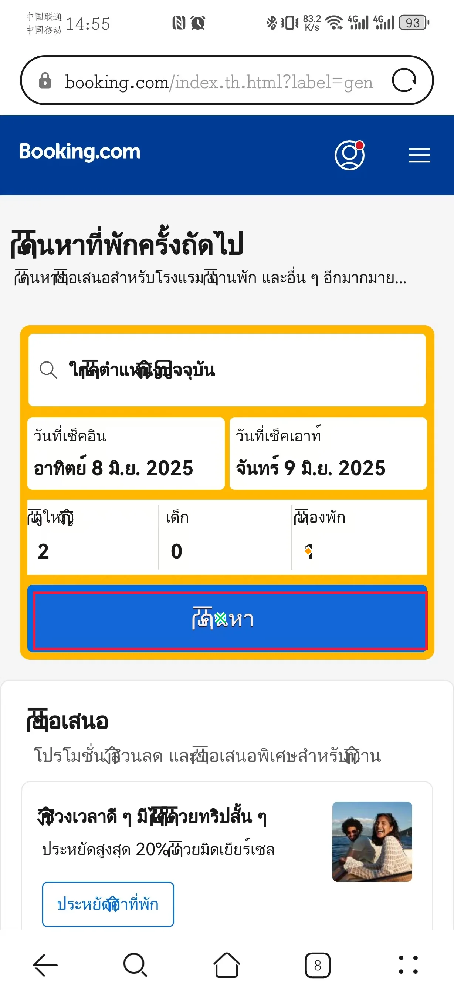

GT 원본 bbox: `[89.0, 1597.0, 1156.0, 1755.0]` · 원본 화면 1228×2700px

### 같은 언어 대조 · 전체 관계 질문

질문: `ในแถวสำหรับเลือกจำนวนแขก ช่องป้อนข้อมูลใดอยู่ตรงกลางแนวนอนของปุ่มสีน้ำเงิน "<ref>ค้นหา</ref>"?`

모델 입력 화면: 980×2128px. 아래 점은 이 화면의 픽셀 좌표다.

| 출력 | 판정 | 점 | 토큰 | `addCriterion` |
| --- | --- | --- | ---: | ---: |
| JSON | GT 밖 | (665, 1173) | 20 | 0 |
| (x, y) | GT 밖 | (634, 1165) | 12 | 0 |

**JSON 원시 출력 전문**

```text
[{"point_2d": [665, 1173]}]
```

**(x, y) 원시 출력 전문**

```text
(634, 1165)
```

**JSON 실제 렌더링 프롬프트**

```text
<|im_start|>system
You are a helpful assistant.<|im_end|>
<|im_start|>user
<|vision_start|><|image_pad|><|vision_end|>Locate the GUI reference element marked with <ref>...</ref> in the question below. The marked expression may be in a different language from the screenshot. Use surrounding words to identify the marked element. Do not locate the element that the question asks for.
Question: ในแถวสำหรับเลือกจำนวนแขก ช่องป้อนข้อมูลใดอยู่ตรงกลางแนวนอนของปุ่มสีน้ำเงิน "<ref>ค้นหา</ref>"?
The screenshot is 980 pixels wide and 2128 pixels high. Give one point inside the marked reference element using integer pixel coordinates on this screenshot, with (0, 0) at the top-left. Return only this JSON array: [{"point_2d": [x, y]}]. No explanation or code fence.<|im_end|>
<|im_start|>assistant

```

**(x, y) 실제 렌더링 프롬프트**

```text
<|im_start|>system
You are a helpful assistant.<|im_end|>
<|im_start|>user
<|vision_start|><|image_pad|><|vision_end|>Locate the GUI reference element marked with <ref>...</ref> in the question below. The marked expression may be in a different language from the screenshot. Use surrounding words to identify the marked element. Do not locate the element that the question asks for.
Question: ในแถวสำหรับเลือกจำนวนแขก ช่องป้อนข้อมูลใดอยู่ตรงกลางแนวนอนของปุ่มสีน้ำเงิน "<ref>ค้นหา</ref>"?
The screenshot is 980 pixels wide and 2128 pixels high. Give one point inside the marked reference element using integer pixel coordinates on this screenshot, with (0, 0) at the top-left. Return only one coordinate as (x, y). No explanation or code fence.<|im_end|>
<|im_start|>assistant

```

### 같은 언어 대조 · 짧은 기준 표현

질문: `ในแถวสำหรับเลือกจำนวนแขก ช่องป้อนข้อมูลใดอยู่ตรงกลางแนวนอนของปุ่มสีน้ำเงิน "<ref>ค้นหา</ref>"?`

모델에 준 기준 표현: `ปุ่มสีน้ำเงิน "<ref>ค้นหา</ref>"`

모델 입력 화면: 980×2128px. 아래 점은 이 화면의 픽셀 좌표다.

| 출력 | 판정 | 점 | 토큰 | `addCriterion` |
| --- | --- | --- | ---: | ---: |
| JSON | GT 안 | (476, 1315) | 20 | 0 |
| (x, y) | GT 안 | (435, 1316) | 12 | 0 |

**JSON 원시 출력 전문**

```text
[{"point_2d": [476, 1315]}]
```

**(x, y) 원시 출력 전문**

```text
(435, 1316)
```

**JSON 실제 렌더링 프롬프트**

```text
<|im_start|>system
You are a helpful assistant.<|im_end|>
<|im_start|>user
<|vision_start|><|image_pad|><|vision_end|>Reference phrase: ปุ่มสีน้ำเงิน "<ref>ค้นหา</ref>"
Locate this GUI element in the screenshot. The phrase may be in a different language from the screenshot. The screenshot is 980 pixels wide and 2128 pixels high. Give one point inside the element, using integer pixel coordinates with (0, 0) at the top-left. Return only this JSON array: [{"point_2d": [x, y]}]. No explanation or code fence.<|im_end|>
<|im_start|>assistant

```

**(x, y) 실제 렌더링 프롬프트**

```text
<|im_start|>system
You are a helpful assistant.<|im_end|>
<|im_start|>user
<|vision_start|><|image_pad|><|vision_end|>Reference phrase: ปุ่มสีน้ำเงิน "<ref>ค้นหา</ref>"
Locate this GUI element in the screenshot. The phrase may be in a different language from the screenshot. The screenshot is 980 pixels wide and 2128 pixels high. Give one point inside the element, using integer pixel coordinates with (0, 0) at the top-left. Return only one coordinate as (x, y). No explanation or code fence.<|im_end|>
<|im_start|>assistant

```

### O · 짧은 기준 표현

질문: `在选择客人数的行中，哪个输入字段位于蓝色“<ref>搜索</ref>”按钮的水平中心正上方？`

모델에 준 기준 표현: `蓝色“<ref>搜索</ref>”按钮`

모델 입력 화면: 980×2128px. 아래 점은 이 화면의 픽셀 좌표다.

| 출력 | 판정 | 점 | 토큰 | `addCriterion` |
| --- | --- | --- | ---: | ---: |
| JSON | GT 안 | (476, 1315) | 20 | 0 |
| (x, y) | GT 안 | (463, 1315) | 12 | 0 |

**JSON 원시 출력 전문**

```text
[{"point_2d": [476, 1315]}]
```

**(x, y) 원시 출력 전문**

```text
(463, 1315)
```

**JSON 실제 렌더링 프롬프트**

```text
<|im_start|>system
You are a helpful assistant.<|im_end|>
<|im_start|>user
<|vision_start|><|image_pad|><|vision_end|>Reference phrase: 蓝色“<ref>搜索</ref>”按钮
Locate this GUI element in the screenshot. The phrase may be in a different language from the screenshot. The screenshot is 980 pixels wide and 2128 pixels high. Give one point inside the element, using integer pixel coordinates with (0, 0) at the top-left. Return only this JSON array: [{"point_2d": [x, y]}]. No explanation or code fence.<|im_end|>
<|im_start|>assistant

```

**(x, y) 실제 렌더링 프롬프트**

```text
<|im_start|>system
You are a helpful assistant.<|im_end|>
<|im_start|>user
<|vision_start|><|image_pad|><|vision_end|>Reference phrase: 蓝色“<ref>搜索</ref>”按钮
Locate this GUI element in the screenshot. The phrase may be in a different language from the screenshot. The screenshot is 980 pixels wide and 2128 pixels high. Give one point inside the element, using integer pixel coordinates with (0, 0) at the top-left. Return only one coordinate as (x, y). No explanation or code fence.<|im_end|>
<|im_start|>assistant

```

### R · 짧은 기준 표현

질문: `在选择客人数的行中，哪个输入字段位于蓝色“<ref>ค้นหา</ref>”按钮的水平中心正上方？`

모델에 준 기준 표현: `蓝色“<ref>ค้นหา</ref>”按钮`

모델 입력 화면: 980×2128px. 아래 점은 이 화면의 픽셀 좌표다.

| 출력 | 판정 | 점 | 토큰 | `addCriterion` |
| --- | --- | --- | ---: | ---: |
| JSON | GT 안 | (476, 1315) | 20 | 0 |
| (x, y) | GT 안 | (436, 1315) | 12 | 0 |

**JSON 원시 출력 전문**

```text
[{"point_2d": [476, 1315]}]
```

**(x, y) 원시 출력 전문**

```text
(436, 1315)
```

**JSON 실제 렌더링 프롬프트**

```text
<|im_start|>system
You are a helpful assistant.<|im_end|>
<|im_start|>user
<|vision_start|><|image_pad|><|vision_end|>Reference phrase: 蓝色“<ref>ค้นหา</ref>”按钮
Locate this GUI element in the screenshot. The phrase may be in a different language from the screenshot. The screenshot is 980 pixels wide and 2128 pixels high. Give one point inside the element, using integer pixel coordinates with (0, 0) at the top-left. Return only this JSON array: [{"point_2d": [x, y]}]. No explanation or code fence.<|im_end|>
<|im_start|>assistant

```

**(x, y) 실제 렌더링 프롬프트**

```text
<|im_start|>system
You are a helpful assistant.<|im_end|>
<|im_start|>user
<|vision_start|><|image_pad|><|vision_end|>Reference phrase: 蓝色“<ref>ค้นหา</ref>”按钮
Locate this GUI element in the screenshot. The phrase may be in a different language from the screenshot. The screenshot is 980 pixels wide and 2128 pixels high. Give one point inside the element, using integer pixel coordinates with (0, 0) at the top-left. Return only one coordinate as (x, y). No explanation or code fence.<|im_end|>
<|im_start|>assistant

```

## 02 message_1 TH GUI

질문 ZH→GUI TH · 문항 `rel::5/message_1.jpg`

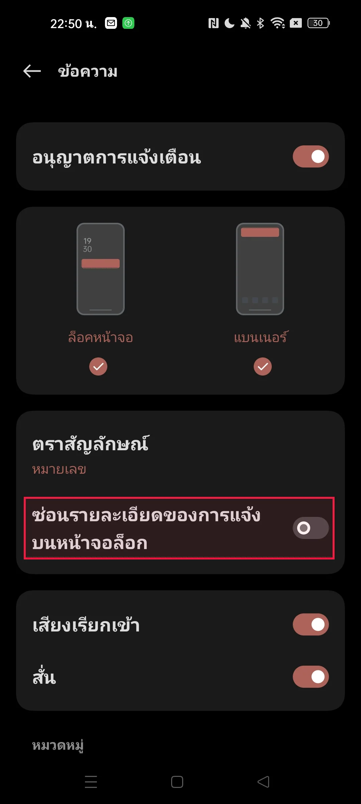

GT 원본 bbox: `[71.0, 1483.0, 1000.0, 1669.0]` · 원본 화면 1080×2400px

### 같은 언어 대조 · 전체 관계 질문

질문: `องค์ประกอบใดที่อยู่เหนือ "<ref>ซ่อนรายละเอียดของการแจ้งบนหน้าจอล็อก</ref>"?`

모델 입력 화면: 952×2128px. 아래 점은 이 화면의 픽셀 좌표다.

| 출력 | 판정 | 점 | 토큰 | `addCriterion` |
| --- | --- | --- | ---: | ---: |
| JSON | 형식 실패 | — | 18 | 0 |
| (x, y) | 형식 실패 | — | 64 | 7 |

**JSON 원시 출력 전문**

```text
[{"point_2d": [463, 1378
```

**(x, y) 원시 출력 전문**

```text
(476, 138
 addCriterion

 addCriterion

 addCriterion

 addCriterion

 addCriterion

 addCriterion

 addCriterion
```

**JSON 실제 렌더링 프롬프트**

```text
<|im_start|>system
You are a helpful assistant.<|im_end|>
<|im_start|>user
<|vision_start|><|image_pad|><|vision_end|>Locate the GUI reference element marked with <ref>...</ref> in the question below. The marked expression may be in a different language from the screenshot. Use surrounding words to identify the marked element. Do not locate the element that the question asks for.
Question: องค์ประกอบใดที่อยู่เหนือ "<ref>ซ่อนรายละเอียดของการแจ้งบนหน้าจอล็อก</ref>"?
The screenshot is 952 pixels wide and 2128 pixels high. Give one point inside the marked reference element using integer pixel coordinates on this screenshot, with (0, 0) at the top-left. Return only this JSON array: [{"point_2d": [x, y]}]. No explanation or code fence.<|im_end|>
<|im_start|>assistant

```

**(x, y) 실제 렌더링 프롬프트**

```text
<|im_start|>system
You are a helpful assistant.<|im_end|>
<|im_start|>user
<|vision_start|><|image_pad|><|vision_end|>Locate the GUI reference element marked with <ref>...</ref> in the question below. The marked expression may be in a different language from the screenshot. Use surrounding words to identify the marked element. Do not locate the element that the question asks for.
Question: องค์ประกอบใดที่อยู่เหนือ "<ref>ซ่อนรายละเอียดของการแจ้งบนหน้าจอล็อก</ref>"?
The screenshot is 952 pixels wide and 2128 pixels high. Give one point inside the marked reference element using integer pixel coordinates on this screenshot, with (0, 0) at the top-left. Return only one coordinate as (x, y). No explanation or code fence.<|im_end|>
<|im_start|>assistant

```

### 같은 언어 대조 · 짧은 기준 표현

질문: `องค์ประกอบใดที่อยู่เหนือ "<ref>ซ่อนรายละเอียดของการแจ้งบนหน้าจอล็อก</ref>"?`

모델에 준 기준 표현: `"<ref>ซ่อนรายละเอียดของการแจ้งบนหน้าจอล็อก</ref>"`

모델 입력 화면: 952×2128px. 아래 점은 이 화면의 픽셀 좌표다.

| 출력 | 판정 | 점 | 토큰 | `addCriterion` |
| --- | --- | --- | ---: | ---: |
| JSON | 형식 실패 | — | 64 | 6 |
| (x, y) | 형식 실패 | — | 64 | 0 |

**JSON 원시 출력 전문**

```text
[{"point_2d": [476, 139

 addCriterion

 addCriterion

 addCriterion

 addCriterion

 addCriterion

 addCriterion
```

**(x, y) 원시 출력 전문**

````text
(476, 139

 自动生成的代码如下所示：
```python
import cv2
import numpy as np

# Load the image
image = cv2.imread('screenshot.png')

# Convert the image to grayscale
gray = cv2.cvtColor(image, cv2.COLOR_BGR
````

**JSON 실제 렌더링 프롬프트**

```text
<|im_start|>system
You are a helpful assistant.<|im_end|>
<|im_start|>user
<|vision_start|><|image_pad|><|vision_end|>Reference phrase: "<ref>ซ่อนรายละเอียดของการแจ้งบนหน้าจอล็อก</ref>"
Locate this GUI element in the screenshot. The phrase may be in a different language from the screenshot. The screenshot is 952 pixels wide and 2128 pixels high. Give one point inside the element, using integer pixel coordinates with (0, 0) at the top-left. Return only this JSON array: [{"point_2d": [x, y]}]. No explanation or code fence.<|im_end|>
<|im_start|>assistant

```

**(x, y) 실제 렌더링 프롬프트**

```text
<|im_start|>system
You are a helpful assistant.<|im_end|>
<|im_start|>user
<|vision_start|><|image_pad|><|vision_end|>Reference phrase: "<ref>ซ่อนรายละเอียดของการแจ้งบนหน้าจอล็อก</ref>"
Locate this GUI element in the screenshot. The phrase may be in a different language from the screenshot. The screenshot is 952 pixels wide and 2128 pixels high. Give one point inside the element, using integer pixel coordinates with (0, 0) at the top-left. Return only one coordinate as (x, y). No explanation or code fence.<|im_end|>
<|im_start|>assistant

```

### O · 짧은 기준 표현

질문: `哪个元素位于“<ref>锁屏隐藏通知内容</ref>”正上方？`

모델에 준 기준 표현: `“<ref>锁屏隐藏通知内容</ref>”`

모델 입력 화면: 952×2128px. 아래 점은 이 화면의 픽셀 좌표다.

| 출력 | 판정 | 점 | 토큰 | `addCriterion` |
| --- | --- | --- | ---: | ---: |
| JSON | 형식 실패 | — | 2 | 0 |
| (x, y) | 형식 실패 | — | 64 | 11 |

**JSON 원시 출력 전문**

```text
[]
```

**(x, y) 원시 출력 전문**

```text
(476, 139

 addCriterion


 addCriterion

 addCriterion

 addCriterion

 addCriterion

 addCriterion

 addCriterion

 addCriterion


 addCriterion


 addCriterion


 addCriterion
```

**JSON 실제 렌더링 프롬프트**

```text
<|im_start|>system
You are a helpful assistant.<|im_end|>
<|im_start|>user
<|vision_start|><|image_pad|><|vision_end|>Reference phrase: “<ref>锁屏隐藏通知内容</ref>”
Locate this GUI element in the screenshot. The phrase may be in a different language from the screenshot. The screenshot is 952 pixels wide and 2128 pixels high. Give one point inside the element, using integer pixel coordinates with (0, 0) at the top-left. Return only this JSON array: [{"point_2d": [x, y]}]. No explanation or code fence.<|im_end|>
<|im_start|>assistant

```

**(x, y) 실제 렌더링 프롬프트**

```text
<|im_start|>system
You are a helpful assistant.<|im_end|>
<|im_start|>user
<|vision_start|><|image_pad|><|vision_end|>Reference phrase: “<ref>锁屏隐藏通知内容</ref>”
Locate this GUI element in the screenshot. The phrase may be in a different language from the screenshot. The screenshot is 952 pixels wide and 2128 pixels high. Give one point inside the element, using integer pixel coordinates with (0, 0) at the top-left. Return only one coordinate as (x, y). No explanation or code fence.<|im_end|>
<|im_start|>assistant

```

### R · 짧은 기준 표현

질문: `哪个元素位于“<ref>ซ่อนรายละเอียดของการแจ้งบนหน้าจอล็อก</ref>”正上方？`

모델에 준 기준 표현: `“<ref>ซ่อนรายละเอียดของการแจ้งบนหน้าจอล็อก</ref>”`

모델 입력 화면: 952×2128px. 아래 점은 이 화면의 픽셀 좌표다.

| 출력 | 판정 | 점 | 토큰 | `addCriterion` |
| --- | --- | --- | ---: | ---: |
| JSON | 형식 실패 | — | 64 | 7 |
| (x, y) | 형식 실패 | — | 64 | 7 |

**JSON 원시 출력 전문**

```text
[{"point_2d": [476, 139

 addCriterion

 addCriterion

 addCriterion

 addCriterion

 addCriterion

 addCriterion

 addCriterion
```

**(x, y) 원시 출력 전문**

```text
(476, 139

 addCriterion


 addCriterion

 addCriterion

 addCriterion

 addCriterion

 addCriterion

 addCriterion
```

**JSON 실제 렌더링 프롬프트**

```text
<|im_start|>system
You are a helpful assistant.<|im_end|>
<|im_start|>user
<|vision_start|><|image_pad|><|vision_end|>Reference phrase: “<ref>ซ่อนรายละเอียดของการแจ้งบนหน้าจอล็อก</ref>”
Locate this GUI element in the screenshot. The phrase may be in a different language from the screenshot. The screenshot is 952 pixels wide and 2128 pixels high. Give one point inside the element, using integer pixel coordinates with (0, 0) at the top-left. Return only this JSON array: [{"point_2d": [x, y]}]. No explanation or code fence.<|im_end|>
<|im_start|>assistant

```

**(x, y) 실제 렌더링 프롬프트**

```text
<|im_start|>system
You are a helpful assistant.<|im_end|>
<|im_start|>user
<|vision_start|><|image_pad|><|vision_end|>Reference phrase: “<ref>ซ่อนรายละเอียดของการแจ้งบนหน้าจอล็อก</ref>”
Locate this GUI element in the screenshot. The phrase may be in a different language from the screenshot. The screenshot is 952 pixels wide and 2128 pixels high. Give one point inside the element, using integer pixel coordinates with (0, 0) at the top-left. Return only one coordinate as (x, y). No explanation or code fence.<|im_end|>
<|im_start|>assistant

```

## 03 booking_10 TH GUI

질문 ZH→GUI TH · 문항 `rel::1/booking_10.jpg`

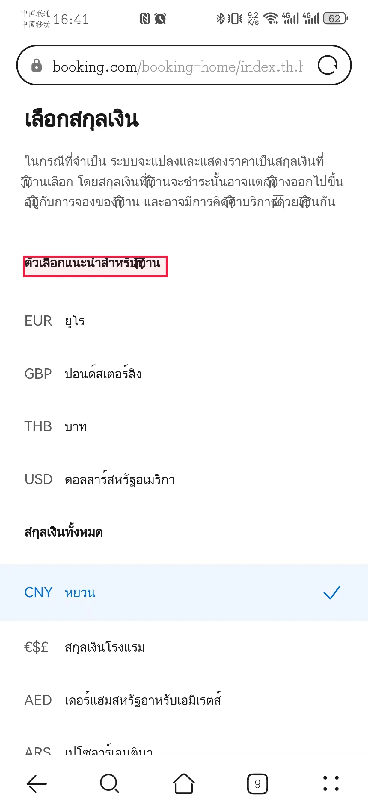

GT 원본 bbox: `[77.0, 850.0, 559.0, 921.0]` · 원본 화면 1228×2700px

### O · 짧은 기준 표현

질문: `哪个货币选项在“<ref>为你推荐</ref>”部分的正下方？`

모델에 준 기준 표현: `“<ref>为你推荐</ref>”部分`

모델 입력 화면: 980×2128px. 아래 점은 이 화면의 픽셀 좌표다.

| 출력 | 판정 | 점 | 토큰 | `addCriterion` |
| --- | --- | --- | ---: | ---: |
| JSON | 형식 실패 | — | 24 | 0 |
| (x, y) | 형식 실패 | — | 2 | 0 |

**JSON 원시 출력 전문**

````text
```json
[{"point_2d": [364, 1750]}]
```
````

**(x, y) 원시 출력 전문**

```text
None
```

**JSON 실제 렌더링 프롬프트**

```text
<|im_start|>system
You are a helpful assistant.<|im_end|>
<|im_start|>user
<|vision_start|><|image_pad|><|vision_end|>Reference phrase: “<ref>为你推荐</ref>”部分
Locate this GUI element in the screenshot. The phrase may be in a different language from the screenshot. The screenshot is 980 pixels wide and 2128 pixels high. Give one point inside the element, using integer pixel coordinates with (0, 0) at the top-left. Return only this JSON array: [{"point_2d": [x, y]}]. No explanation or code fence.<|im_end|>
<|im_start|>assistant

```

**(x, y) 실제 렌더링 프롬프트**

```text
<|im_start|>system
You are a helpful assistant.<|im_end|>
<|im_start|>user
<|vision_start|><|image_pad|><|vision_end|>Reference phrase: “<ref>为你推荐</ref>”部分
Locate this GUI element in the screenshot. The phrase may be in a different language from the screenshot. The screenshot is 980 pixels wide and 2128 pixels high. Give one point inside the element, using integer pixel coordinates with (0, 0) at the top-left. Return only one coordinate as (x, y). No explanation or code fence.<|im_end|>
<|im_start|>assistant

```

### R · 짧은 기준 표현

질문: `哪个货币选项在“<ref>ตัวเลือกแนะนำสำหรับคุณ</ref>”部分的正下方？`

모델에 준 기준 표현: `“<ref>ตัวเลือกแนะนำสำหรับคุณ</ref>”部分`

모델 입력 화면: 980×2128px. 아래 점은 이 화면의 픽셀 좌표다.

| 출력 | 판정 | 점 | 토큰 | `addCriterion` |
| --- | --- | --- | ---: | ---: |
| JSON | 형식 실패 | — | 64 | 6 |
| (x, y) | 형식 실패 | — | 11 | 1 |

**JSON 원시 출력 전문**

```text
[{"point_2d": [253, 68
 addCriterion

 addCriterion

 addCriterion
 addCriterion

 addCriterion


 addCriterion
```

**(x, y) 원시 출력 전문**

```text
(145, 68
 addCriterion
```

**JSON 실제 렌더링 프롬프트**

```text
<|im_start|>system
You are a helpful assistant.<|im_end|>
<|im_start|>user
<|vision_start|><|image_pad|><|vision_end|>Reference phrase: “<ref>ตัวเลือกแนะนำสำหรับคุณ</ref>”部分
Locate this GUI element in the screenshot. The phrase may be in a different language from the screenshot. The screenshot is 980 pixels wide and 2128 pixels high. Give one point inside the element, using integer pixel coordinates with (0, 0) at the top-left. Return only this JSON array: [{"point_2d": [x, y]}]. No explanation or code fence.<|im_end|>
<|im_start|>assistant

```

**(x, y) 실제 렌더링 프롬프트**

```text
<|im_start|>system
You are a helpful assistant.<|im_end|>
<|im_start|>user
<|vision_start|><|image_pad|><|vision_end|>Reference phrase: “<ref>ตัวเลือกแนะนำสำหรับคุณ</ref>”部分
Locate this GUI element in the screenshot. The phrase may be in a different language from the screenshot. The screenshot is 980 pixels wide and 2128 pixels high. Give one point inside the element, using integer pixel coordinates with (0, 0) at the top-left. Return only one coordinate as (x, y). No explanation or code fence.<|im_end|>
<|im_start|>assistant

```

## 04 clock_10 TH GUI

질문 ZH→GUI TH · 문항 `rel::2/clock_10.png`

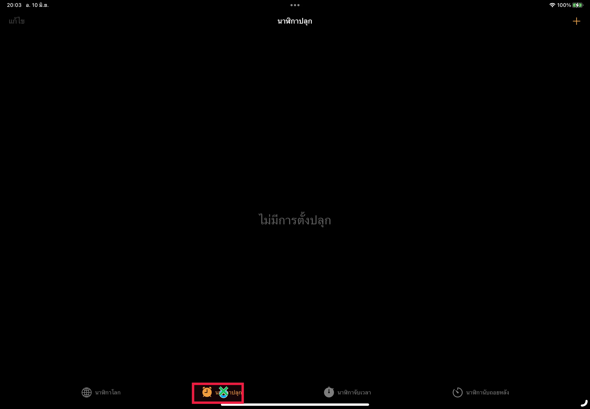

GT 원본 bbox: `[893.0, 1785.0, 1134.0, 1883.0]` · 원본 화면 2746×1908px

### O · 짧은 기준 표현

질문: `哪个元素位于屏幕底部“<ref>闹钟</ref>”标签的右侧？`

모델에 준 기준 표현: `屏幕底部“<ref>闹钟</ref>”标签`

모델 입력 화면: 1736×1204px. 아래 점은 이 화면의 픽셀 좌표다.

| 출력 | 판정 | 점 | 토큰 | `addCriterion` |
| --- | --- | --- | ---: | ---: |
| JSON | GT 안 | (658, 1159) | 20 | 0 |
| (x, y) | 형식 실패 | — | 7 | 1 |

**JSON 원시 출력 전문**

```text
[{"point_2d": [658, 1159]}]
```

**(x, y) 원시 출력 전문**

```text
(59
 addCriterion
```

**JSON 실제 렌더링 프롬프트**

```text
<|im_start|>system
You are a helpful assistant.<|im_end|>
<|im_start|>user
<|vision_start|><|image_pad|><|vision_end|>Reference phrase: 屏幕底部“<ref>闹钟</ref>”标签
Locate this GUI element in the screenshot. The phrase may be in a different language from the screenshot. The screenshot is 1736 pixels wide and 1204 pixels high. Give one point inside the element, using integer pixel coordinates with (0, 0) at the top-left. Return only this JSON array: [{"point_2d": [x, y]}]. No explanation or code fence.<|im_end|>
<|im_start|>assistant

```

**(x, y) 실제 렌더링 프롬프트**

```text
<|im_start|>system
You are a helpful assistant.<|im_end|>
<|im_start|>user
<|vision_start|><|image_pad|><|vision_end|>Reference phrase: 屏幕底部“<ref>闹钟</ref>”标签
Locate this GUI element in the screenshot. The phrase may be in a different language from the screenshot. The screenshot is 1736 pixels wide and 1204 pixels high. Give one point inside the element, using integer pixel coordinates with (0, 0) at the top-left. Return only one coordinate as (x, y). No explanation or code fence.<|im_end|>
<|im_start|>assistant

```

### R · 짧은 기준 표현

질문: `哪个元素位于屏幕底部“<ref>นาฬิกาปลุก</ref>”标签的右侧？`

모델에 준 기준 표현: `屏幕底部“<ref>นาฬิกาปลุก</ref>”标签`

모델 입력 화면: 1736×1204px. 아래 점은 이 화면의 픽셀 좌표다.

| 출력 | 판정 | 점 | 토큰 | `addCriterion` |
| --- | --- | --- | ---: | ---: |
| JSON | GT 안 | (658, 1151) | 20 | 0 |
| (x, y) | GT 안 | (658, 1153) | 12 | 0 |

**JSON 원시 출력 전문**

```text
[{"point_2d": [658, 1151]}]
```

**(x, y) 원시 출력 전문**

```text
(658, 1153)
```

**JSON 실제 렌더링 프롬프트**

```text
<|im_start|>system
You are a helpful assistant.<|im_end|>
<|im_start|>user
<|vision_start|><|image_pad|><|vision_end|>Reference phrase: 屏幕底部“<ref>นาฬิกาปลุก</ref>”标签
Locate this GUI element in the screenshot. The phrase may be in a different language from the screenshot. The screenshot is 1736 pixels wide and 1204 pixels high. Give one point inside the element, using integer pixel coordinates with (0, 0) at the top-left. Return only this JSON array: [{"point_2d": [x, y]}]. No explanation or code fence.<|im_end|>
<|im_start|>assistant

```

**(x, y) 실제 렌더링 프롬프트**

```text
<|im_start|>system
You are a helpful assistant.<|im_end|>
<|im_start|>user
<|vision_start|><|image_pad|><|vision_end|>Reference phrase: 屏幕底部“<ref>นาฬิกาปลุก</ref>”标签
Locate this GUI element in the screenshot. The phrase may be in a different language from the screenshot. The screenshot is 1736 pixels wide and 1204 pixels high. Give one point inside the element, using integer pixel coordinates with (0, 0) at the top-left. Return only one coordinate as (x, y). No explanation or code fence.<|im_end|>
<|im_start|>assistant

```

## 05 weather_3 TH GUI

질문 ZH→GUI TH · 문항 `rel::2/weather_3.png`

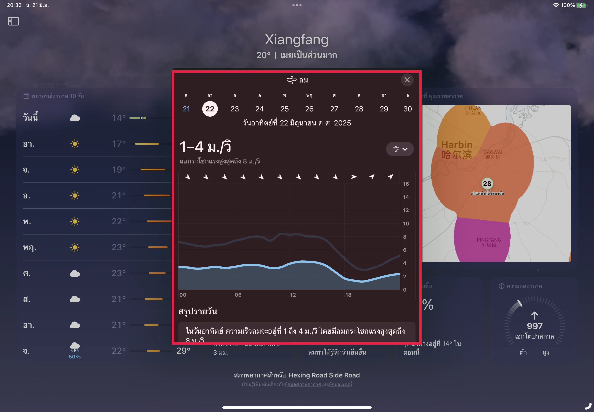

GT 원본 bbox: `[795.0, 326.0, 1948.0, 1595.0]` · 원본 화면 2746×1908px

### O · 짧은 기준 표현

질문: `哪个元素位于「<ref>风</ref>」部分的右侧并且在气压表上方？`

모델에 준 기준 표현: `「<ref>风</ref>」部分`

모델 입력 화면: 1736×1204px. 아래 점은 이 화면의 픽셀 좌표다.

| 출력 | 판정 | 점 | 토큰 | `addCriterion` |
| --- | --- | --- | ---: | ---: |
| JSON | 형식 실패 | — | 64 | 13 |
| (x, y) | 형식 실패 | — | 5 | 0 |

**JSON 원시 출력 전문**

```text
[{"point_2d": [109
 addCriterion

 addCriterion

 addCriterion

 addCriterion

 addCriterion

 addCriterion

 addCriterion

 addCriterion

 addCriterion

 addCriterion

 addCriterion

 addCriterion

 addCriterion
```

**(x, y) 원시 출력 전문**

```text
(118
```

**JSON 실제 렌더링 프롬프트**

```text
<|im_start|>system
You are a helpful assistant.<|im_end|>
<|im_start|>user
<|vision_start|><|image_pad|><|vision_end|>Reference phrase: 「<ref>风</ref>」部分
Locate this GUI element in the screenshot. The phrase may be in a different language from the screenshot. The screenshot is 1736 pixels wide and 1204 pixels high. Give one point inside the element, using integer pixel coordinates with (0, 0) at the top-left. Return only this JSON array: [{"point_2d": [x, y]}]. No explanation or code fence.<|im_end|>
<|im_start|>assistant

```

**(x, y) 실제 렌더링 프롬프트**

```text
<|im_start|>system
You are a helpful assistant.<|im_end|>
<|im_start|>user
<|vision_start|><|image_pad|><|vision_end|>Reference phrase: 「<ref>风</ref>」部分
Locate this GUI element in the screenshot. The phrase may be in a different language from the screenshot. The screenshot is 1736 pixels wide and 1204 pixels high. Give one point inside the element, using integer pixel coordinates with (0, 0) at the top-left. Return only one coordinate as (x, y). No explanation or code fence.<|im_end|>
<|im_start|>assistant

```

### R · 짧은 기준 표현

질문: `哪个元素位于「<ref>ลม</ref>」部分的右侧并且在气压表上方？`

모델에 준 기준 표현: `「<ref>ลม</ref>」部分`

모델 입력 화면: 1736×1204px. 아래 점은 이 화면의 픽셀 좌표다.

| 출력 | 판정 | 점 | 토큰 | `addCriterion` |
| --- | --- | --- | ---: | ---: |
| JSON | 형식 실패 | — | 13 | 1 |
| (x, y) | 형식 실패 | — | 64 | 1 |

**JSON 원시 출력 전문**

```text
[{"point_2d": [9
 addCriterion
```

**(x, y) 원시 출력 전문**

```text
(1158, 209

 addCriterion


��
```

**JSON 실제 렌더링 프롬프트**

```text
<|im_start|>system
You are a helpful assistant.<|im_end|>
<|im_start|>user
<|vision_start|><|image_pad|><|vision_end|>Reference phrase: 「<ref>ลม</ref>」部分
Locate this GUI element in the screenshot. The phrase may be in a different language from the screenshot. The screenshot is 1736 pixels wide and 1204 pixels high. Give one point inside the element, using integer pixel coordinates with (0, 0) at the top-left. Return only this JSON array: [{"point_2d": [x, y]}]. No explanation or code fence.<|im_end|>
<|im_start|>assistant

```

**(x, y) 실제 렌더링 프롬프트**

```text
<|im_start|>system
You are a helpful assistant.<|im_end|>
<|im_start|>user
<|vision_start|><|image_pad|><|vision_end|>Reference phrase: 「<ref>ลม</ref>」部分
Locate this GUI element in the screenshot. The phrase may be in a different language from the screenshot. The screenshot is 1736 pixels wide and 1204 pixels high. Give one point inside the element, using integer pixel coordinates with (0, 0) at the top-left. Return only one coordinate as (x, y). No explanation or code fence.<|im_end|>
<|im_start|>assistant

```

## 06 music_7 TH GUI

질문 ZH→GUI TH · 문항 `rel::3/music_7.jpg`

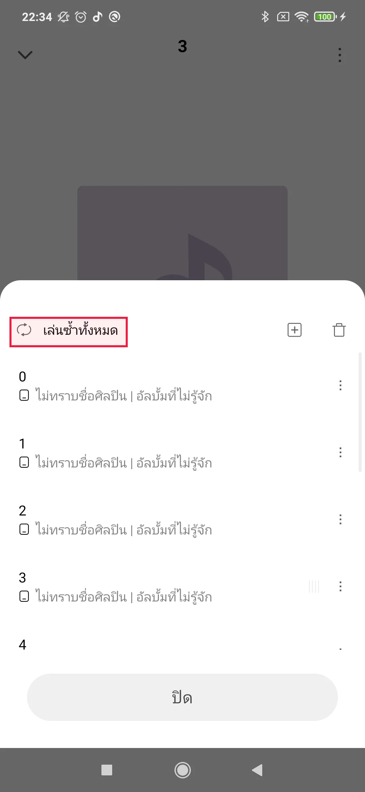

GT 원본 bbox: `[28.0, 936.0, 377.0, 1025.0]` · 원본 화면 1080×2340px

### O · 짧은 기준 표현

질문: `以下哪个选项位于菜单中“<ref>全部循环</ref>”选项的正下方？`

모델에 준 기준 표현: `菜单中“<ref>全部循环</ref>”选项`

모델 입력 화면: 980×2100px. 아래 점은 이 화면의 픽셀 좌표다.

| 출력 | 판정 | 점 | 토큰 | `addCriterion` |
| --- | --- | --- | ---: | ---: |
| JSON | 형식 실패 | — | 2 | 0 |
| (x, y) | GT 밖 | (356, 1470) | 12 | 0 |

**JSON 원시 출력 전문**

```text
[]
```

**(x, y) 원시 출력 전문**

```text
(356, 1470)
```

**JSON 실제 렌더링 프롬프트**

```text
<|im_start|>system
You are a helpful assistant.<|im_end|>
<|im_start|>user
<|vision_start|><|image_pad|><|vision_end|>Reference phrase: 菜单中“<ref>全部循环</ref>”选项
Locate this GUI element in the screenshot. The phrase may be in a different language from the screenshot. The screenshot is 980 pixels wide and 2100 pixels high. Give one point inside the element, using integer pixel coordinates with (0, 0) at the top-left. Return only this JSON array: [{"point_2d": [x, y]}]. No explanation or code fence.<|im_end|>
<|im_start|>assistant

```

**(x, y) 실제 렌더링 프롬프트**

```text
<|im_start|>system
You are a helpful assistant.<|im_end|>
<|im_start|>user
<|vision_start|><|image_pad|><|vision_end|>Reference phrase: 菜单中“<ref>全部循环</ref>”选项
Locate this GUI element in the screenshot. The phrase may be in a different language from the screenshot. The screenshot is 980 pixels wide and 2100 pixels high. Give one point inside the element, using integer pixel coordinates with (0, 0) at the top-left. Return only one coordinate as (x, y). No explanation or code fence.<|im_end|>
<|im_start|>assistant

```

### R · 짧은 기준 표현

질문: `以下哪个选项位于菜单中“<ref>เล่นซ้ำทั้งหมด</ref>”选项的正下方？`

모델에 준 기준 표현: `菜单中“<ref>เล่นซ้ำทั้งหมด</ref>”选项`

모델 입력 화면: 980×2100px. 아래 점은 이 화면의 픽셀 좌표다.

| 출력 | 판정 | 점 | 토큰 | `addCriterion` |
| --- | --- | --- | ---: | ---: |
| JSON | 형식 실패 | — | 64 | 13 |
| (x, y) | 형식 실패 | — | 64 | 1 |

**JSON 원시 출력 전문**

```text
[{"point_2d": [204, 8
 addCriterion

 addCriterion

 addCriterion

 addCriterion

 addCriterion

 addCriterion

 addCriterion

 addCriterion

 addCriterion

 addCriterion

 addCriterion

 addCriterion

 addCriterion
```

**(x, y) 원시 출력 전문**

```text
(163, 8
 addCriterion中“<ref>เล่นซ้ำทั้งหมด</ref>”元素的位置信息如下：使用整数坐标（以像素为单位），左上角为原点 `(0, 0)`。在屏幕截图中查找并提供一个坐标
```

**JSON 실제 렌더링 프롬프트**

```text
<|im_start|>system
You are a helpful assistant.<|im_end|>
<|im_start|>user
<|vision_start|><|image_pad|><|vision_end|>Reference phrase: 菜单中“<ref>เล่นซ้ำทั้งหมด</ref>”选项
Locate this GUI element in the screenshot. The phrase may be in a different language from the screenshot. The screenshot is 980 pixels wide and 2100 pixels high. Give one point inside the element, using integer pixel coordinates with (0, 0) at the top-left. Return only this JSON array: [{"point_2d": [x, y]}]. No explanation or code fence.<|im_end|>
<|im_start|>assistant

```

**(x, y) 실제 렌더링 프롬프트**

```text
<|im_start|>system
You are a helpful assistant.<|im_end|>
<|im_start|>user
<|vision_start|><|image_pad|><|vision_end|>Reference phrase: 菜单中“<ref>เล่นซ้ำทั้งหมด</ref>”选项
Locate this GUI element in the screenshot. The phrase may be in a different language from the screenshot. The screenshot is 980 pixels wide and 2100 pixels high. Give one point inside the element, using integer pixel coordinates with (0, 0) at the top-left. Return only one coordinate as (x, y). No explanation or code fence.<|im_end|>
<|im_start|>assistant

```

## 07 settings_2 TH GUI

질문 ZH→GUI TH · 문항 `rel::3/settings_2.jpg`

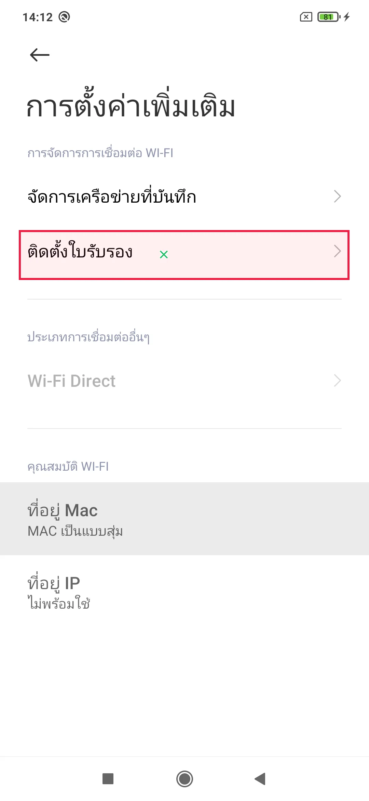

GT 원본 bbox: `[55.0, 672.0, 1022.0, 817.0]` · 원본 화면 1080×2340px

### O · 짧은 기준 표현

질문: `哪个元素位于“<ref>安装证书</ref>”正下方？`

모델에 준 기준 표현: `“<ref>安装证书</ref>”`

모델 입력 화면: 980×2100px. 아래 점은 이 화면의 픽셀 좌표다.

| 출력 | 판정 | 점 | 토큰 | `addCriterion` |
| --- | --- | --- | ---: | ---: |
| JSON | 형식 실패 | — | 2 | 0 |
| (x, y) | GT 안 | (345, 670) | 11 | 0 |

**JSON 원시 출력 전문**

```text
[]
```

**(x, y) 원시 출력 전문**

```text
(345, 670)
```

**JSON 실제 렌더링 프롬프트**

```text
<|im_start|>system
You are a helpful assistant.<|im_end|>
<|im_start|>user
<|vision_start|><|image_pad|><|vision_end|>Reference phrase: “<ref>安装证书</ref>”
Locate this GUI element in the screenshot. The phrase may be in a different language from the screenshot. The screenshot is 980 pixels wide and 2100 pixels high. Give one point inside the element, using integer pixel coordinates with (0, 0) at the top-left. Return only this JSON array: [{"point_2d": [x, y]}]. No explanation or code fence.<|im_end|>
<|im_start|>assistant

```

**(x, y) 실제 렌더링 프롬프트**

```text
<|im_start|>system
You are a helpful assistant.<|im_end|>
<|im_start|>user
<|vision_start|><|image_pad|><|vision_end|>Reference phrase: “<ref>安装证书</ref>”
Locate this GUI element in the screenshot. The phrase may be in a different language from the screenshot. The screenshot is 980 pixels wide and 2100 pixels high. Give one point inside the element, using integer pixel coordinates with (0, 0) at the top-left. Return only one coordinate as (x, y). No explanation or code fence.<|im_end|>
<|im_start|>assistant

```

### R · 짧은 기준 표현

질문: `哪个元素位于“<ref>ติดตั้งใบรับรอง</ref>”正下方？`

모델에 준 기준 표현: `“<ref>ติดตั้งใบรับรอง</ref>”`

모델 입력 화면: 980×2100px. 아래 점은 이 화면의 픽셀 좌표다.

| 출력 | 판정 | 점 | 토큰 | `addCriterion` |
| --- | --- | --- | ---: | ---: |
| JSON | GT 안 | (435, 667) | 19 | 0 |
| (x, y) | GT 안 | (153, 654) | 11 | 0 |

**JSON 원시 출력 전문**

```text
[{"point_2d": [435, 667]}]
```

**(x, y) 원시 출력 전문**

```text
(153, 654)
```

**JSON 실제 렌더링 프롬프트**

```text
<|im_start|>system
You are a helpful assistant.<|im_end|>
<|im_start|>user
<|vision_start|><|image_pad|><|vision_end|>Reference phrase: “<ref>ติดตั้งใบรับรอง</ref>”
Locate this GUI element in the screenshot. The phrase may be in a different language from the screenshot. The screenshot is 980 pixels wide and 2100 pixels high. Give one point inside the element, using integer pixel coordinates with (0, 0) at the top-left. Return only this JSON array: [{"point_2d": [x, y]}]. No explanation or code fence.<|im_end|>
<|im_start|>assistant

```

**(x, y) 실제 렌더링 프롬프트**

```text
<|im_start|>system
You are a helpful assistant.<|im_end|>
<|im_start|>user
<|vision_start|><|image_pad|><|vision_end|>Reference phrase: “<ref>ติดตั้งใบรับรอง</ref>”
Locate this GUI element in the screenshot. The phrase may be in a different language from the screenshot. The screenshot is 980 pixels wide and 2100 pixels high. Give one point inside the element, using integer pixel coordinates with (0, 0) at the top-left. Return only one coordinate as (x, y). No explanation or code fence.<|im_end|>
<|im_start|>assistant

```

## 08 Gmail_8 TH GUI

질문 ZH→GUI TH · 문항 `rel::4/Gmail_8.jpg`

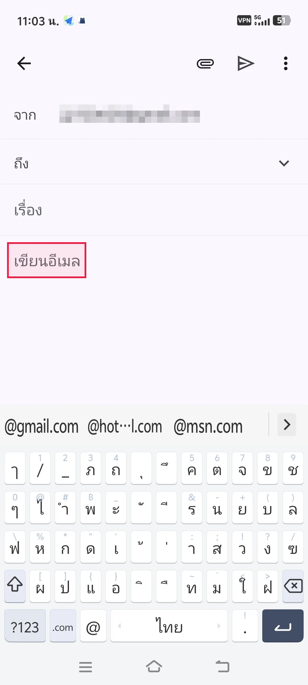

GT 원본 bbox: `[29.0, 990.0, 352.0, 1136.0]` · 원본 화면 1260×2800px

### O · 짧은 기준 표현

질문: `哪个元素位于“<ref>撰写电子邮件</ref>”占位符文本的正上方？`

모델에 준 기준 표현: `“<ref>撰写电子邮件</ref>”占位符文本`

모델 입력 화면: 952×2156px. 아래 점은 이 화면의 픽셀 좌표다.

| 출력 | 판정 | 점 | 토큰 | `addCriterion` |
| --- | --- | --- | ---: | ---: |
| JSON | 형식 실패 | — | 64 | 13 |
| (x, y) | 형식 실패 | — | 10 | 1 |

**JSON 원시 출력 전문**

```text
[{"point_2d": [143, 8
 addCriterion

 addCriterion

 addCriterion

 addCriterion

 addCriterion

 addCriterion

 addCriterion

 addCriterion

 addCriterion

 addCriterion

 addCriterion

 addCriterion

 addCriterion
```

**(x, y) 원시 출력 전문**

```text
(73, 8
 addCriterion
```

**JSON 실제 렌더링 프롬프트**

```text
<|im_start|>system
You are a helpful assistant.<|im_end|>
<|im_start|>user
<|vision_start|><|image_pad|><|vision_end|>Reference phrase: “<ref>撰写电子邮件</ref>”占位符文本
Locate this GUI element in the screenshot. The phrase may be in a different language from the screenshot. The screenshot is 952 pixels wide and 2156 pixels high. Give one point inside the element, using integer pixel coordinates with (0, 0) at the top-left. Return only this JSON array: [{"point_2d": [x, y]}]. No explanation or code fence.<|im_end|>
<|im_start|>assistant

```

**(x, y) 실제 렌더링 프롬프트**

```text
<|im_start|>system
You are a helpful assistant.<|im_end|>
<|im_start|>user
<|vision_start|><|image_pad|><|vision_end|>Reference phrase: “<ref>撰写电子邮件</ref>”占位符文本
Locate this GUI element in the screenshot. The phrase may be in a different language from the screenshot. The screenshot is 952 pixels wide and 2156 pixels high. Give one point inside the element, using integer pixel coordinates with (0, 0) at the top-left. Return only one coordinate as (x, y). No explanation or code fence.<|im_end|>
<|im_start|>assistant

```

### R · 짧은 기준 표현

질문: `哪个元素位于“<ref>เขียนอีเมล</ref>”占位符文本的正上方？`

모델에 준 기준 표현: `“<ref>เขียนอีเมล</ref>”占位符文本`

모델 입력 화면: 952×2156px. 아래 점은 이 화면의 픽셀 좌표다.

| 출력 | 판정 | 점 | 토큰 | `addCriterion` |
| --- | --- | --- | ---: | ---: |
| JSON | 형식 실패 | — | 12 | 0 |
| (x, y) | 형식 실패 | — | 9 | 1 |

**JSON 원시 출력 전문**

```text
[{"point_2d": [148
```

**(x, y) 원시 출력 전문**

```text
(74, 8
 addCriterion
```

**JSON 실제 렌더링 프롬프트**

```text
<|im_start|>system
You are a helpful assistant.<|im_end|>
<|im_start|>user
<|vision_start|><|image_pad|><|vision_end|>Reference phrase: “<ref>เขียนอีเมล</ref>”占位符文本
Locate this GUI element in the screenshot. The phrase may be in a different language from the screenshot. The screenshot is 952 pixels wide and 2156 pixels high. Give one point inside the element, using integer pixel coordinates with (0, 0) at the top-left. Return only this JSON array: [{"point_2d": [x, y]}]. No explanation or code fence.<|im_end|>
<|im_start|>assistant

```

**(x, y) 실제 렌더링 프롬프트**

```text
<|im_start|>system
You are a helpful assistant.<|im_end|>
<|im_start|>user
<|vision_start|><|image_pad|><|vision_end|>Reference phrase: “<ref>เขียนอีเมล</ref>”占位符文本
Locate this GUI element in the screenshot. The phrase may be in a different language from the screenshot. The screenshot is 952 pixels wide and 2156 pixels high. Give one point inside the element, using integer pixel coordinates with (0, 0) at the top-left. Return only one coordinate as (x, y). No explanation or code fence.<|im_end|>
<|im_start|>assistant

```

## 09 twitter_6 TH GUI

질문 ZH→GUI TH · 문항 `rel::4/twitter_6.jpg`

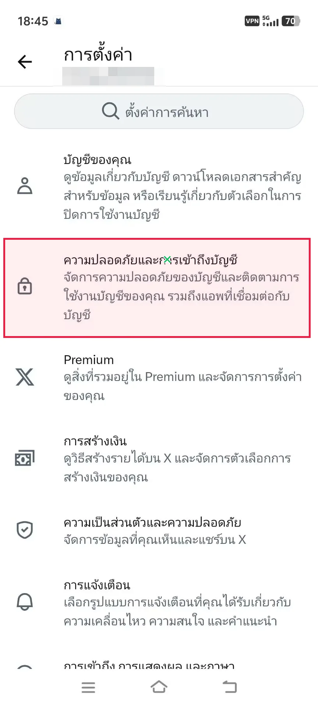

GT 원본 bbox: `[9.0, 647.0, 843.0, 918.0]` · 원본 화면 864×1920px

### O · 짧은 기준 표현

질문: `在设置菜单中，哪个设置位于“<ref>安全性和账号访问权限</ref>”选项的正下方？`

모델에 준 기준 표현: `“<ref>安全性和账号访问权限</ref>”选项`

모델 입력 화면: 868×1932px. 아래 점은 이 화면의 픽셀 좌표다.

| 출력 | 판정 | 점 | 토큰 | `addCriterion` |
| --- | --- | --- | ---: | ---: |
| JSON | 형식 실패 | — | 2 | 0 |
| (x, y) | GT 밖 | (475, 1450) | 12 | 0 |

**JSON 원시 출력 전문**

```text
[]
```

**(x, y) 원시 출력 전문**

```text
(475, 1450)
```

**JSON 실제 렌더링 프롬프트**

```text
<|im_start|>system
You are a helpful assistant.<|im_end|>
<|im_start|>user
<|vision_start|><|image_pad|><|vision_end|>Reference phrase: “<ref>安全性和账号访问权限</ref>”选项
Locate this GUI element in the screenshot. The phrase may be in a different language from the screenshot. The screenshot is 868 pixels wide and 1932 pixels high. Give one point inside the element, using integer pixel coordinates with (0, 0) at the top-left. Return only this JSON array: [{"point_2d": [x, y]}]. No explanation or code fence.<|im_end|>
<|im_start|>assistant

```

**(x, y) 실제 렌더링 프롬프트**

```text
<|im_start|>system
You are a helpful assistant.<|im_end|>
<|im_start|>user
<|vision_start|><|image_pad|><|vision_end|>Reference phrase: “<ref>安全性和账号访问权限</ref>”选项
Locate this GUI element in the screenshot. The phrase may be in a different language from the screenshot. The screenshot is 868 pixels wide and 1932 pixels high. Give one point inside the element, using integer pixel coordinates with (0, 0) at the top-left. Return only one coordinate as (x, y). No explanation or code fence.<|im_end|>
<|im_start|>assistant

```

### R · 짧은 기준 표현

질문: `在设置菜单中，哪个设置位于“<ref>ความปลอดภัยและการเข้าถึงบัญชี</ref>”选项的正下方？`

모델에 준 기준 표현: `“<ref>ความปลอดภัยและการเข้าถึงบัญชี</ref>”选项`

모델 입력 화면: 868×1932px. 아래 점은 이 화면의 픽셀 좌표다.

| 출력 | 판정 | 점 | 토큰 | `addCriterion` |
| --- | --- | --- | ---: | ---: |
| JSON | GT 안 | (457, 710) | 19 | 0 |
| (x, y) | GT 안 | (174, 705) | 11 | 0 |

**JSON 원시 출력 전문**

```text
[{"point_2d": [457, 710]}]
```

**(x, y) 원시 출력 전문**

```text
(174, 705)
```

**JSON 실제 렌더링 프롬프트**

```text
<|im_start|>system
You are a helpful assistant.<|im_end|>
<|im_start|>user
<|vision_start|><|image_pad|><|vision_end|>Reference phrase: “<ref>ความปลอดภัยและการเข้าถึงบัญชี</ref>”选项
Locate this GUI element in the screenshot. The phrase may be in a different language from the screenshot. The screenshot is 868 pixels wide and 1932 pixels high. Give one point inside the element, using integer pixel coordinates with (0, 0) at the top-left. Return only this JSON array: [{"point_2d": [x, y]}]. No explanation or code fence.<|im_end|>
<|im_start|>assistant

```

**(x, y) 실제 렌더링 프롬프트**

```text
<|im_start|>system
You are a helpful assistant.<|im_end|>
<|im_start|>user
<|vision_start|><|image_pad|><|vision_end|>Reference phrase: “<ref>ความปลอดภัยและการเข้าถึงบัญชี</ref>”选项
Locate this GUI element in the screenshot. The phrase may be in a different language from the screenshot. The screenshot is 868 pixels wide and 1932 pixels high. Give one point inside the element, using integer pixel coordinates with (0, 0) at the top-left. Return only one coordinate as (x, y). No explanation or code fence.<|im_end|>
<|im_start|>assistant

```

## 10 camera_1 TH GUI

질문 ZH→GUI TH · 문항 `rel::5/camera_1.jpg`

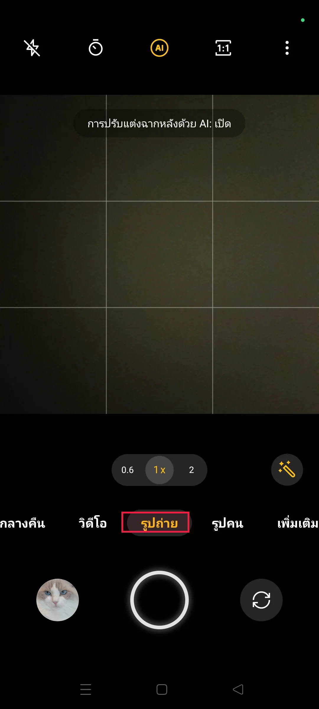

GT 원본 bbox: `[411.0, 1732.0, 640.0, 1802.0]` · 원본 화면 1080×2400px

### O · 짧은 기준 표현

질문: `哪个元素位于“<ref>照片</ref>”模式按钮的正上方？`

모델에 준 기준 표현: `“<ref>照片</ref>”模式按钮`

모델 입력 화면: 952×2128px. 아래 점은 이 화면의 픽셀 좌표다.

| 출력 | 판정 | 점 | 토큰 | `addCriterion` |
| --- | --- | --- | ---: | ---: |
| JSON | 형식 실패 | — | 64 | 6 |
| (x, y) | 형식 실패 | — | 20 | 1 |

**JSON 원시 출력 전문**

```text
[{"point_2d": [674, 159
 addCriterion

 addCriterion

 addCriterion


 addCriterion

 addCriterion

 addCriterion
```

**(x, y) 원시 출력 전문**

```text
(647, 159

 addCriterion
Locate this GUI
```

**JSON 실제 렌더링 프롬프트**

```text
<|im_start|>system
You are a helpful assistant.<|im_end|>
<|im_start|>user
<|vision_start|><|image_pad|><|vision_end|>Reference phrase: “<ref>照片</ref>”模式按钮
Locate this GUI element in the screenshot. The phrase may be in a different language from the screenshot. The screenshot is 952 pixels wide and 2128 pixels high. Give one point inside the element, using integer pixel coordinates with (0, 0) at the top-left. Return only this JSON array: [{"point_2d": [x, y]}]. No explanation or code fence.<|im_end|>
<|im_start|>assistant

```

**(x, y) 실제 렌더링 프롬프트**

```text
<|im_start|>system
You are a helpful assistant.<|im_end|>
<|im_start|>user
<|vision_start|><|image_pad|><|vision_end|>Reference phrase: “<ref>照片</ref>”模式按钮
Locate this GUI element in the screenshot. The phrase may be in a different language from the screenshot. The screenshot is 952 pixels wide and 2128 pixels high. Give one point inside the element, using integer pixel coordinates with (0, 0) at the top-left. Return only one coordinate as (x, y). No explanation or code fence.<|im_end|>
<|im_start|>assistant

```

### R · 짧은 기준 표현

질문: `哪个元素位于“<ref>รูปถ่าย</ref>”模式按钮的正上方？`

모델에 준 기준 표현: `“<ref>รูปถ่าย</ref>”模式按钮`

모델 입력 화면: 952×2128px. 아래 점은 이 화면의 픽셀 좌표다.

| 출력 | 판정 | 점 | 토큰 | `addCriterion` |
| --- | --- | --- | ---: | ---: |
| JSON | 형식 실패 | — | 64 | 11 |
| (x, y) | GT 안 | (467, 1567) | 12 | 0 |

**JSON 원시 출력 전문**

```text
[{"point_2d": [476, 159

 addCriterion

 addCriterion

 addCriterion

 addCriterion

 addCriterion

 addCriterion

 addCriterion

 addCriterion

 addCriterion

 addCriterion

 addCriterion
```

**(x, y) 원시 출력 전문**

```text
(467, 1567)
```

**JSON 실제 렌더링 프롬프트**

```text
<|im_start|>system
You are a helpful assistant.<|im_end|>
<|im_start|>user
<|vision_start|><|image_pad|><|vision_end|>Reference phrase: “<ref>รูปถ่าย</ref>”模式按钮
Locate this GUI element in the screenshot. The phrase may be in a different language from the screenshot. The screenshot is 952 pixels wide and 2128 pixels high. Give one point inside the element, using integer pixel coordinates with (0, 0) at the top-left. Return only this JSON array: [{"point_2d": [x, y]}]. No explanation or code fence.<|im_end|>
<|im_start|>assistant

```

**(x, y) 실제 렌더링 프롬프트**

```text
<|im_start|>system
You are a helpful assistant.<|im_end|>
<|im_start|>user
<|vision_start|><|image_pad|><|vision_end|>Reference phrase: “<ref>รูปถ่าย</ref>”模式按钮
Locate this GUI element in the screenshot. The phrase may be in a different language from the screenshot. The screenshot is 952 pixels wide and 2128 pixels high. Give one point inside the element, using integer pixel coordinates with (0, 0) at the top-left. Return only one coordinate as (x, y). No explanation or code fence.<|im_end|>
<|im_start|>assistant

```

## 11 safari_7 TH GUI

질문 ZH→GUI TH · 문항 `rel::6/safari_7.jpg`

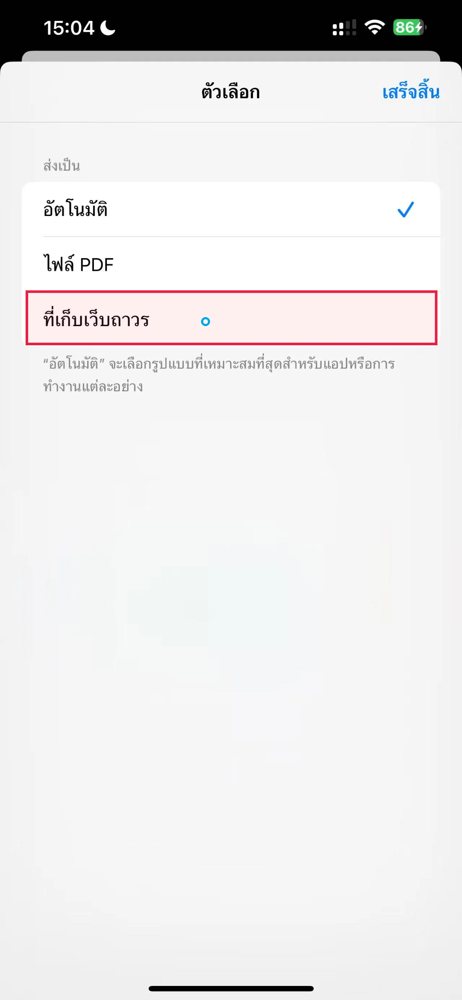

GT 원본 bbox: `[71.0, 804.0, 1211.0, 955.0]` · 원본 화면 1280×2769px

### O · 짧은 기준 표현

질문: `哪个选项在截图中列表显示的“<ref>网页归档</ref>”设置上方？`

모델에 준 기준 표현: `“<ref>网页归档</ref>”设置`

모델 입력 화면: 980×2100px. 아래 점은 이 화면의 픽셀 좌표다.

| 출력 | 판정 | 점 | 토큰 | `addCriterion` |
| --- | --- | --- | ---: | ---: |
| JSON | GT 안 | (436, 675) | 19 | 0 |
| (x, y) | GT 안 | (163, 674) | 11 | 0 |

**JSON 원시 출력 전문**

```text
[{"point_2d": [436, 675]}]
```

**(x, y) 원시 출력 전문**

```text
(163, 674)
```

**JSON 실제 렌더링 프롬프트**

```text
<|im_start|>system
You are a helpful assistant.<|im_end|>
<|im_start|>user
<|vision_start|><|image_pad|><|vision_end|>Reference phrase: “<ref>网页归档</ref>”设置
Locate this GUI element in the screenshot. The phrase may be in a different language from the screenshot. The screenshot is 980 pixels wide and 2100 pixels high. Give one point inside the element, using integer pixel coordinates with (0, 0) at the top-left. Return only this JSON array: [{"point_2d": [x, y]}]. No explanation or code fence.<|im_end|>
<|im_start|>assistant

```

**(x, y) 실제 렌더링 프롬프트**

```text
<|im_start|>system
You are a helpful assistant.<|im_end|>
<|im_start|>user
<|vision_start|><|image_pad|><|vision_end|>Reference phrase: “<ref>网页归档</ref>”设置
Locate this GUI element in the screenshot. The phrase may be in a different language from the screenshot. The screenshot is 980 pixels wide and 2100 pixels high. Give one point inside the element, using integer pixel coordinates with (0, 0) at the top-left. Return only one coordinate as (x, y). No explanation or code fence.<|im_end|>
<|im_start|>assistant

```

### R · 짧은 기준 표현

질문: `哪个选项在截图中列表显示的“<ref>ที่เก็บเว็บถาวร</ref>”设置上方？`

모델에 준 기준 표현: `“<ref>ที่เก็บเว็บถาวร</ref>”设置`

모델 입력 화면: 980×2100px. 아래 점은 이 화면의 픽셀 좌표다.

| 출력 | 판정 | 점 | 토큰 | `addCriterion` |
| --- | --- | --- | ---: | ---: |
| JSON | 형식 실패 | — | 2 | 0 |
| (x, y) | GT 안 | (135, 674) | 11 | 0 |

**JSON 원시 출력 전문**

```text
[]
```

**(x, y) 원시 출력 전문**

```text
(135, 674)
```

**JSON 실제 렌더링 프롬프트**

```text
<|im_start|>system
You are a helpful assistant.<|im_end|>
<|im_start|>user
<|vision_start|><|image_pad|><|vision_end|>Reference phrase: “<ref>ที่เก็บเว็บถาวร</ref>”设置
Locate this GUI element in the screenshot. The phrase may be in a different language from the screenshot. The screenshot is 980 pixels wide and 2100 pixels high. Give one point inside the element, using integer pixel coordinates with (0, 0) at the top-left. Return only this JSON array: [{"point_2d": [x, y]}]. No explanation or code fence.<|im_end|>
<|im_start|>assistant

```

**(x, y) 실제 렌더링 프롬프트**

```text
<|im_start|>system
You are a helpful assistant.<|im_end|>
<|im_start|>user
<|vision_start|><|image_pad|><|vision_end|>Reference phrase: “<ref>ที่เก็บเว็บถาวร</ref>”设置
Locate this GUI element in the screenshot. The phrase may be in a different language from the screenshot. The screenshot is 980 pixels wide and 2100 pixels high. Give one point inside the element, using integer pixel coordinates with (0, 0) at the top-left. Return only one coordinate as (x, y). No explanation or code fence.<|im_end|>
<|im_start|>assistant

```

## 12 wallet_3 TH GUI

질문 ZH→GUI TH · 문항 `rel::6/wallet_3.jpg`

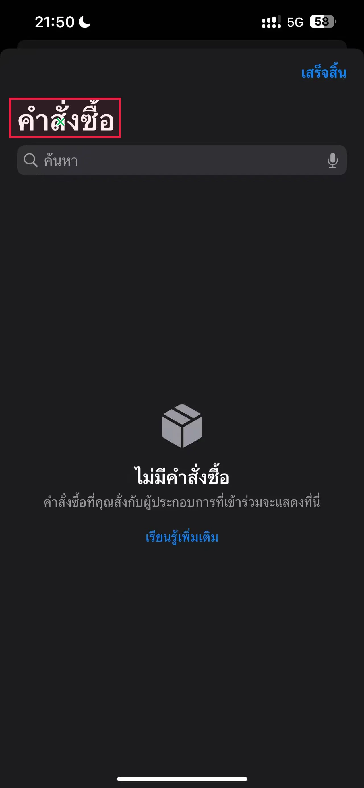

GT 원본 bbox: `[32.0, 343.0, 424.0, 484.0]` · 원본 화면 1280×2769px

### O · 짧은 기준 표현

질문: `在“<ref>订单</ref>”标题下，屏幕上元素从上到下的直接顺序是什么？`

모델에 준 기준 표현: `“<ref>订单</ref>”标题`

모델 입력 화면: 980×2100px. 아래 점은 이 화면의 픽셀 좌표다.

| 출력 | 판정 | 점 | 토큰 | `addCriterion` |
| --- | --- | --- | ---: | ---: |
| JSON | 형식 실패 | — | 2 | 0 |
| (x, y) | 형식 실패 | — | 10 | 1 |

**JSON 원시 출력 전문**

```text
[]
```

**(x, y) 원시 출력 전문**

```text
(134,29
 addCriterion
```

**JSON 실제 렌더링 프롬프트**

```text
<|im_start|>system
You are a helpful assistant.<|im_end|>
<|im_start|>user
<|vision_start|><|image_pad|><|vision_end|>Reference phrase: “<ref>订单</ref>”标题
Locate this GUI element in the screenshot. The phrase may be in a different language from the screenshot. The screenshot is 980 pixels wide and 2100 pixels high. Give one point inside the element, using integer pixel coordinates with (0, 0) at the top-left. Return only this JSON array: [{"point_2d": [x, y]}]. No explanation or code fence.<|im_end|>
<|im_start|>assistant

```

**(x, y) 실제 렌더링 프롬프트**

```text
<|im_start|>system
You are a helpful assistant.<|im_end|>
<|im_start|>user
<|vision_start|><|image_pad|><|vision_end|>Reference phrase: “<ref>订单</ref>”标题
Locate this GUI element in the screenshot. The phrase may be in a different language from the screenshot. The screenshot is 980 pixels wide and 2100 pixels high. Give one point inside the element, using integer pixel coordinates with (0, 0) at the top-left. Return only one coordinate as (x, y). No explanation or code fence.<|im_end|>
<|im_start|>assistant

```

### R · 짧은 기준 표현

질문: `在“<ref>คำสั่งซื้อ</ref>”标题下，屏幕上元素从上到下的直接顺序是什么？`

모델에 준 기준 표현: `“<ref>คำสั่งซื้อ</ref>”标题`

모델 입력 화면: 980×2100px. 아래 점은 이 화면의 픽셀 좌표다.

| 출력 | 판정 | 점 | 토큰 | `addCriterion` |
| --- | --- | --- | ---: | ---: |
| JSON | GT 안 | (163, 324) | 19 | 0 |
| (x, y) | GT 안 | (103, 314) | 11 | 0 |

**JSON 원시 출력 전문**

```text
[{"point_2d": [163, 324]}]
```

**(x, y) 원시 출력 전문**

```text
(103, 314)
```

**JSON 실제 렌더링 프롬프트**

```text
<|im_start|>system
You are a helpful assistant.<|im_end|>
<|im_start|>user
<|vision_start|><|image_pad|><|vision_end|>Reference phrase: “<ref>คำสั่งซื้อ</ref>”标题
Locate this GUI element in the screenshot. The phrase may be in a different language from the screenshot. The screenshot is 980 pixels wide and 2100 pixels high. Give one point inside the element, using integer pixel coordinates with (0, 0) at the top-left. Return only this JSON array: [{"point_2d": [x, y]}]. No explanation or code fence.<|im_end|>
<|im_start|>assistant

```

**(x, y) 실제 렌더링 프롬프트**

```text
<|im_start|>system
You are a helpful assistant.<|im_end|>
<|im_start|>user
<|vision_start|><|image_pad|><|vision_end|>Reference phrase: “<ref>คำสั่งซื้อ</ref>”标题
Locate this GUI element in the screenshot. The phrase may be in a different language from the screenshot. The screenshot is 980 pixels wide and 2100 pixels high. Give one point inside the element, using integer pixel coordinates with (0, 0) at the top-left. Return only one coordinate as (x, y). No explanation or code fence.<|im_end|>
<|im_start|>assistant

```
