# Qwen 위치 지정 원시 출력 · ZH GUI

[전체 요약과 `addCriterion` 점검](QWEN_RAW_OUTPUT_AUDIT_KO.md) · [JSON↔괄호 결과](QWEN_FORMAT_COMPARISON_RESULTS_KO.md)

12개 화면, 56개 응답의 **원문 전체**를 기록했다. `addCriterion` 포함 응답은 22개다. 같은 언어 대조는 첫 두 문항에만 있다.

이미지의 **빨간 bbox는 GT**, 파란 원·초록 X는 짧은 표현 JSON O/R 예측, 주황 마름모는 v3 JSON 대조의 예측이다. 괄호형 예측점은 이미지에 그려져 있지 않으며 아래 표에서 확인한다. 이미지는 보기용이고 채점은 원본 이미지로 했다.

| # | 문항 | 질문 방향 | `addCriterion` 응답 |
| ---: | --- | --- | ---: |
| 01 | [booking_1](#01-booking_1-zh-gui) | EN→ZH | 3 |
| 02 | [message_1](#02-message_1-zh-gui) | EN→ZH | 1 |
| 03 | [booking_10](#03-booking_10-zh-gui) | EN→ZH | 4 |
| 04 | [clock_10](#04-clock_10-zh-gui) | EN→ZH | 1 |
| 05 | [weather_3](#05-weather_3-zh-gui) | EN→ZH | 4 |
| 06 | [music_7](#06-music_7-zh-gui) | EN→ZH | 4 |
| 07 | [settings_2](#07-settings_2-zh-gui) | EN→ZH | 0 |
| 08 | [Gmail_8](#08-gmail_8-zh-gui) | EN→ZH | 2 |
| 09 | [twitter_6](#09-twitter_6-zh-gui) | EN→ZH | 1 |
| 10 | [camera_1](#10-camera_1-zh-gui) | EN→ZH | 0 |
| 11 | [safari_7](#11-safari_7-zh-gui) | EN→ZH | 1 |
| 12 | [wallet_3](#12-wallet_3-zh-gui) | EN→ZH | 1 |

## 01 booking_1 ZH GUI

질문 EN→GUI ZH · 문항 `rel::1/booking_1.jpg`

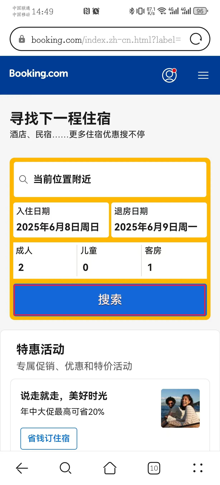

GT 원본 bbox: `[76.0, 1584.0, 1146.0, 1756.0]` · 원본 화면 1228×2700px

### 같은 언어 대조 · 전체 관계 질문

질문: `在选择客人数的行中，哪个输入字段位于蓝色“<ref>搜索</ref>”按钮的水平中心正上方？`

모델 입력 화면: 980×2128px. 아래 점은 이 화면의 픽셀 좌표다.

| 출력 | 판정 | 점 | 토큰 | `addCriterion` |
| --- | --- | --- | ---: | ---: |
| JSON | 형식 실패 | — | 12 | 0 |
| (x, y) | GT 안 | (476, 1305) | 12 | 0 |

**JSON 원시 출력 전문**

```text
[{"point_2d": [679
```

**(x, y) 원시 출력 전문**

```text
(476, 1305)
```

**JSON 실제 렌더링 프롬프트**

```text
<|im_start|>system
You are a helpful assistant.<|im_end|>
<|im_start|>user
<|vision_start|><|image_pad|><|vision_end|>Locate the GUI reference element marked with <ref>...</ref> in the question below. The marked expression may be in a different language from the screenshot. Use surrounding words to identify the marked element. Do not locate the element that the question asks for.
Question: 在选择客人数的行中，哪个输入字段位于蓝色“<ref>搜索</ref>”按钮的水平中心正上方？
The screenshot is 980 pixels wide and 2128 pixels high. Give one point inside the marked reference element using integer pixel coordinates on this screenshot, with (0, 0) at the top-left. Return only this JSON array: [{"point_2d": [x, y]}]. No explanation or code fence.<|im_end|>
<|im_start|>assistant

```

**(x, y) 실제 렌더링 프롬프트**

```text
<|im_start|>system
You are a helpful assistant.<|im_end|>
<|im_start|>user
<|vision_start|><|image_pad|><|vision_end|>Locate the GUI reference element marked with <ref>...</ref> in the question below. The marked expression may be in a different language from the screenshot. Use surrounding words to identify the marked element. Do not locate the element that the question asks for.
Question: 在选择客人数的行中，哪个输入字段位于蓝色“<ref>搜索</ref>”按钮的水平中心正上方？
The screenshot is 980 pixels wide and 2128 pixels high. Give one point inside the marked reference element using integer pixel coordinates on this screenshot, with (0, 0) at the top-left. Return only one coordinate as (x, y). No explanation or code fence.<|im_end|>
<|im_start|>assistant

```

### 같은 언어 대조 · 짧은 기준 표현

질문: `在选择客人数的行中，哪个输入字段位于蓝色“<ref>搜索</ref>”按钮的水平中心正上方？`

모델에 준 기준 표현: `蓝色“<ref>搜索</ref>”按钮`

모델 입력 화면: 980×2128px. 아래 점은 이 화면의 픽셀 좌표다.

| 출력 | 판정 | 점 | 토큰 | `addCriterion` |
| --- | --- | --- | ---: | ---: |
| JSON | 형식 실패 | — | 64 | 14 |
| (x, y) | GT 안 | (467, 1305) | 12 | 0 |

**JSON 원시 출력 전문**

```text
[{"point_2d": [48
 addCriterion

 addCriterion

 addCriterion

 addCriterion

 addCriterion

 addCriterion

 addCriterion

 addCriterion

 addCriterion

 addCriterion

 addCriterion

 addCriterion

 addCriterion

 addCriterion
```

**(x, y) 원시 출력 전문**

```text
(467, 1305)
```

**JSON 실제 렌더링 프롬프트**

```text
<|im_start|>system
You are a helpful assistant.<|im_end|>
<|im_start|>user
<|vision_start|><|image_pad|><|vision_end|>Reference phrase: 蓝色“<ref>搜索</ref>”按钮
Locate this GUI element in the screenshot. The phrase may be in a different language from the screenshot. The screenshot is 980 pixels wide and 2128 pixels high. Give one point inside the element, using integer pixel coordinates with (0, 0) at the top-left. Return only this JSON array: [{"point_2d": [x, y]}]. No explanation or code fence.<|im_end|>
<|im_start|>assistant

```

**(x, y) 실제 렌더링 프롬프트**

```text
<|im_start|>system
You are a helpful assistant.<|im_end|>
<|im_start|>user
<|vision_start|><|image_pad|><|vision_end|>Reference phrase: 蓝色“<ref>搜索</ref>”按钮
Locate this GUI element in the screenshot. The phrase may be in a different language from the screenshot. The screenshot is 980 pixels wide and 2128 pixels high. Give one point inside the element, using integer pixel coordinates with (0, 0) at the top-left. Return only one coordinate as (x, y). No explanation or code fence.<|im_end|>
<|im_start|>assistant

```

### O · 짧은 기준 표현

질문: `In the row for selecting the number of guests, which input field is located directly above the horizontal center of the blue '<ref>Search</ref>' button?`

모델에 준 기준 표현: `blue '<ref>Search</ref>' button`

모델 입력 화면: 980×2128px. 아래 점은 이 화면의 픽셀 좌표다.

| 출력 | 판정 | 점 | 토큰 | `addCriterion` |
| --- | --- | --- | ---: | ---: |
| JSON | 형식 실패 | — | 64 | 14 |
| (x, y) | GT 안 | (437, 1305) | 12 | 0 |

**JSON 원시 출력 전문**

```text
[{"point_2d": [48
 addCriterion

 addCriterion

 addCriterion

 addCriterion

 addCriterion

 addCriterion

 addCriterion

 addCriterion

 addCriterion

 addCriterion

 addCriterion

 addCriterion

 addCriterion

 addCriterion
```

**(x, y) 원시 출력 전문**

```text
(437, 1305)
```

**JSON 실제 렌더링 프롬프트**

```text
<|im_start|>system
You are a helpful assistant.<|im_end|>
<|im_start|>user
<|vision_start|><|image_pad|><|vision_end|>Reference phrase: blue '<ref>Search</ref>' button
Locate this GUI element in the screenshot. The phrase may be in a different language from the screenshot. The screenshot is 980 pixels wide and 2128 pixels high. Give one point inside the element, using integer pixel coordinates with (0, 0) at the top-left. Return only this JSON array: [{"point_2d": [x, y]}]. No explanation or code fence.<|im_end|>
<|im_start|>assistant

```

**(x, y) 실제 렌더링 프롬프트**

```text
<|im_start|>system
You are a helpful assistant.<|im_end|>
<|im_start|>user
<|vision_start|><|image_pad|><|vision_end|>Reference phrase: blue '<ref>Search</ref>' button
Locate this GUI element in the screenshot. The phrase may be in a different language from the screenshot. The screenshot is 980 pixels wide and 2128 pixels high. Give one point inside the element, using integer pixel coordinates with (0, 0) at the top-left. Return only one coordinate as (x, y). No explanation or code fence.<|im_end|>
<|im_start|>assistant

```

### R · 짧은 기준 표현

질문: `In the row for selecting the number of guests, which input field is located directly above the horizontal center of the blue '<ref>搜索</ref>' button?`

모델에 준 기준 표현: `blue '<ref>搜索</ref>' button`

모델 입력 화면: 980×2128px. 아래 점은 이 화면의 픽셀 좌표다.

| 출력 | 판정 | 점 | 토큰 | `addCriterion` |
| --- | --- | --- | ---: | ---: |
| JSON | 형식 실패 | — | 64 | 14 |
| (x, y) | GT 안 | (467, 1305) | 12 | 0 |

**JSON 원시 출력 전문**

```text
[{"point_2d": [48
 addCriterion

 addCriterion

 addCriterion

 addCriterion

 addCriterion

 addCriterion

 addCriterion

 addCriterion

 addCriterion

 addCriterion

 addCriterion

 addCriterion

 addCriterion

 addCriterion
```

**(x, y) 원시 출력 전문**

```text
(467, 1305)
```

**JSON 실제 렌더링 프롬프트**

```text
<|im_start|>system
You are a helpful assistant.<|im_end|>
<|im_start|>user
<|vision_start|><|image_pad|><|vision_end|>Reference phrase: blue '<ref>搜索</ref>' button
Locate this GUI element in the screenshot. The phrase may be in a different language from the screenshot. The screenshot is 980 pixels wide and 2128 pixels high. Give one point inside the element, using integer pixel coordinates with (0, 0) at the top-left. Return only this JSON array: [{"point_2d": [x, y]}]. No explanation or code fence.<|im_end|>
<|im_start|>assistant

```

**(x, y) 실제 렌더링 프롬프트**

```text
<|im_start|>system
You are a helpful assistant.<|im_end|>
<|im_start|>user
<|vision_start|><|image_pad|><|vision_end|>Reference phrase: blue '<ref>搜索</ref>' button
Locate this GUI element in the screenshot. The phrase may be in a different language from the screenshot. The screenshot is 980 pixels wide and 2128 pixels high. Give one point inside the element, using integer pixel coordinates with (0, 0) at the top-left. Return only one coordinate as (x, y). No explanation or code fence.<|im_end|>
<|im_start|>assistant

```

## 02 message_1 ZH GUI

질문 EN→GUI ZH · 문항 `rel::5/message_1.jpg`

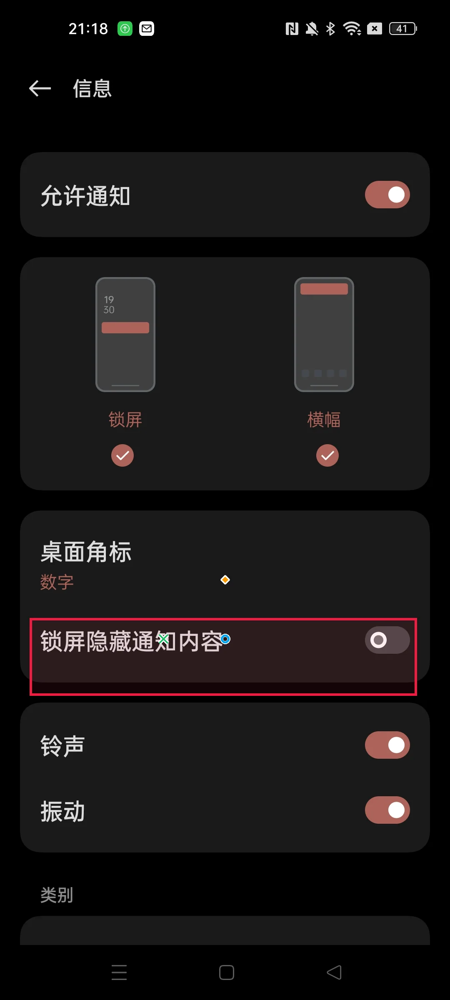

GT 원본 bbox: `[71.0, 1483.0, 1000.0, 1669.0]` · 원본 화면 1080×2400px

### 같은 언어 대조 · 전체 관계 질문

질문: `哪个元素位于“<ref>锁屏隐藏通知内容</ref>”正上方？`

모델 입력 화면: 952×2128px. 아래 점은 이 화면의 픽셀 좌표다.

| 출력 | 판정 | 점 | 토큰 | `addCriterion` |
| --- | --- | --- | ---: | ---: |
| JSON | GT 밖 | (476, 1234) | 20 | 0 |
| (x, y) | 형식 실패 | — | 13 | 1 |

**JSON 원시 출력 전문**

```text
[{"point_2d": [476, 1234]}]
```

**(x, y) 원시 출력 전문**

```text
(163, 129
 addCriterion
```

**JSON 실제 렌더링 프롬프트**

```text
<|im_start|>system
You are a helpful assistant.<|im_end|>
<|im_start|>user
<|vision_start|><|image_pad|><|vision_end|>Locate the GUI reference element marked with <ref>...</ref> in the question below. The marked expression may be in a different language from the screenshot. Use surrounding words to identify the marked element. Do not locate the element that the question asks for.
Question: 哪个元素位于“<ref>锁屏隐藏通知内容</ref>”正上方？
The screenshot is 952 pixels wide and 2128 pixels high. Give one point inside the marked reference element using integer pixel coordinates on this screenshot, with (0, 0) at the top-left. Return only this JSON array: [{"point_2d": [x, y]}]. No explanation or code fence.<|im_end|>
<|im_start|>assistant

```

**(x, y) 실제 렌더링 프롬프트**

```text
<|im_start|>system
You are a helpful assistant.<|im_end|>
<|im_start|>user
<|vision_start|><|image_pad|><|vision_end|>Locate the GUI reference element marked with <ref>...</ref> in the question below. The marked expression may be in a different language from the screenshot. Use surrounding words to identify the marked element. Do not locate the element that the question asks for.
Question: 哪个元素位于“<ref>锁屏隐藏通知内容</ref>”正上方？
The screenshot is 952 pixels wide and 2128 pixels high. Give one point inside the marked reference element using integer pixel coordinates on this screenshot, with (0, 0) at the top-left. Return only one coordinate as (x, y). No explanation or code fence.<|im_end|>
<|im_start|>assistant

```

### 같은 언어 대조 · 짧은 기준 표현

질문: `哪个元素位于“<ref>锁屏隐藏通知内容</ref>”正上方？`

모델에 준 기준 표현: `“<ref>锁屏隐藏通知内容</ref>”`

모델 입력 화면: 952×2128px. 아래 점은 이 화면의 픽셀 좌표다.

| 출력 | 판정 | 점 | 토큰 | `addCriterion` |
| --- | --- | --- | ---: | ---: |
| JSON | GT 안 | (476, 1360) | 20 | 0 |
| (x, y) | GT 안 | (476, 1357) | 12 | 0 |

**JSON 원시 출력 전문**

```text
[{"point_2d": [476, 1360]}]
```

**(x, y) 원시 출력 전문**

```text
(476, 1357)
```

**JSON 실제 렌더링 프롬프트**

```text
<|im_start|>system
You are a helpful assistant.<|im_end|>
<|im_start|>user
<|vision_start|><|image_pad|><|vision_end|>Reference phrase: “<ref>锁屏隐藏通知内容</ref>”
Locate this GUI element in the screenshot. The phrase may be in a different language from the screenshot. The screenshot is 952 pixels wide and 2128 pixels high. Give one point inside the element, using integer pixel coordinates with (0, 0) at the top-left. Return only this JSON array: [{"point_2d": [x, y]}]. No explanation or code fence.<|im_end|>
<|im_start|>assistant

```

**(x, y) 실제 렌더링 프롬프트**

```text
<|im_start|>system
You are a helpful assistant.<|im_end|>
<|im_start|>user
<|vision_start|><|image_pad|><|vision_end|>Reference phrase: “<ref>锁屏隐藏通知内容</ref>”
Locate this GUI element in the screenshot. The phrase may be in a different language from the screenshot. The screenshot is 952 pixels wide and 2128 pixels high. Give one point inside the element, using integer pixel coordinates with (0, 0) at the top-left. Return only one coordinate as (x, y). No explanation or code fence.<|im_end|>
<|im_start|>assistant

```

### O · 짧은 기준 표현

질문: `Which element is positioned directly above '<ref>Hide notification details on Lock screen</ref>'?`

모델에 준 기준 표현: `'<ref>Hide notification details on Lock screen</ref>'`

모델 입력 화면: 952×2128px. 아래 점은 이 화면의 픽셀 좌표다.

| 출력 | 판정 | 점 | 토큰 | `addCriterion` |
| --- | --- | --- | ---: | ---: |
| JSON | GT 안 | (476, 1360) | 20 | 0 |
| (x, y) | GT 안 | (476, 1357) | 12 | 0 |

**JSON 원시 출력 전문**

```text
[{"point_2d": [476, 1360]}]
```

**(x, y) 원시 출력 전문**

```text
(476, 1357)
```

**JSON 실제 렌더링 프롬프트**

```text
<|im_start|>system
You are a helpful assistant.<|im_end|>
<|im_start|>user
<|vision_start|><|image_pad|><|vision_end|>Reference phrase: '<ref>Hide notification details on Lock screen</ref>'
Locate this GUI element in the screenshot. The phrase may be in a different language from the screenshot. The screenshot is 952 pixels wide and 2128 pixels high. Give one point inside the element, using integer pixel coordinates with (0, 0) at the top-left. Return only this JSON array: [{"point_2d": [x, y]}]. No explanation or code fence.<|im_end|>
<|im_start|>assistant

```

**(x, y) 실제 렌더링 프롬프트**

```text
<|im_start|>system
You are a helpful assistant.<|im_end|>
<|im_start|>user
<|vision_start|><|image_pad|><|vision_end|>Reference phrase: '<ref>Hide notification details on Lock screen</ref>'
Locate this GUI element in the screenshot. The phrase may be in a different language from the screenshot. The screenshot is 952 pixels wide and 2128 pixels high. Give one point inside the element, using integer pixel coordinates with (0, 0) at the top-left. Return only one coordinate as (x, y). No explanation or code fence.<|im_end|>
<|im_start|>assistant

```

### R · 짧은 기준 표현

질문: `Which element is positioned directly above '<ref>锁屏隐藏通知内容</ref>'?`

모델에 준 기준 표현: `'<ref>锁屏隐藏通知内容</ref>'`

모델 입력 화면: 952×2128px. 아래 점은 이 화면의 픽셀 좌표다.

| 출력 | 판정 | 점 | 토큰 | `addCriterion` |
| --- | --- | --- | ---: | ---: |
| JSON | GT 안 | (346, 1360) | 20 | 0 |
| (x, y) | GT 안 | (163, 1354) | 12 | 0 |

**JSON 원시 출력 전문**

```text
[{"point_2d": [346, 1360]}]
```

**(x, y) 원시 출력 전문**

```text
(163, 1354)
```

**JSON 실제 렌더링 프롬프트**

```text
<|im_start|>system
You are a helpful assistant.<|im_end|>
<|im_start|>user
<|vision_start|><|image_pad|><|vision_end|>Reference phrase: '<ref>锁屏隐藏通知内容</ref>'
Locate this GUI element in the screenshot. The phrase may be in a different language from the screenshot. The screenshot is 952 pixels wide and 2128 pixels high. Give one point inside the element, using integer pixel coordinates with (0, 0) at the top-left. Return only this JSON array: [{"point_2d": [x, y]}]. No explanation or code fence.<|im_end|>
<|im_start|>assistant

```

**(x, y) 실제 렌더링 프롬프트**

```text
<|im_start|>system
You are a helpful assistant.<|im_end|>
<|im_start|>user
<|vision_start|><|image_pad|><|vision_end|>Reference phrase: '<ref>锁屏隐藏通知内容</ref>'
Locate this GUI element in the screenshot. The phrase may be in a different language from the screenshot. The screenshot is 952 pixels wide and 2128 pixels high. Give one point inside the element, using integer pixel coordinates with (0, 0) at the top-left. Return only one coordinate as (x, y). No explanation or code fence.<|im_end|>
<|im_start|>assistant

```

## 03 booking_10 ZH GUI

질문 EN→GUI ZH · 문항 `rel::1/booking_10.jpg`

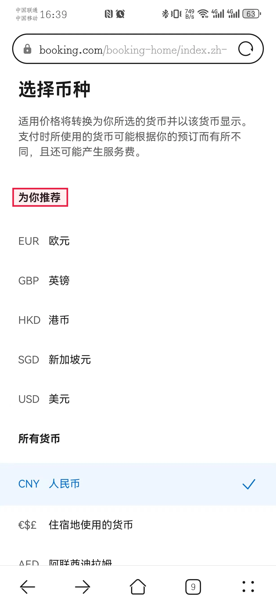

GT 원본 bbox: `[55.0, 834.0, 302.0, 917.0]` · 원본 화면 1228×2700px

### O · 짧은 기준 표현

질문: `Which currency option is immediately below the "<ref>Suggested for you</ref>" section?`

모델에 준 기준 표현: `"<ref>Suggested for you</ref>" section`

모델 입력 화면: 980×2128px. 아래 점은 이 화면의 픽셀 좌표다.

| 출력 | 판정 | 점 | 토큰 | `addCriterion` |
| --- | --- | --- | ---: | ---: |
| JSON | 형식 실패 | — | 64 | 8 |
| (x, y) | 형식 실패 | — | 10 | 1 |

**JSON 원시 출력 전문**

```text
[{"point_2d": [137, 68
 addCriterion

 addCriterion

 addCriterion
 addCriterion
 addCriterion

 addCriterion

 addCriterion


 addCriterion
```

**(x, y) 원시 출력 전문**

```text
(67, 68
 addCriterion
```

**JSON 실제 렌더링 프롬프트**

```text
<|im_start|>system
You are a helpful assistant.<|im_end|>
<|im_start|>user
<|vision_start|><|image_pad|><|vision_end|>Reference phrase: "<ref>Suggested for you</ref>" section
Locate this GUI element in the screenshot. The phrase may be in a different language from the screenshot. The screenshot is 980 pixels wide and 2128 pixels high. Give one point inside the element, using integer pixel coordinates with (0, 0) at the top-left. Return only this JSON array: [{"point_2d": [x, y]}]. No explanation or code fence.<|im_end|>
<|im_start|>assistant

```

**(x, y) 실제 렌더링 프롬프트**

```text
<|im_start|>system
You are a helpful assistant.<|im_end|>
<|im_start|>user
<|vision_start|><|image_pad|><|vision_end|>Reference phrase: "<ref>Suggested for you</ref>" section
Locate this GUI element in the screenshot. The phrase may be in a different language from the screenshot. The screenshot is 980 pixels wide and 2128 pixels high. Give one point inside the element, using integer pixel coordinates with (0, 0) at the top-left. Return only one coordinate as (x, y). No explanation or code fence.<|im_end|>
<|im_start|>assistant

```

### R · 짧은 기준 표현

질문: `Which currency option is immediately below the "<ref>为你推荐</ref>" section?`

모델에 준 기준 표현: `"<ref>为你推荐</ref>" section`

모델 입력 화면: 980×2128px. 아래 점은 이 화면의 픽셀 좌표다.

| 출력 | 판정 | 점 | 토큰 | `addCriterion` |
| --- | --- | --- | ---: | ---: |
| JSON | 형식 실패 | — | 19 | 1 |
| (x, y) | 형식 실패 | — | 10 | 1 |

**JSON 원시 출력 전문**

```text
[{"point_2d": [137, 68
 addCriterion
```

**(x, y) 원시 출력 전문**

```text
(67, 68
 addCriterion
```

**JSON 실제 렌더링 프롬프트**

```text
<|im_start|>system
You are a helpful assistant.<|im_end|>
<|im_start|>user
<|vision_start|><|image_pad|><|vision_end|>Reference phrase: "<ref>为你推荐</ref>" section
Locate this GUI element in the screenshot. The phrase may be in a different language from the screenshot. The screenshot is 980 pixels wide and 2128 pixels high. Give one point inside the element, using integer pixel coordinates with (0, 0) at the top-left. Return only this JSON array: [{"point_2d": [x, y]}]. No explanation or code fence.<|im_end|>
<|im_start|>assistant

```

**(x, y) 실제 렌더링 프롬프트**

```text
<|im_start|>system
You are a helpful assistant.<|im_end|>
<|im_start|>user
<|vision_start|><|image_pad|><|vision_end|>Reference phrase: "<ref>为你推荐</ref>" section
Locate this GUI element in the screenshot. The phrase may be in a different language from the screenshot. The screenshot is 980 pixels wide and 2128 pixels high. Give one point inside the element, using integer pixel coordinates with (0, 0) at the top-left. Return only one coordinate as (x, y). No explanation or code fence.<|im_end|>
<|im_start|>assistant

```

## 04 clock_10 ZH GUI

질문 EN→GUI ZH · 문항 `rel::2/clock_10.png`

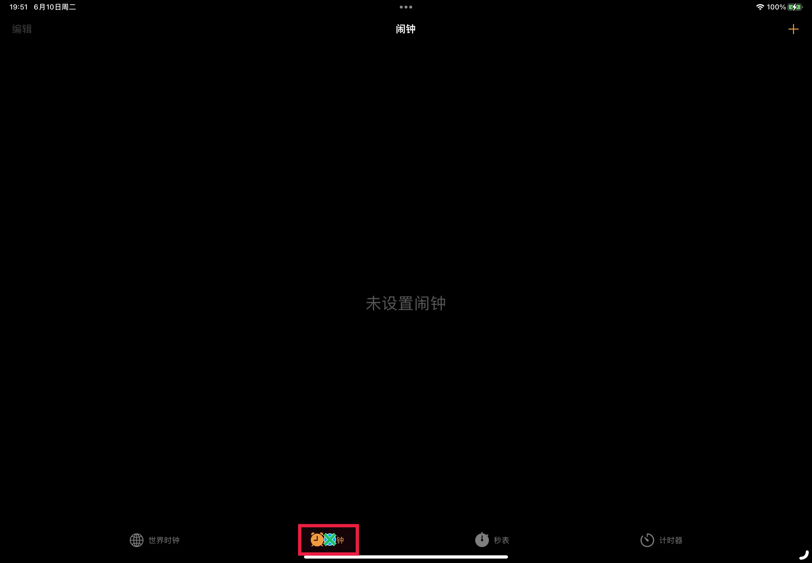

GT 원본 bbox: `[1008.0, 1776.0, 1213.0, 1882.0]` · 원본 화면 2746×1908px

### O · 짧은 기준 표현

질문: `Which element is located directly to the right of the '<ref>Alarm</ref>' tab at the bottom of the screen?`

모델에 준 기준 표현: `'<ref>Alarm</ref>' tab at the bottom of the screen`

모델 입력 화면: 1736×1204px. 아래 점은 이 화면의 픽셀 좌표다.

| 출력 | 판정 | 점 | 토큰 | `addCriterion` |
| --- | --- | --- | ---: | ---: |
| JSON | GT 안 | (705, 1154) | 20 | 0 |
| (x, y) | 형식 실패 | — | 19 | 1 |

**JSON 원시 출력 전문**

```text
[{"point_2d": [705, 1154]}]
```

**(x, y) 원시 출력 전문**

```text
(69

 addCriterion
(705, 1151
```

**JSON 실제 렌더링 프롬프트**

```text
<|im_start|>system
You are a helpful assistant.<|im_end|>
<|im_start|>user
<|vision_start|><|image_pad|><|vision_end|>Reference phrase: '<ref>Alarm</ref>' tab at the bottom of the screen
Locate this GUI element in the screenshot. The phrase may be in a different language from the screenshot. The screenshot is 1736 pixels wide and 1204 pixels high. Give one point inside the element, using integer pixel coordinates with (0, 0) at the top-left. Return only this JSON array: [{"point_2d": [x, y]}]. No explanation or code fence.<|im_end|>
<|im_start|>assistant

```

**(x, y) 실제 렌더링 프롬프트**

```text
<|im_start|>system
You are a helpful assistant.<|im_end|>
<|im_start|>user
<|vision_start|><|image_pad|><|vision_end|>Reference phrase: '<ref>Alarm</ref>' tab at the bottom of the screen
Locate this GUI element in the screenshot. The phrase may be in a different language from the screenshot. The screenshot is 1736 pixels wide and 1204 pixels high. Give one point inside the element, using integer pixel coordinates with (0, 0) at the top-left. Return only one coordinate as (x, y). No explanation or code fence.<|im_end|>
<|im_start|>assistant

```

### R · 짧은 기준 표현

질문: `Which element is located directly to the right of the '<ref>闹钟</ref>' tab at the bottom of the screen?`

모델에 준 기준 표현: `'<ref>闹钟</ref>' tab at the bottom of the screen`

모델 입력 화면: 1736×1204px. 아래 점은 이 화면의 픽셀 좌표다.

| 출력 | 판정 | 점 | 토큰 | `addCriterion` |
| --- | --- | --- | ---: | ---: |
| JSON | GT 안 | (705, 1154) | 20 | 0 |
| (x, y) | 형식 실패 | — | 6 | 0 |

**JSON 원시 출력 전문**

```text
[{"point_2d": [705, 1154]}]
```

**(x, y) 원시 출력 전문**

```text
(69
```

**JSON 실제 렌더링 프롬프트**

```text
<|im_start|>system
You are a helpful assistant.<|im_end|>
<|im_start|>user
<|vision_start|><|image_pad|><|vision_end|>Reference phrase: '<ref>闹钟</ref>' tab at the bottom of the screen
Locate this GUI element in the screenshot. The phrase may be in a different language from the screenshot. The screenshot is 1736 pixels wide and 1204 pixels high. Give one point inside the element, using integer pixel coordinates with (0, 0) at the top-left. Return only this JSON array: [{"point_2d": [x, y]}]. No explanation or code fence.<|im_end|>
<|im_start|>assistant

```

**(x, y) 실제 렌더링 프롬프트**

```text
<|im_start|>system
You are a helpful assistant.<|im_end|>
<|im_start|>user
<|vision_start|><|image_pad|><|vision_end|>Reference phrase: '<ref>闹钟</ref>' tab at the bottom of the screen
Locate this GUI element in the screenshot. The phrase may be in a different language from the screenshot. The screenshot is 1736 pixels wide and 1204 pixels high. Give one point inside the element, using integer pixel coordinates with (0, 0) at the top-left. Return only one coordinate as (x, y). No explanation or code fence.<|im_end|>
<|im_start|>assistant

```

## 05 weather_3 ZH GUI

질문 EN→GUI ZH · 문항 `rel::2/weather_3.png`

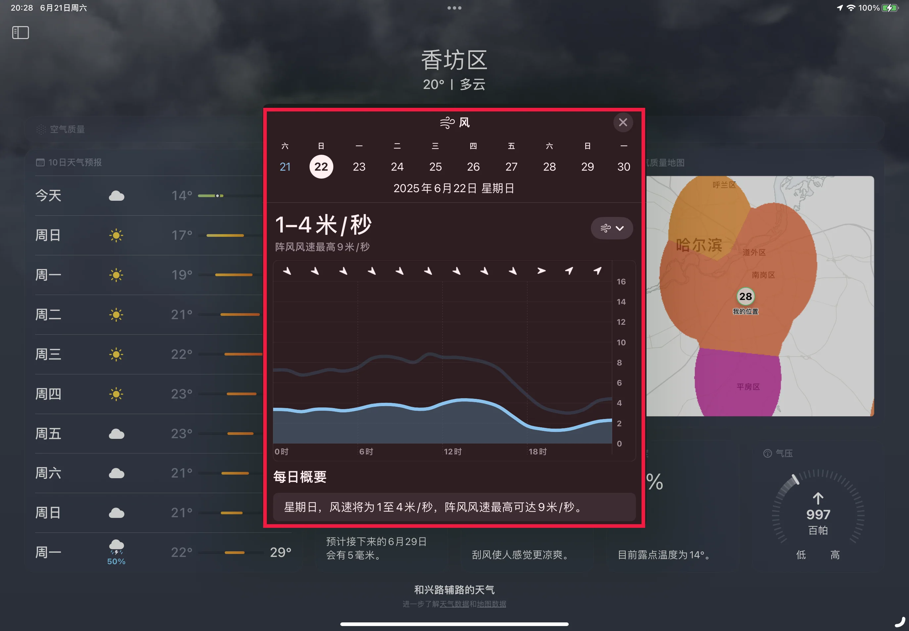

GT 원본 bbox: `[795.0, 326.0, 1948.0, 1595.0]` · 원본 화면 2746×1908px

### O · 짧은 기준 표현

질문: `Which element is located directly to the right of the '<ref>Wind</ref>' section and above the pressure gauge?`

모델에 준 기준 표현: `'<ref>Wind</ref>' section`

모델 입력 화면: 1736×1204px. 아래 점은 이 화면의 픽셀 좌표다.

| 출력 | 판정 | 점 | 토큰 | `addCriterion` |
| --- | --- | --- | ---: | ---: |
| JSON | 형식 실패 | — | 64 | 13 |
| (x, y) | 형식 실패 | — | 12 | 2 |

**JSON 원시 출력 전문**

```text
[{"point_2d": [8

 addCriterion

 addCriterion

 addCriterion

 addCriterion

 addCriterion

 addCriterion

 addCriterion

 addCriterion

 addCriterion

 addCriterion

 addCriterion

 addCriterion

 addCriterion
```

**(x, y) 원시 출력 전문**

```text
(8
 addCriterion
(8
 addCriterion
(
```

**JSON 실제 렌더링 프롬프트**

```text
<|im_start|>system
You are a helpful assistant.<|im_end|>
<|im_start|>user
<|vision_start|><|image_pad|><|vision_end|>Reference phrase: '<ref>Wind</ref>' section
Locate this GUI element in the screenshot. The phrase may be in a different language from the screenshot. The screenshot is 1736 pixels wide and 1204 pixels high. Give one point inside the element, using integer pixel coordinates with (0, 0) at the top-left. Return only this JSON array: [{"point_2d": [x, y]}]. No explanation or code fence.<|im_end|>
<|im_start|>assistant

```

**(x, y) 실제 렌더링 프롬프트**

```text
<|im_start|>system
You are a helpful assistant.<|im_end|>
<|im_start|>user
<|vision_start|><|image_pad|><|vision_end|>Reference phrase: '<ref>Wind</ref>' section
Locate this GUI element in the screenshot. The phrase may be in a different language from the screenshot. The screenshot is 1736 pixels wide and 1204 pixels high. Give one point inside the element, using integer pixel coordinates with (0, 0) at the top-left. Return only one coordinate as (x, y). No explanation or code fence.<|im_end|>
<|im_start|>assistant

```

### R · 짧은 기준 표현

질문: `Which element is located directly to the right of the '<ref>风</ref>' section and above the pressure gauge?`

모델에 준 기준 표현: `'<ref>风</ref>' section`

모델 입력 화면: 1736×1204px. 아래 점은 이 화면의 픽셀 좌표다.

| 출력 | 판정 | 점 | 토큰 | `addCriterion` |
| --- | --- | --- | ---: | ---: |
| JSON | 형식 실패 | — | 56 | 2 |
| (x, y) | 형식 실패 | — | 10 | 1 |

**JSON 원시 출력 전문**

```text
[{"point_2d": [8

 addCriterion


 自动生成的 JSON 格式数组 `[{"point_2d": [9
 addCriterion

 自动生成的 JSON 格式数组 `[{"point_2d": [
```

**(x, y) 원시 출력 전문**

```text
(8
 addCriterion
(8
 !***
```

**JSON 실제 렌더링 프롬프트**

```text
<|im_start|>system
You are a helpful assistant.<|im_end|>
<|im_start|>user
<|vision_start|><|image_pad|><|vision_end|>Reference phrase: '<ref>风</ref>' section
Locate this GUI element in the screenshot. The phrase may be in a different language from the screenshot. The screenshot is 1736 pixels wide and 1204 pixels high. Give one point inside the element, using integer pixel coordinates with (0, 0) at the top-left. Return only this JSON array: [{"point_2d": [x, y]}]. No explanation or code fence.<|im_end|>
<|im_start|>assistant

```

**(x, y) 실제 렌더링 프롬프트**

```text
<|im_start|>system
You are a helpful assistant.<|im_end|>
<|im_start|>user
<|vision_start|><|image_pad|><|vision_end|>Reference phrase: '<ref>风</ref>' section
Locate this GUI element in the screenshot. The phrase may be in a different language from the screenshot. The screenshot is 1736 pixels wide and 1204 pixels high. Give one point inside the element, using integer pixel coordinates with (0, 0) at the top-left. Return only one coordinate as (x, y). No explanation or code fence.<|im_end|>
<|im_start|>assistant

```

## 06 music_7 ZH GUI

질문 EN→GUI ZH · 문항 `rel::3/music_7.jpg`

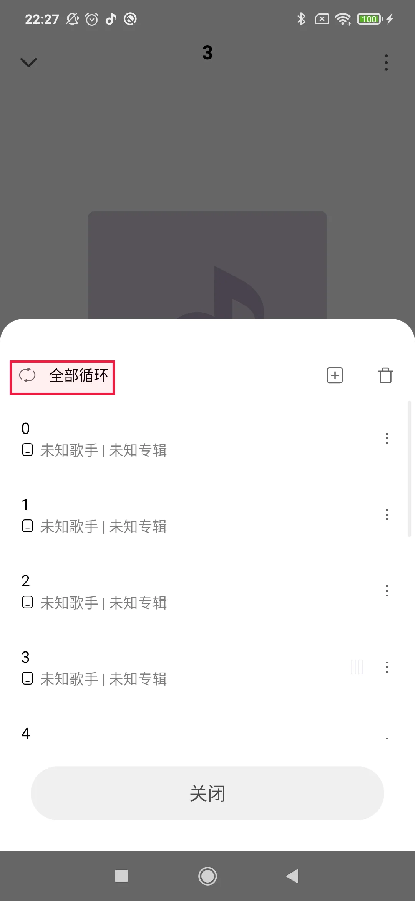

GT 원본 bbox: `[25.0, 936.0, 298.0, 1025.0]` · 원본 화면 1080×2340px

### O · 짧은 기준 표현

질문: `Which of the following options is located directly below the "<ref>Repeat all</ref>" option in the menu?`

모델에 준 기준 표현: `"<ref>Repeat all</ref>" option in the menu`

모델 입력 화면: 980×2100px. 아래 점은 이 화면의 픽셀 좌표다.

| 출력 | 판정 | 점 | 토큰 | `addCriterion` |
| --- | --- | --- | ---: | ---: |
| JSON | 형식 실패 | — | 64 | 13 |
| (x, y) | 형식 실패 | — | 10 | 1 |

**JSON 원시 출력 전문**

```text
[{"point_2d": [176, 8
 addCriterion

 addCriterion

 addCriterion

 addCriterion

 addCriterion

 addCriterion

 addCriterion

 addCriterion

 addCriterion

 addCriterion

 addCriterion

 addCriterion

 addCriterion
```

**(x, y) 원시 출력 전문**

```text
(173, 8
 addCriterion
```

**JSON 실제 렌더링 프롬프트**

```text
<|im_start|>system
You are a helpful assistant.<|im_end|>
<|im_start|>user
<|vision_start|><|image_pad|><|vision_end|>Reference phrase: "<ref>Repeat all</ref>" option in the menu
Locate this GUI element in the screenshot. The phrase may be in a different language from the screenshot. The screenshot is 980 pixels wide and 2100 pixels high. Give one point inside the element, using integer pixel coordinates with (0, 0) at the top-left. Return only this JSON array: [{"point_2d": [x, y]}]. No explanation or code fence.<|im_end|>
<|im_start|>assistant

```

**(x, y) 실제 렌더링 프롬프트**

```text
<|im_start|>system
You are a helpful assistant.<|im_end|>
<|im_start|>user
<|vision_start|><|image_pad|><|vision_end|>Reference phrase: "<ref>Repeat all</ref>" option in the menu
Locate this GUI element in the screenshot. The phrase may be in a different language from the screenshot. The screenshot is 980 pixels wide and 2100 pixels high. Give one point inside the element, using integer pixel coordinates with (0, 0) at the top-left. Return only one coordinate as (x, y). No explanation or code fence.<|im_end|>
<|im_start|>assistant

```

### R · 짧은 기준 표현

질문: `Which of the following options is located directly below the "<ref>全部循环</ref>" option in the menu?`

모델에 준 기준 표현: `"<ref>全部循环</ref>" option in the menu`

모델 입력 화면: 980×2100px. 아래 점은 이 화면의 픽셀 좌표다.

| 출력 | 판정 | 점 | 토큰 | `addCriterion` |
| --- | --- | --- | ---: | ---: |
| JSON | 형식 실패 | — | 64 | 14 |
| (x, y) | 형식 실패 | — | 11 | 1 |

**JSON 원시 출력 전문**

```text
[{"point_2d": [19
 addCriterion

 addCriterion

 addCriterion

 addCriterion

 addCriterion

 addCriterion

 addCriterion

 addCriterion

 addCriterion

 addCriterion

 addCriterion

 addCriterion

 addCriterion

 addCriterion
```

**(x, y) 원시 출력 전문**

```text
(170, 8
 addCriterion
```

**JSON 실제 렌더링 프롬프트**

```text
<|im_start|>system
You are a helpful assistant.<|im_end|>
<|im_start|>user
<|vision_start|><|image_pad|><|vision_end|>Reference phrase: "<ref>全部循环</ref>" option in the menu
Locate this GUI element in the screenshot. The phrase may be in a different language from the screenshot. The screenshot is 980 pixels wide and 2100 pixels high. Give one point inside the element, using integer pixel coordinates with (0, 0) at the top-left. Return only this JSON array: [{"point_2d": [x, y]}]. No explanation or code fence.<|im_end|>
<|im_start|>assistant

```

**(x, y) 실제 렌더링 프롬프트**

```text
<|im_start|>system
You are a helpful assistant.<|im_end|>
<|im_start|>user
<|vision_start|><|image_pad|><|vision_end|>Reference phrase: "<ref>全部循环</ref>" option in the menu
Locate this GUI element in the screenshot. The phrase may be in a different language from the screenshot. The screenshot is 980 pixels wide and 2100 pixels high. Give one point inside the element, using integer pixel coordinates with (0, 0) at the top-left. Return only one coordinate as (x, y). No explanation or code fence.<|im_end|>
<|im_start|>assistant

```

## 07 settings_2 ZH GUI

질문 EN→GUI ZH · 문항 `rel::3/settings_2.jpg`

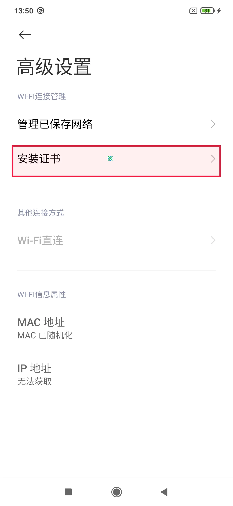

GT 원본 bbox: `[55.0, 672.0, 1022.0, 817.0]` · 원본 화면 1080×2340px

### O · 짧은 기준 표현

질문: `Which element is located directly below '<ref>Install certificates</ref>'?`

모델에 준 기준 표현: `'<ref>Install certificates</ref>'`

모델 입력 화면: 980×2100px. 아래 점은 이 화면의 픽셀 좌표다.

| 출력 | 판정 | 점 | 토큰 | `addCriterion` |
| --- | --- | --- | ---: | ---: |
| JSON | GT 안 | (463, 657) | 19 | 0 |
| (x, y) | GT 안 | (156, 673) | 11 | 0 |

**JSON 원시 출력 전문**

```text
[{"point_2d": [463, 657]}]
```

**(x, y) 원시 출력 전문**

```text
(156, 673)
```

**JSON 실제 렌더링 프롬프트**

```text
<|im_start|>system
You are a helpful assistant.<|im_end|>
<|im_start|>user
<|vision_start|><|image_pad|><|vision_end|>Reference phrase: '<ref>Install certificates</ref>'
Locate this GUI element in the screenshot. The phrase may be in a different language from the screenshot. The screenshot is 980 pixels wide and 2100 pixels high. Give one point inside the element, using integer pixel coordinates with (0, 0) at the top-left. Return only this JSON array: [{"point_2d": [x, y]}]. No explanation or code fence.<|im_end|>
<|im_start|>assistant

```

**(x, y) 실제 렌더링 프롬프트**

```text
<|im_start|>system
You are a helpful assistant.<|im_end|>
<|im_start|>user
<|vision_start|><|image_pad|><|vision_end|>Reference phrase: '<ref>Install certificates</ref>'
Locate this GUI element in the screenshot. The phrase may be in a different language from the screenshot. The screenshot is 980 pixels wide and 2100 pixels high. Give one point inside the element, using integer pixel coordinates with (0, 0) at the top-left. Return only one coordinate as (x, y). No explanation or code fence.<|im_end|>
<|im_start|>assistant

```

### R · 짧은 기준 표현

질문: `Which element is located directly below '<ref>安装证书</ref>'?`

모델에 준 기준 표현: `'<ref>安装证书</ref>'`

모델 입력 화면: 980×2100px. 아래 점은 이 화면의 픽셀 좌표다.

| 출력 | 판정 | 점 | 토큰 | `addCriterion` |
| --- | --- | --- | ---: | ---: |
| JSON | GT 안 | (463, 657) | 19 | 0 |
| (x, y) | GT 안 | (134, 657) | 10 | 0 |

**JSON 원시 출력 전문**

```text
[{"point_2d": [463, 657]}]
```

**(x, y) 원시 출력 전문**

```text
(134,657)
```

**JSON 실제 렌더링 프롬프트**

```text
<|im_start|>system
You are a helpful assistant.<|im_end|>
<|im_start|>user
<|vision_start|><|image_pad|><|vision_end|>Reference phrase: '<ref>安装证书</ref>'
Locate this GUI element in the screenshot. The phrase may be in a different language from the screenshot. The screenshot is 980 pixels wide and 2100 pixels high. Give one point inside the element, using integer pixel coordinates with (0, 0) at the top-left. Return only this JSON array: [{"point_2d": [x, y]}]. No explanation or code fence.<|im_end|>
<|im_start|>assistant

```

**(x, y) 실제 렌더링 프롬프트**

```text
<|im_start|>system
You are a helpful assistant.<|im_end|>
<|im_start|>user
<|vision_start|><|image_pad|><|vision_end|>Reference phrase: '<ref>安装证书</ref>'
Locate this GUI element in the screenshot. The phrase may be in a different language from the screenshot. The screenshot is 980 pixels wide and 2100 pixels high. Give one point inside the element, using integer pixel coordinates with (0, 0) at the top-left. Return only one coordinate as (x, y). No explanation or code fence.<|im_end|>
<|im_start|>assistant

```

## 08 Gmail_8 ZH GUI

질문 EN→GUI ZH · 문항 `rel::4/Gmail_8.jpg`

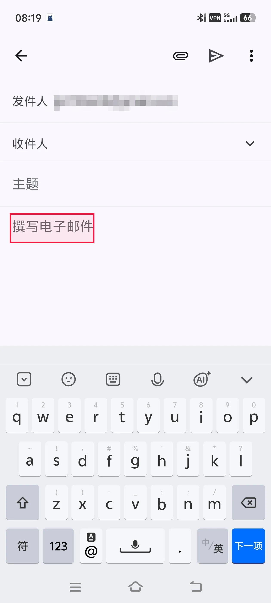

GT 원본 bbox: `[45.0, 990.0, 438.0, 1128.0]` · 원본 화면 1260×2800px

### O · 짧은 기준 표현

질문: `Which element is located directly above the '<ref>Compose email</ref>' placeholder text?`

모델에 준 기준 표현: `'<ref>Compose email</ref>' placeholder text`

모델 입력 화면: 952×2156px. 아래 점은 이 화면의 픽셀 좌표다.

| 출력 | 판정 | 점 | 토큰 | `addCriterion` |
| --- | --- | --- | ---: | ---: |
| JSON | 형식 실패 | — | 18 | 1 |
| (x, y) | GT 밖 | (134, 8) | 8 | 0 |

**JSON 원시 출력 전문**

```text
[{"point_2d": [173, 8
 addCriterion
```

**(x, y) 원시 출력 전문**

```text
(134,8)
```

**JSON 실제 렌더링 프롬프트**

```text
<|im_start|>system
You are a helpful assistant.<|im_end|>
<|im_start|>user
<|vision_start|><|image_pad|><|vision_end|>Reference phrase: '<ref>Compose email</ref>' placeholder text
Locate this GUI element in the screenshot. The phrase may be in a different language from the screenshot. The screenshot is 952 pixels wide and 2156 pixels high. Give one point inside the element, using integer pixel coordinates with (0, 0) at the top-left. Return only this JSON array: [{"point_2d": [x, y]}]. No explanation or code fence.<|im_end|>
<|im_start|>assistant

```

**(x, y) 실제 렌더링 프롬프트**

```text
<|im_start|>system
You are a helpful assistant.<|im_end|>
<|im_start|>user
<|vision_start|><|image_pad|><|vision_end|>Reference phrase: '<ref>Compose email</ref>' placeholder text
Locate this GUI element in the screenshot. The phrase may be in a different language from the screenshot. The screenshot is 952 pixels wide and 2156 pixels high. Give one point inside the element, using integer pixel coordinates with (0, 0) at the top-left. Return only one coordinate as (x, y). No explanation or code fence.<|im_end|>
<|im_start|>assistant

```

### R · 짧은 기준 표현

질문: `Which element is located directly above the '<ref>撰写电子邮件</ref>' placeholder text?`

모델에 준 기준 표현: `'<ref>撰写电子邮件</ref>' placeholder text`

모델 입력 화면: 952×2156px. 아래 점은 이 화면의 픽셀 좌표다.

| 출력 | 판정 | 점 | 토큰 | `addCriterion` |
| --- | --- | --- | ---: | ---: |
| JSON | 형식 실패 | — | 64 | 13 |
| (x, y) | GT 밖 | (134, 8) | 8 | 0 |

**JSON 원시 출력 전문**

```text
[{"point_2d": [478, 8
 addCriterion

 addCriterion

 addCriterion

 addCriterion

 addCriterion

 addCriterion

 addCriterion

 addCriterion

 addCriterion

 addCriterion

 addCriterion

 addCriterion

 addCriterion
```

**(x, y) 원시 출력 전문**

```text
(134,8)
```

**JSON 실제 렌더링 프롬프트**

```text
<|im_start|>system
You are a helpful assistant.<|im_end|>
<|im_start|>user
<|vision_start|><|image_pad|><|vision_end|>Reference phrase: '<ref>撰写电子邮件</ref>' placeholder text
Locate this GUI element in the screenshot. The phrase may be in a different language from the screenshot. The screenshot is 952 pixels wide and 2156 pixels high. Give one point inside the element, using integer pixel coordinates with (0, 0) at the top-left. Return only this JSON array: [{"point_2d": [x, y]}]. No explanation or code fence.<|im_end|>
<|im_start|>assistant

```

**(x, y) 실제 렌더링 프롬프트**

```text
<|im_start|>system
You are a helpful assistant.<|im_end|>
<|im_start|>user
<|vision_start|><|image_pad|><|vision_end|>Reference phrase: '<ref>撰写电子邮件</ref>' placeholder text
Locate this GUI element in the screenshot. The phrase may be in a different language from the screenshot. The screenshot is 952 pixels wide and 2156 pixels high. Give one point inside the element, using integer pixel coordinates with (0, 0) at the top-left. Return only one coordinate as (x, y). No explanation or code fence.<|im_end|>
<|im_start|>assistant

```

## 09 twitter_6 ZH GUI

질문 EN→GUI ZH · 문항 `rel::4/twitter_6.jpg`

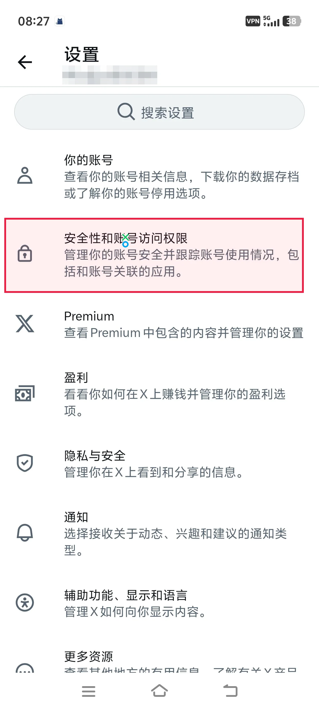

GT 원본 bbox: `[17.0, 859.0, 1199.0, 1154.0]` · 원본 화면 1260×2800px

### O · 짧은 기준 표현

질문: `Which setting is located directly below the '<ref>Security and account access</ref>' option in the settings menu?`

모델에 준 기준 표현: `'<ref>Security and account access</ref>' option in the settings menu`

모델 입력 화면: 952×2156px. 아래 점은 이 화면의 픽셀 좌표다.

| 출력 | 판정 | 점 | 토큰 | `addCriterion` |
| --- | --- | --- | ---: | ---: |
| JSON | GT 안 | (374, 742) | 19 | 0 |
| (x, y) | 형식 실패 | — | 5 | 0 |

**JSON 원시 출력 전문**

```text
[{"point_2d": [374, 742]}]
```

**(x, y) 원시 출력 전문**

```text
(378
```

**JSON 실제 렌더링 프롬프트**

```text
<|im_start|>system
You are a helpful assistant.<|im_end|>
<|im_start|>user
<|vision_start|><|image_pad|><|vision_end|>Reference phrase: '<ref>Security and account access</ref>' option in the settings menu
Locate this GUI element in the screenshot. The phrase may be in a different language from the screenshot. The screenshot is 952 pixels wide and 2156 pixels high. Give one point inside the element, using integer pixel coordinates with (0, 0) at the top-left. Return only this JSON array: [{"point_2d": [x, y]}]. No explanation or code fence.<|im_end|>
<|im_start|>assistant

```

**(x, y) 실제 렌더링 프롬프트**

```text
<|im_start|>system
You are a helpful assistant.<|im_end|>
<|im_start|>user
<|vision_start|><|image_pad|><|vision_end|>Reference phrase: '<ref>Security and account access</ref>' option in the settings menu
Locate this GUI element in the screenshot. The phrase may be in a different language from the screenshot. The screenshot is 952 pixels wide and 2156 pixels high. Give one point inside the element, using integer pixel coordinates with (0, 0) at the top-left. Return only one coordinate as (x, y). No explanation or code fence.<|im_end|>
<|im_start|>assistant

```

### R · 짧은 기준 표현

질문: `Which setting is located directly below the '<ref>安全性和账号访问权限</ref>' option in the settings menu?`

모델에 준 기준 표현: `'<ref>安全性和账号访问权限</ref>' option in the settings menu`

모델 입력 화면: 952×2156px. 아래 점은 이 화면의 픽셀 좌표다.

| 출력 | 판정 | 점 | 토큰 | `addCriterion` |
| --- | --- | --- | ---: | ---: |
| JSON | GT 안 | (374, 720) | 19 | 0 |
| (x, y) | 형식 실패 | — | 6 | 1 |

**JSON 원시 출력 전문**

```text
[{"point_2d": [374, 720]}]
```

**(x, y) 원시 출력 전문**

```text
(18
 addCriterion
```

**JSON 실제 렌더링 프롬프트**

```text
<|im_start|>system
You are a helpful assistant.<|im_end|>
<|im_start|>user
<|vision_start|><|image_pad|><|vision_end|>Reference phrase: '<ref>安全性和账号访问权限</ref>' option in the settings menu
Locate this GUI element in the screenshot. The phrase may be in a different language from the screenshot. The screenshot is 952 pixels wide and 2156 pixels high. Give one point inside the element, using integer pixel coordinates with (0, 0) at the top-left. Return only this JSON array: [{"point_2d": [x, y]}]. No explanation or code fence.<|im_end|>
<|im_start|>assistant

```

**(x, y) 실제 렌더링 프롬프트**

```text
<|im_start|>system
You are a helpful assistant.<|im_end|>
<|im_start|>user
<|vision_start|><|image_pad|><|vision_end|>Reference phrase: '<ref>安全性和账号访问权限</ref>' option in the settings menu
Locate this GUI element in the screenshot. The phrase may be in a different language from the screenshot. The screenshot is 952 pixels wide and 2156 pixels high. Give one point inside the element, using integer pixel coordinates with (0, 0) at the top-left. Return only one coordinate as (x, y). No explanation or code fence.<|im_end|>
<|im_start|>assistant

```

## 10 camera_1 ZH GUI

질문 EN→GUI ZH · 문항 `rel::5/camera_1.jpg`

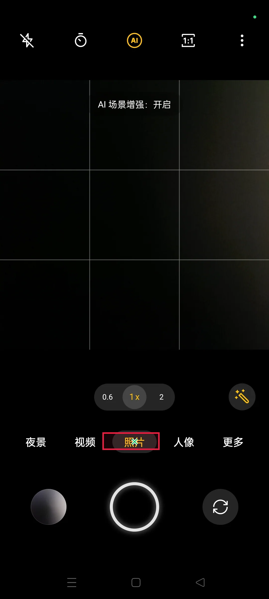

GT 원본 bbox: `[411.0, 1732.0, 640.0, 1802.0]` · 원본 화면 1080×2400px

### O · 짧은 기준 표현

질문: `Which element is located directly above the '<ref>PHOTO</ref>' mode button?`

모델에 준 기준 표현: `'<ref>PHOTO</ref>' mode button`

모델 입력 화면: 952×2128px. 아래 점은 이 화면의 픽셀 좌표다.

| 출력 | 판정 | 점 | 토큰 | `addCriterion` |
| --- | --- | --- | ---: | ---: |
| JSON | 형식 실패 | — | 20 | 0 |
| (x, y) | GT 안 | (467, 1563) | 12 | 0 |

**JSON 원시 출력 전문**

```text
[{"point_2d": [476, 1569]})
```

**(x, y) 원시 출력 전문**

```text
(467, 1563)
```

**JSON 실제 렌더링 프롬프트**

```text
<|im_start|>system
You are a helpful assistant.<|im_end|>
<|im_start|>user
<|vision_start|><|image_pad|><|vision_end|>Reference phrase: '<ref>PHOTO</ref>' mode button
Locate this GUI element in the screenshot. The phrase may be in a different language from the screenshot. The screenshot is 952 pixels wide and 2128 pixels high. Give one point inside the element, using integer pixel coordinates with (0, 0) at the top-left. Return only this JSON array: [{"point_2d": [x, y]}]. No explanation or code fence.<|im_end|>
<|im_start|>assistant

```

**(x, y) 실제 렌더링 프롬프트**

```text
<|im_start|>system
You are a helpful assistant.<|im_end|>
<|im_start|>user
<|vision_start|><|image_pad|><|vision_end|>Reference phrase: '<ref>PHOTO</ref>' mode button
Locate this GUI element in the screenshot. The phrase may be in a different language from the screenshot. The screenshot is 952 pixels wide and 2128 pixels high. Give one point inside the element, using integer pixel coordinates with (0, 0) at the top-left. Return only one coordinate as (x, y). No explanation or code fence.<|im_end|>
<|im_start|>assistant

```

### R · 짧은 기준 표현

질문: `Which element is located directly above the '<ref>照片</ref>' mode button?`

모델에 준 기준 표현: `'<ref>照片</ref>' mode button`

모델 입력 화면: 952×2128px. 아래 점은 이 화면의 픽셀 좌표다.

| 출력 | 판정 | 점 | 토큰 | `addCriterion` |
| --- | --- | --- | ---: | ---: |
| JSON | GT 안 | (476, 1569) | 20 | 0 |
| (x, y) | GT 안 | (467, 1563) | 12 | 0 |

**JSON 원시 출력 전문**

```text
[{"point_2d": [476, 1569]}]
```

**(x, y) 원시 출력 전문**

```text
(467, 1563)
```

**JSON 실제 렌더링 프롬프트**

```text
<|im_start|>system
You are a helpful assistant.<|im_end|>
<|im_start|>user
<|vision_start|><|image_pad|><|vision_end|>Reference phrase: '<ref>照片</ref>' mode button
Locate this GUI element in the screenshot. The phrase may be in a different language from the screenshot. The screenshot is 952 pixels wide and 2128 pixels high. Give one point inside the element, using integer pixel coordinates with (0, 0) at the top-left. Return only this JSON array: [{"point_2d": [x, y]}]. No explanation or code fence.<|im_end|>
<|im_start|>assistant

```

**(x, y) 실제 렌더링 프롬프트**

```text
<|im_start|>system
You are a helpful assistant.<|im_end|>
<|im_start|>user
<|vision_start|><|image_pad|><|vision_end|>Reference phrase: '<ref>照片</ref>' mode button
Locate this GUI element in the screenshot. The phrase may be in a different language from the screenshot. The screenshot is 952 pixels wide and 2128 pixels high. Give one point inside the element, using integer pixel coordinates with (0, 0) at the top-left. Return only one coordinate as (x, y). No explanation or code fence.<|im_end|>
<|im_start|>assistant

```

## 11 safari_7 ZH GUI

질문 EN→GUI ZH · 문항 `rel::6/safari_7.jpg`

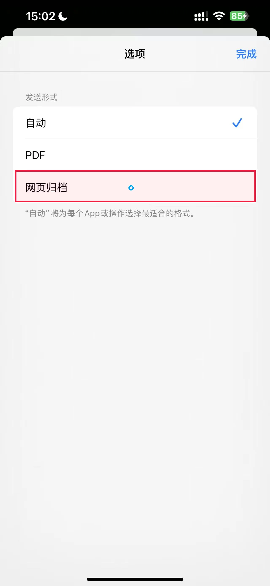

GT 원본 bbox: `[71.0, 804.0, 1211.0, 955.0]` · 원본 화면 1280×2769px

### O · 짧은 기준 표현

질문: `Which option appears directly above the '<ref>Web Archive</ref>' setting in the list shown in the screenshot?`

모델에 준 기준 표현: `'<ref>Web Archive</ref>' setting in the list`

모델 입력 화면: 980×2100px. 아래 점은 이 화면의 픽셀 좌표다.

| 출력 | 판정 | 점 | 토큰 | `addCriterion` |
| --- | --- | --- | ---: | ---: |
| JSON | GT 안 | (476, 673) | 19 | 0 |
| (x, y) | GT 안 | (156, 674) | 11 | 0 |

**JSON 원시 출력 전문**

```text
[{"point_2d": [476, 673]}]
```

**(x, y) 원시 출력 전문**

```text
(156, 674)
```

**JSON 실제 렌더링 프롬프트**

```text
<|im_start|>system
You are a helpful assistant.<|im_end|>
<|im_start|>user
<|vision_start|><|image_pad|><|vision_end|>Reference phrase: '<ref>Web Archive</ref>' setting in the list
Locate this GUI element in the screenshot. The phrase may be in a different language from the screenshot. The screenshot is 980 pixels wide and 2100 pixels high. Give one point inside the element, using integer pixel coordinates with (0, 0) at the top-left. Return only this JSON array: [{"point_2d": [x, y]}]. No explanation or code fence.<|im_end|>
<|im_start|>assistant

```

**(x, y) 실제 렌더링 프롬프트**

```text
<|im_start|>system
You are a helpful assistant.<|im_end|>
<|im_start|>user
<|vision_start|><|image_pad|><|vision_end|>Reference phrase: '<ref>Web Archive</ref>' setting in the list
Locate this GUI element in the screenshot. The phrase may be in a different language from the screenshot. The screenshot is 980 pixels wide and 2100 pixels high. Give one point inside the element, using integer pixel coordinates with (0, 0) at the top-left. Return only one coordinate as (x, y). No explanation or code fence.<|im_end|>
<|im_start|>assistant

```

### R · 짧은 기준 표현

질문: `Which option appears directly above the '<ref>网页归档</ref>' setting in the list shown in the screenshot?`

모델에 준 기준 표현: `'<ref>网页归档</ref>' setting in the list`

모델 입력 화면: 980×2100px. 아래 점은 이 화면의 픽셀 좌표다.

| 출력 | 판정 | 점 | 토큰 | `addCriterion` |
| --- | --- | --- | ---: | ---: |
| JSON | 형식 실패 | — | 64 | 7 |
| (x, y) | GT 안 | (134, 675) | 11 | 0 |

**JSON 원시 출력 전문**

```text
[{"point_2d": [49
 addCriterion

 addCriterion

 addCriterion

 addCriterion

 addCriterion

 addCriterion

 addCriterion
```

**(x, y) 원시 출력 전문**

```text
(134, 675)
```

**JSON 실제 렌더링 프롬프트**

```text
<|im_start|>system
You are a helpful assistant.<|im_end|>
<|im_start|>user
<|vision_start|><|image_pad|><|vision_end|>Reference phrase: '<ref>网页归档</ref>' setting in the list
Locate this GUI element in the screenshot. The phrase may be in a different language from the screenshot. The screenshot is 980 pixels wide and 2100 pixels high. Give one point inside the element, using integer pixel coordinates with (0, 0) at the top-left. Return only this JSON array: [{"point_2d": [x, y]}]. No explanation or code fence.<|im_end|>
<|im_start|>assistant

```

**(x, y) 실제 렌더링 프롬프트**

```text
<|im_start|>system
You are a helpful assistant.<|im_end|>
<|im_start|>user
<|vision_start|><|image_pad|><|vision_end|>Reference phrase: '<ref>网页归档</ref>' setting in the list
Locate this GUI element in the screenshot. The phrase may be in a different language from the screenshot. The screenshot is 980 pixels wide and 2100 pixels high. Give one point inside the element, using integer pixel coordinates with (0, 0) at the top-left. Return only one coordinate as (x, y). No explanation or code fence.<|im_end|>
<|im_start|>assistant

```

## 12 wallet_3 ZH GUI

질문 EN→GUI ZH · 문항 `rel::6/wallet_3.jpg`

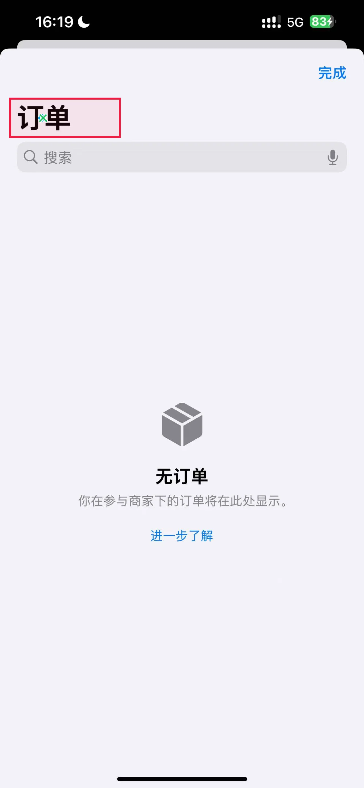

GT 원본 bbox: `[32.0, 343.0, 424.0, 484.0]` · 원본 화면 1280×2769px

### O · 짧은 기준 표현

질문: `What is the direct order of elements from top to bottom on the screen after the '<ref>Orders</ref>' title?`

모델에 준 기준 표현: `'<ref>Orders</ref>' title`

모델 입력 화면: 980×2100px. 아래 점은 이 화면의 픽셀 좌표다.

| 출력 | 판정 | 점 | 토큰 | `addCriterion` |
| --- | --- | --- | ---: | ---: |
| JSON | GT 안 | (113, 314) | 19 | 0 |
| (x, y) | 형식 실패 | — | 64 | 7 |

**JSON 원시 출력 전문**

```text
[{"point_2d": [113, 314]}]
```

**(x, y) 원시 출력 전문**

```text
(75, 304), (18
 addCriterion

 addCriterion

 addCriterion

 addCriterion

 addCriterion

 addCriterion

 addCriterion
```

**JSON 실제 렌더링 프롬프트**

```text
<|im_start|>system
You are a helpful assistant.<|im_end|>
<|im_start|>user
<|vision_start|><|image_pad|><|vision_end|>Reference phrase: '<ref>Orders</ref>' title
Locate this GUI element in the screenshot. The phrase may be in a different language from the screenshot. The screenshot is 980 pixels wide and 2100 pixels high. Give one point inside the element, using integer pixel coordinates with (0, 0) at the top-left. Return only this JSON array: [{"point_2d": [x, y]}]. No explanation or code fence.<|im_end|>
<|im_start|>assistant

```

**(x, y) 실제 렌더링 프롬프트**

```text
<|im_start|>system
You are a helpful assistant.<|im_end|>
<|im_start|>user
<|vision_start|><|image_pad|><|vision_end|>Reference phrase: '<ref>Orders</ref>' title
Locate this GUI element in the screenshot. The phrase may be in a different language from the screenshot. The screenshot is 980 pixels wide and 2100 pixels high. Give one point inside the element, using integer pixel coordinates with (0, 0) at the top-left. Return only one coordinate as (x, y). No explanation or code fence.<|im_end|>
<|im_start|>assistant

```

### R · 짧은 기준 표현

질문: `What is the direct order of elements from top to bottom on the screen after the '<ref>订单</ref>' title?`

모델에 준 기준 표현: `'<ref>订单</ref>' title`

모델 입력 화면: 980×2100px. 아래 점은 이 화면의 픽셀 좌표다.

| 출력 | 판정 | 점 | 토큰 | `addCriterion` |
| --- | --- | --- | ---: | ---: |
| JSON | GT 안 | (116, 314) | 19 | 0 |
| (x, y) | GT 안 | (64, 305) | 10 | 0 |

**JSON 원시 출력 전문**

```text
[{"point_2d": [116, 314]}]
```

**(x, y) 원시 출력 전문**

```text
(64, 305)
```

**JSON 실제 렌더링 프롬프트**

```text
<|im_start|>system
You are a helpful assistant.<|im_end|>
<|im_start|>user
<|vision_start|><|image_pad|><|vision_end|>Reference phrase: '<ref>订单</ref>' title
Locate this GUI element in the screenshot. The phrase may be in a different language from the screenshot. The screenshot is 980 pixels wide and 2100 pixels high. Give one point inside the element, using integer pixel coordinates with (0, 0) at the top-left. Return only this JSON array: [{"point_2d": [x, y]}]. No explanation or code fence.<|im_end|>
<|im_start|>assistant

```

**(x, y) 실제 렌더링 프롬프트**

```text
<|im_start|>system
You are a helpful assistant.<|im_end|>
<|im_start|>user
<|vision_start|><|image_pad|><|vision_end|>Reference phrase: '<ref>订单</ref>' title
Locate this GUI element in the screenshot. The phrase may be in a different language from the screenshot. The screenshot is 980 pixels wide and 2100 pixels high. Give one point inside the element, using integer pixel coordinates with (0, 0) at the top-left. Return only one coordinate as (x, y). No explanation or code fence.<|im_end|>
<|im_start|>assistant

```
